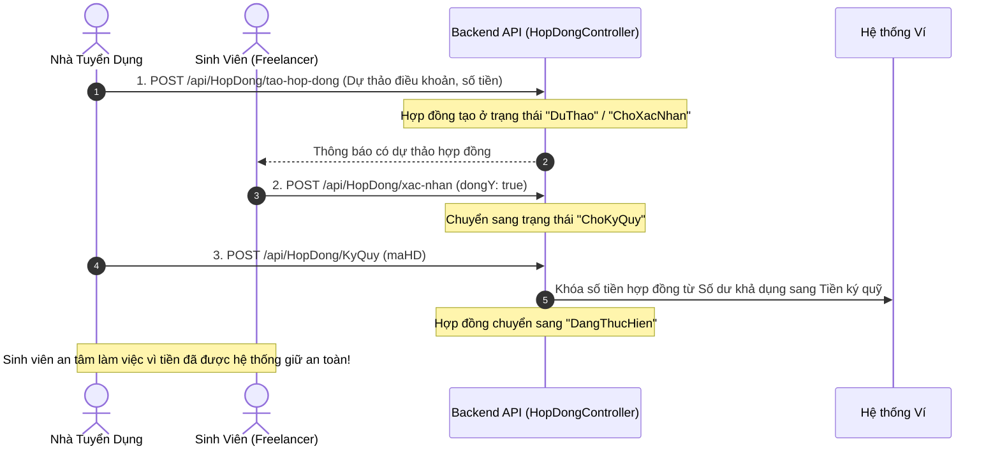

# TÀI LIỆU TOÀN DIỆN: MAPPING CHỨC NĂNG TỪ WEB MVC ĐẾN BACKEND API CHO FLUTTER MOBILE

> **Dự án:** Hệ thống kết nối Freelancer Sinh viên và Nhà tuyển dụng (KLTN)  
> **Mục tiêu:** Bản hướng dẫn chi tiết cách ánh xạ toàn bộ các chức năng đã có trên **Web MVC** ([FreelancerStudent.Web](file:///d:/KLTN/KLTN/Improve/FreelancerStudent.Web)) thông qua **Backend REST API** ([FreelancerStudent.API](file:///d:/KLTN/KLTN/Improve/FreelancerStudent.API)) sang ứng dụng **Flutter Mobile** ([Mobile/freelancerstudent](file:///d:/KLTN/KLTN/Improve/Mobile/freelancerstudent)).

---

## 📑 MỤC LỤC
1. [Tổng quan Kiến trúc Ánh xạ 3 Tầng](#1-tổng-quan-kiến-trúc-ánh-xạ-3-tầng)
2. [Bảng Ma trận Đối chiếu Toàn diện (8 Phân hệ)](#2-bảng-ma-trận-đối-chiếu-toàn-diện-8-phân-hệ)
3. [Hướng dẫn Chi tiết Từng Phân hệ Kỹ thuật](#3-hướng-dẫn-chi-tiết-từng-phân-hệ-kỹ-thuật)
   - [Phân hệ 1: Xác thực & Quản lý Tài khoản (Auth & Profile)](#phân-hệ-1-xác-thực--quản-lý-tài-khoản-auth--profile)
   - [Phân hệ 2: Đăng tin & Tìm kiếm Việc làm (JobPost Feed & Management)](#phân-hệ-2-đăng-tin--tìm-kiếm-việc-làm-jobpost-feed--management)
   - [Phân hệ 3: Quy trình Ứng tuyển & Duyệt Ứng viên (Applications)](#phân-hệ-3-quy-trình-ứng-tuyển--duyệt-ứng-viên-applications)
   - [Phân hệ 4: Tin Tìm việc của Sinh viên (Student Posts)](#phân-hệ-4-tin-tìm-việc-của-sinh-viên-student-posts)
   - [Phân hệ 5: Quy trình Hợp đồng & Ký quỹ Escrow (Contracts) - QUAN TRỌNG](#phân-hệ-5-quy-trình-hợp-đồng--ký-quỹ-escrow-contracts---quan-trọng)
   - [Phân hệ 6: Ví điện tử & Nạp tiền QR SePay (Wallet & Top-up)](#phân-hệ-6-ví-điện-tử--nạp-tiền-qr-sepay-wallet--top-up)
   - [Phân hệ 7: Hồ sơ Năng lực & Quản lý Portfolio (Freelancer Profile)](#phân-hệ-7-hồ-sơ-năng-lực--quản-lý-portfolio-freelancer-profile)
   - [Phân hệ 8: Nhắn tin Trực tuyến Thời gian thực (SignalR Chat)](#phân-hệ-8-nhắn-tin-trực-tuyến-thời-gian-thực-signalr-chat)
4. [Lộ trình Triển khai Đề xuất (Implementation Roadmap)](#4-lộ-trình-triển-khai-đề-xuất-implementation-roadmap)
5. [Các Quy tắc Sống còn khi Kết nối Mobile với .NET API](#5-các-quy-tắc-sống-còn-khi-kết-nối-mobile-với-net-api)
6. [Quy chuẩn Đặt tên Hàm và Biến Thuần Tiếng Việt trên Mobile](#6-quy-chuẩn-đặt-tên-hàm-và-biến-thuần-tiếng-việt-trên-mobile-đồng-bộ-100-với-web--api)

---

## 1. Tổng quan Kiến trúc Ánh xạ 3 Tầng

Trong dự án này, hệ thống hoạt động dựa trên 3 tầng liên kết:

```text
┌─────────────────────────┐          ┌─────────────────────────┐
│     WEB APPLICATION     │          │      MOBILE FLUTTER     │
│ (ASP.NET Core MVC SSR)  │          │    (Client-Side MVVM)   │
│  Razor Views (.cshtml)  │          │   Dart Widgets + State  │
└────────────┬────────────┘          └────────────┬────────────┘
             │                                    │
             │   Cùng chung nghiệp vụ             │ Gửi HTTP / JSON
             │   (Data / Service chung)           │ (hoặc SignalR WebSocket)
             ▼                                    ▼
┌──────────────────────────────────────────────────────────────┐
│                    BACKEND ASP.NET CORE API                  │
│       Controllers ➔ Application Services ➔ SQL Server       │
│               (FreelancerStudent.API)                        │
└──────────────────────────────────────────────────────────────┘
```

- **Web MVC:** Người dùng thao tác trên trình duyệt, gọi Controller Web, Controller Web gọi API hoặc Service để lấy dữ liệu rồi render ra file HTML `.cshtml`.
- **Mobile Flutter:** Thiết bị di động gửi HTTP Request trực tiếp đến Backend API qua thư viện `Dio` (đã cấu hình tại [api_client.dart](file:///d:/KLTN/KLTN/Improve/Mobile/freelancerstudent/lib/core/network/api_client.dart)), nhận về chuỗi JSON thô, parse thành Model Dart và vẽ lại giao diện cục bộ (Rebuild Widget).

---

## 2. Bảng Ma trận Đối chiếu Toàn diện (8 Phân hệ)

Dưới đây là bảng đối chiếu chi tiết giữa màn hình Web, Controller Web, Endpoint API và Màn hình Mobile tương ứng:

| STT | Phân hệ nghiệp vụ | View trên Web (`.cshtml`) | Controller Web (`.cs`) | Endpoint Backend API (`.NET`) | File Màn hình Mobile (`Flutter`) | Đánh giá trạng thái |
| :---: | :--- | :--- | :--- | :--- | :--- | :---: |
| **1** | **Xác thực & Tài khoản** | [DangNhap.cshtml](file:///d:/KLTN/KLTN/Improve/FreelancerStudent.Web/Views/Account/DangNhap.cshtml)<br>[DangKy.cshtml](file:///d:/KLTN/KLTN/Improve/FreelancerStudent.Web/Views/Account/DangKy.cshtml)<br>[ThietLapTaiKhoan.cshtml](file:///d:/KLTN/KLTN/Improve/FreelancerStudent.Web/Views/Account/ThietLapTaiKhoan.cshtml) | [AccountController.cs](file:///d:/KLTN/KLTN/Improve/FreelancerStudent.Web/Controllers/AccountController.cs) | `POST /api/Auth/DangNhap`<br>`POST /api/Auth/dangky`<br>`GET /api/Auth/ThongTinTaiKhoan/{id}`<br>`PUT /api/Auth/CapNhatThongTinTaiKhoan`<br>`PUT /api/Auth/CapNhatAvatar`<br>`PUT /api/Auth/DoiMatKhau` | [login_screen.dart](file:///d:/KLTN/KLTN/Improve/Mobile/freelancerstudent/lib/views/auth/login_screen.dart)<br>[register_screen.dart](file:///d:/KLTN/KLTN/Improve/Mobile/freelancerstudent/lib/views/auth/register_screen.dart)<br>[profile_screen.dart](file:///d:/KLTN/KLTN/Improve/Mobile/freelancerstudent/lib/views/profile/profile_screen.dart)<br>[edit_profile_screen.dart](file:///d:/KLTN/KLTN/Improve/Mobile/freelancerstudent/lib/views/profile/edit_profile_screen.dart)<br>[change_password_screen.dart](file:///d:/KLTN/KLTN/Improve/Mobile/freelancerstudent/lib/views/profile/change_password_screen.dart) | 🟢 **100% Sẵn sàng** |
| **2** | **Việc làm (JobPost)** | [Index.cshtml](file:///d:/KLTN/KLTN/Improve/FreelancerStudent.Web/Views/JobPost/Index.cshtml)<br>[Detail.cshtml](file:///d:/KLTN/KLTN/Improve/FreelancerStudent.Web/Views/JobPost/Detail.cshtml)<br>[Create.cshtml](file:///d:/KLTN/KLTN/Improve/FreelancerStudent.Web/Views/JobPost/Create.cshtml)<br>[QuanLyTinTuyenDung.cshtml](file:///d:/KLTN/KLTN/Improve/FreelancerStudent.Web/Views/JobPost/QuanLyTinTuyenDung.cshtml)<br>[Edit.cshtml](file:///d:/KLTN/KLTN/Improve/FreelancerStudent.Web/Views/JobPost/Edit.cshtml) | [JobPostController.cs](file:///d:/KLTN/KLTN/Improve/FreelancerStudent.Web/Controllers/JobPostController.cs) | `GET /api/JobPost/DanhSachJobPost`<br>`GET /api/JobPost/ChiTietJobPost/{maJob}`<br>`POST /api/JobPost/TaoJob`<br>`GET /api/JobPost/CuaToi/{maUser}`<br>`PUT /api/JobPost/CapNhat` | [home_screen.dart](file:///d:/KLTN/KLTN/Improve/Mobile/freelancerstudent/lib/views/home/home_screen.dart)<br>[job_detail_screen.dart](file:///d:/KLTN/KLTN/Improve/Mobile/freelancerstudent/lib/views/job_detail/job_detail_screen.dart)<br>[create_job_post_screen.dart](file:///d:/KLTN/KLTN/Improve/Mobile/freelancerstudent/lib/views/employer/create_job_post_screen.dart)<br>[employer_home_screen.dart](file:///d:/KLTN/KLTN/Improve/Mobile/freelancerstudent/lib/views/employer/employer_home_screen.dart) | 🟢 **100% Sẵn sàng** |
| **3** | **Ứng tuyển & Duyệt hồ sơ** | [UngTuyen.cshtml](file:///d:/KLTN/KLTN/Improve/FreelancerStudent.Web/Views/JobPost/UngTuyen.cshtml)<br>[DanhSachUngVien.cshtml](file:///d:/KLTN/KLTN/Improve/FreelancerStudent.Web/Views/NhaTuyenDung/DanhSachUngVien.cshtml)<br>[DanhSachNopTuyen.cshtml](file:///d:/KLTN/KLTN/Improve/FreelancerStudent.Web/Views/FreelancerStudent/DanhSachNopTuyen.cshtml) | [JobPostController.cs](file:///d:/KLTN/KLTN/Improve/FreelancerStudent.Web/Controllers/JobPostController.cs)<br>[NhaTuyenDungController.cs](file:///d:/KLTN/KLTN/Improve/FreelancerStudent.Web/Controllers/NhaTuyenDungController.cs) | `POST /api/JobPost/UngTuyen`<br>`GET /api/JobPost/DanhSachUngTuyen/{maUser}`<br>`POST /api/JobPost/DuyetUngTuyen` | [apply_job_bottom_sheet.dart](file:///d:/KLTN/KLTN/Improve/Mobile/freelancerstudent/lib/views/job_detail/apply_job_bottom_sheet.dart)<br>[applicant_list_screen.dart](file:///d:/KLTN/KLTN/Improve/Mobile/freelancerstudent/lib/views/applications/applicant_list_screen.dart)<br>[my_applications_screen.dart](file:///d:/KLTN/KLTN/Improve/Mobile/freelancerstudent/lib/views/applications/my_applications_screen.dart) | 🟢 **100% Sẵn sàng** |
| **4** | **Tin tìm việc của Sinh viên** | [DangTinTimViec.cshtml](file:///d:/KLTN/KLTN/Improve/FreelancerStudent.Web/Views/FreelancerStudent/DangTinTimViec.cshtml)<br>[QuanLyTimViec.cshtml](file:///d:/KLTN/KLTN/Improve/FreelancerStudent.Web/Views/FreelancerStudent/QuanLyTimViec.cshtml)<br>[SuaTinTimViec.cshtml](file:///d:/KLTN/KLTN/Improve/FreelancerStudent.Web/Views/FreelancerStudent/SuaTinTimViec.cshtml) | [FreelancerStudentController.cs](file:///d:/KLTN/KLTN/Improve/FreelancerStudent.Web/Controllers/FreelancerStudentController.cs) | `POST /api/BaiDangTimViec/TaoBaiDang`<br>`GET /api/BaiDangTimViec/TatCa`<br>`GET /api/BaiDangTimViec/CuaToi/{maUser}`<br>`PUT /api/BaiDangTimViec/CapNhat/{ma}`<br>`PUT /api/BaiDangTimViec/DoiTrangThai`<br>`DELETE /api/BaiDangTimViec/Xoa/{ma}` | [create_student_post_screen.dart](file:///d:/KLTN/KLTN/Improve/Mobile/freelancerstudent/lib/views/student_posts/create_student_post_screen.dart)<br>[student_post_list_screen.dart](file:///d:/KLTN/KLTN/Improve/Mobile/freelancerstudent/lib/views/student_posts/student_post_list_screen.dart)<br>[student_post_detail_screen.dart](file:///d:/KLTN/KLTN/Improve/Mobile/freelancerstudent/lib/views/student_posts/student_post_detail_screen.dart) | 🟢 **100% Sẵn sàng** |
| **5** | **Hợp đồng & Ký quỹ (Escrow)** | [TaoHopDong.cshtml](file:///d:/KLTN/KLTN/Improve/FreelancerStudent.Web/Views/HopDong/TaoHopDong.cshtml)<br>[ChiTiet.cshtml](file:///d:/KLTN/KLTN/Improve/FreelancerStudent.Web/Views/HopDong/ChiTiet.cshtml)<br>[Index.cshtml](file:///d:/KLTN/KLTN/Improve/FreelancerStudent.Web/Views/HopDong/Index.cshtml) | [HopDongController.cs](file:///d:/KLTN/KLTN/Improve/FreelancerStudent.Web/Controllers/HopDongController.cs) | `GET /api/HopDong/danh-sach/{maNTD}`<br>`GET /api/HopDong/danh-sach-freelancer/{maFL}`<br>`GET /api/HopDong/chi-tiet/{maHD}`<br>`GET /api/HopDong/theo-job/{maJob}`<br>`POST /api/HopDong/tao-hop-dong`<br>`POST /api/HopDong/xac-nhan`<br>`POST /api/HopDong/KyQuy` | *(Chưa có - Cần tạo:)*<br>`views/contracts/contract_list_screen.dart`<br>`views/contracts/contract_detail_screen.dart`<br>`views/contracts/create_contract_dialog.dart` | 🟡 **API 100% Xong**<br>*(Cần tạo thêm UI Mobile)* |
| **6** | **Ví điện tử & Nạp tiền SePay** | [Index.cshtml](file:///d:/KLTN/KLTN/Improve/FreelancerStudent.Web/Views/Wallet/Index.cshtml) | [WalletController.cs](file:///d:/KLTN/KLTN/Improve/FreelancerStudent.Web/Controllers/WalletController.cs) | `GET /api/Wallet/LayViTheoUser/{maUser}`<br>`POST /api/GiaoDichNapTien/TaoGiaoDich/{maUser}`<br>`GET /api/GiaoDichNapTien/TrangThai/{maGD}`<br>`POST /api/GiaoDichNapTien/Webhook` | [wallet_screen.dart](file:///d:/KLTN/KLTN/Improve/Mobile/freelancerstudent/lib/views/wallet/wallet_screen.dart)<br>[deposit_screen.dart](file:///d:/KLTN/KLTN/Improve/Mobile/freelancerstudent/lib/views/wallet/deposit_screen.dart)<br>[transaction_history_screen.dart](file:///d:/KLTN/KLTN/Improve/Mobile/freelancerstudent/lib/views/wallet/transaction_history_screen.dart) | 🟢 **95% Sẵn sàng** |
| **7** | **Hồ sơ Sinh viên & Portfolio** | [HoSo.cshtml](file:///d:/KLTN/KLTN/Improve/FreelancerStudent.Web/Views/FreelancerStudent/HoSo.cshtml)<br>[Profile.cshtml](file:///d:/KLTN/KLTN/Improve/FreelancerStudent.Web/Views/FreelancerStudent/Profile.cshtml)<br>[Portfolio.cshtml](file:///d:/KLTN/KLTN/Improve/FreelancerStudent.Web/Views/FreelancerStudent/Portfolio.cshtml) | [FreelancerStudentController.cs](file:///d:/KLTN/KLTN/Improve/FreelancerStudent.Web/Controllers/FreelancerStudentController.cs) | `GET /api/FreelancerStudent/ChiTiet/{id}`<br>`PUT /api/FreelancerStudent/CapNhatHoSo`<br>`GET /api/FreelancerStudent/Profile/{id}`<br>`GET /api/Portfolio/{id}`<br>`POST /api/Portfolio/projects`<br>`PUT /api/Portfolio/projects`<br>`DELETE /api/Portfolio/projects/{maDA}`<br>`PUT /api/Portfolio/featured` | [profile_screen.dart](file:///d:/KLTN/KLTN/Improve/Mobile/freelancerstudent/lib/views/profile/profile_screen.dart)<br>[freelancer_profile_service.dart](file:///d:/KLTN/KLTN/Improve/Mobile/freelancerstudent/lib/services/freelancer_profile_service.dart)<br>[freelancer_profile_model.dart](file:///d:/KLTN/KLTN/Improve/Mobile/freelancerstudent/lib/models/freelancer_profile_model.dart) | 🟢 **90% Sẵn sàng** |
| **8** | **Chat trực tuyến SignalR** | [Index.cshtml](file:///d:/KLTN/KLTN/Improve/FreelancerStudent.Web/Views/Chat/Index.cshtml) | [ChatController.cs](file:///d:/KLTN/KLTN/Improve/FreelancerStudent.Web/Controllers/ChatController.cs) | `POST /api/Chat/TaoHoacLayPhong`<br>`GET /api/Chat/DanhSachPhong/{maUser}`<br>`GET /api/Chat/TinNhan/{maPhongChat}`<br>`POST /api/Chat/GuiTinNhan`<br>Hub WebSocket: `/chatHub` | [chat_list_screen.dart](file:///d:/KLTN/KLTN/Improve/Mobile/freelancerstudent/lib/views/chat/chat_list_screen.dart)<br>[chat_detail_screen.dart](file:///d:/KLTN/KLTN/Improve/Mobile/freelancerstudent/lib/views/chat/chat_detail_screen.dart)<br>[chat_signalr_service.dart](file:///d:/KLTN/KLTN/Improve/Mobile/freelancerstudent/lib/services/chat_signalr_service.dart) | 🟢 **85% Sẵn sàng** |

---

## 3. Hướng dẫn Chi tiết Từng Phân hệ Kỹ thuật

---

### Phân hệ 1: Xác thực & Quản lý Tài khoản (Auth & Profile)

#### 1. Hành vi người dùng trên Web
- Người dùng vào `Account/DangNhap` nhập email/mật khẩu. Khi thành công, lưu cookie phiên làm việc và điều hướng về trang chủ.
- Người dùng vào `Account/DangKy` chọn 1 trong 2 vai trò: **Sinh viên tìm việc (`FreelancerStudent`)** hoặc **Nhà tuyển dụng (`NhaTuyenDung`)**.
- Trang `Account/ThietLapTaiKhoan` cho phép xem thông tin cá nhân, sửa họ tên/số điện thoại/ngày sinh, tải lên ảnh đại diện và đổi mật khẩu.

#### 2. Chi tiết API Backend ([AuthController.cs](file:///d:/KLTN/KLTN/Improve/FreelancerStudent.API/Controllers/AuthController.cs))
- **Đăng nhập:** `POST /api/Auth/DangNhap`
  - Body: `{ "email": "...", "matKhau": "..." }`
  - Trả về: `{ "token": "JWT...", "maUser": 1, "hoTen": "...", "vaiTro": "FreelancerStudent", "maFreelancerStudent": 10, "maNhaTuyenDung": null }`
- **Đăng ký:** `POST /api/Auth/dangky`
  - Body: `{ "hoTen": "...", "email": "...", "matKhau": "...", "soDienThoai": "...", "vaiTro": "FreelancerStudent" | "NhaTuyenDung" }`
- **Đổi mật khẩu:** `PUT /api/Auth/DoiMatKhau`
  - Body: `{ "maUser": 1, "matKhauCu": "...", "matKhauMoi": "..." }`
- **Cập nhật Avatar:** `PUT /api/Auth/CapNhatAvatar`
  - Body: `{ "maUser": 1, "avatarUrl": "..." }`

#### 3. Cách Mapping sang Mobile Flutter
- File giao diện: [login_screen.dart](file:///d:/KLTN/KLTN/Improve/Mobile/freelancerstudent/lib/views/auth/login_screen.dart), [register_screen.dart](file:///d:/KLTN/KLTN/Improve/Mobile/freelancerstudent/lib/views/auth/register_screen.dart).
- Khi người dùng đăng nhập thành công, [auth_service.dart](file:///d:/KLTN/KLTN/Improve/Mobile/freelancerstudent/lib/services/auth_service.dart) lưu token và vai trò vào thiết bị:
  ```dart
  await secureStorage.write(key: 'jwt_token', value: response.data.token);
  await prefs.setString('user_role', response.data.vaiTro);
  await prefs.setInt('ma_user', response.data.maUser);
  ```
- Dựa vào `response.data.vaiTro`:
  - Nếu là `FreelancerStudent`: chuyển sang `HomeScreen` (giao diện sinh viên tìm việc).
  - Nếu là `NhaTuyenDung`: chuyển sang `EmployerHomeScreen` (giao diện quản lý bài đăng & ứng viên).

---

### Phân hệ 2: Đăng tin & Tìm kiếm Việc làm (JobPost Feed & Management)

#### 1. Hành vi người dùng trên Web
- **Sinh viên:** Vào `JobPost/Index` để xem tất cả các bài tuyển dụng đang mở, tìm kiếm theo tiêu đề, lọc theo kỹ năng/mức lương. Bấm vào bài để xem `JobPost/Detail`.
- **Nhà tuyển dụng:** Vào `JobPost/Create` để đăng bài tuyển dụng mới (tiêu đề, mô tả, yêu cầu kỹ năng, hạn chót nộp hồ sơ, ngân sách). Vào `JobPost/QuanLyTinTuyenDung` để xem danh sách các bài đăng của mình và trạng thái (Đang mở/Đã đóng).

#### 2. Chi tiết API Backend ([JobPostController.cs](file:///d:/KLTN/KLTN/Improve/FreelancerStudent.API/Controllers/JobPostController.cs))
- **Lấy danh sách việc làm:** `GET /api/JobPost/DanhSachJobPost`
  - Trả về danh sách đối tượng chứa: `maJob`, `tieuDe`, `moTa`, `nganSachMin`, `nganSachMax`, `ngayHetHan`, `tenNhaTuyenDung`, `kyNangYeuCau`.
- **Xem chi tiết 1 việc làm:** `GET /api/JobPost/ChiTietJobPost/{maJob}`
- **NTD tạo bài mới:** `POST /api/JobPost/TaoJob`
  - Body: `{ "maUser": 2, "tieuDe": "...", "moTa": "...", "nganSachMin": 1000000, "nganSachMax": 3000000, "ngayHetHan": "2026-11-01", "danhSachKyNang": ["Flutter", "Dart"] }`
- **NTD xem bài của mình:** `GET /api/JobPost/CuaToi/{maUser}`
- **Cập nhật bài đăng:** `PUT /api/JobPost/CapNhat`

#### 3. Cách Mapping sang Mobile Flutter
- File giao diện:
  - Sinh viên lướt tin: [home_screen.dart](file:///d:/KLTN/KLTN/Improve/Mobile/freelancerstudent/lib/views/home/home_screen.dart) và [job_detail_screen.dart](file:///d:/KLTN/KLTN/Improve/Mobile/freelancerstudent/lib/views/job_detail/job_detail_screen.dart).
  - NTD quản lý & tạo tin: [employer_home_screen.dart](file:///d:/KLTN/KLTN/Improve/Mobile/freelancerstudent/lib/views/employer/employer_home_screen.dart) và [create_job_post_screen.dart](file:///d:/KLTN/KLTN/Improve/Mobile/freelancerstudent/lib/views/employer/create_job_post_screen.dart).
- Dùng `JobViewModel` gọi `JobService.getJobs()` và gán vào danh sách:
  ```dart
  class JobViewModel extends ChangeNotifier {
    List<JobPostModel> _jobs = [];
    List<JobPostModel> get jobs => _jobs;

    Future<void> loadJobs() async {
      _isLoading = true;
      notifyListeners();
      final res = await _jobService.getJobs();
      if (res.isSuccess) _jobs = res.data ?? [];
      _isLoading = false;
      notifyListeners();
    }
  }
  ```

---

### Phân hệ 3: Quy trình Ứng tuyển & Duyệt Ứng viên (Applications)

#### 1. Hành vi người dùng trên Web
- Khi sinh viên đọc chi tiết bài đăng và quyết định nộp đơn, nhấn nút **"Ứng tuyển ngay"** trên Web mở form `JobPost/UngTuyen`, nhập: thư giới thiệu, giá đề xuất (thù lao mong muốn) và thời gian hoàn thành dự kiến.
- Nhà tuyển dụng mở trang `NhaTuyenDung/DanhSachUngVien` xem danh sách những sinh viên đã nộp đơn vào bài đăng của mình. Tại mỗi ứng viên có 2 nút hành động: **Chấp nhận** hoặc **Từ chối**.

#### 2. Chi tiết API Backend ([JobPostController.cs](file:///d:/KLTN/KLTN/Improve/FreelancerStudent.API/Controllers/JobPostController.cs))
- **Nộp đơn ứng tuyển:** `POST /api/JobPost/UngTuyen`
  - Body: `{ "maJob": "JOB_001", "maUser": 10, "thuGioiThieu": "Em có 2 năm kinh nghiệm Flutter...", "giaDeXuat": 2500000, "thoiGianHoanThanhNgay": 14 }`
- **Lấy danh sách ứng viên (dành cho NTD):** `GET /api/JobPost/DanhSachUngTuyen/{maUser}`
  - Trả về danh sách đơn nộp kèm thông tin sinh viên, thư giới thiệu, giá đề xuất, trạng thái (`DangCho`, `ChapNhan`, `TuChoi`).
- **Duyệt đơn ứng tuyển:** `POST /api/JobPost/DuyetUngTuyen`
  - Body: `{ "maUngTuyen": 5, "trangThai": "ChapNhan" | "TuChoi" }`

#### 3. Cách Mapping sang Mobile Flutter
- File giao diện:
  - Nộp đơn: [apply_job_bottom_sheet.dart](file:///d:/KLTN/KLTN/Improve/Mobile/freelancerstudent/lib/views/job_detail/apply_job_bottom_sheet.dart) (hiển thị dạng modal trượt từ dưới lên ngay tại trang chi tiết job).
  - Sinh viên xem các đơn mình đã nộp: [my_applications_screen.dart](file:///d:/KLTN/KLTN/Improve/Mobile/freelancerstudent/lib/views/applications/my_applications_screen.dart).
  - NTD xem ứng viên & duyệt: [applicant_list_screen.dart](file:///d:/KLTN/KLTN/Improve/Mobile/freelancerstudent/lib/views/applications/applicant_list_screen.dart).
- Tại thẻ ứng viên trên Mobile, gắn sự kiện `onTapAccept` gọi:
  ```dart
  await applicationService.reviewApplication(maUngTuyen: item.id, status: 'ChapNhan');
  // Sau khi chấp nhận thành công, hiển thị nút "Tạo hợp đồng"
  ```

---

### Phân hệ 4: Tin Tìm việc của Sinh viên (Student Posts)

#### 1. Hành vi người dùng trên Web
- Sinh viên không chỉ ngồi đợi ứng tuyển mà có thể chủ động đăng tin giới thiệu bản thân (`FreelancerStudent/DangTinTimViec`), gồm: tiêu đề dịch vụ cung cấp, kỹ năng nổi bật, mức thù lao tối thiểu, mô tả kinh nghiệm.
- Nhà tuyển dụng có thể vào trang `FreelancerStudent/Index` để duyệt danh sách các sinh viên đang tìm việc và chủ động liên hệ.
- Sinh viên có trang `FreelancerStudent/QuanLyTimViec` để chuyển trạng thái bài đăng (Hiện bài / Tạm ẩn), sửa hoặc xóa bài.

#### 2. Chi tiết API Backend ([BaiDangTimViecController.cs](file:///d:/KLTN/KLTN/Improve/FreelancerStudent.API/Controllers/BaiDangTimViecController.cs))
- **Lấy tất cả bài tìm việc khả dụng:** `GET /api/BaiDangTimViec/TatCa`
- **Sinh viên tạo bài tìm việc:** `POST /api/BaiDangTimViec/TaoBaiDang`
  - Body: `{ "maUser": 10, "tieuDe": "Nhận lập trình Flutter & API .NET", "moTa": "...", "giaMongMuon": 2000000, "danhSachKyNang": ["Flutter", "SQL Server"] }`
- **Xem các bài tìm việc của tôi:** `GET /api/BaiDangTimViec/CuaToi/{maUser}`
- **Đổi trạng thái bài đăng:** `PUT /api/BaiDangTimViec/DoiTrangThai?maBaiDang=BT_001&trangThai=TamAn`
- **Chỉnh sửa bài đăng:** `PUT /api/BaiDangTimViec/CapNhat/{maBaiDang}`
- **Xóa bài:** `DELETE /api/BaiDangTimViec/Xoa/{maBaiDang}`

#### 3. Cách Mapping sang Mobile Flutter
- File giao diện:
  - Danh sách bài tìm việc: [student_post_list_screen.dart](file:///d:/KLTN/KLTN/Improve/Mobile/freelancerstudent/lib/views/student_posts/student_post_list_screen.dart).
  - Chi tiết bài tìm việc: [student_post_detail_screen.dart](file:///d:/KLTN/KLTN/Improve/Mobile/freelancerstudent/lib/views/student_posts/student_post_detail_screen.dart).
  - Form tạo bài mới: [create_student_post_screen.dart](file:///d:/KLTN/KLTN/Improve/Mobile/freelancerstudent/lib/views/student_posts/create_student_post_screen.dart).

---

### Phân hệ 5: Quy trình Hợp đồng & Ký quỹ Escrow (Contracts) - QUAN TRỌNG

> [!IMPORTANT]
> Đây là phân hệ trọng tâm tạo nên điểm khác biệt của Khóa luận Tốt nghiệp (cơ chế đảm bảo quyền lợi tài chính cho sinh viên và nhà tuyển dụng). Trên Web và API đã hoàn thiện đầy đủ, Mobile cần ánh xạ để hoàn thiện trọn vẹn quy trình!



#### 1. Hành vi người dùng trên Web
- **Tạo hợp đồng (`HopDong/TaoHopDong`):** Sau khi NTD chấp nhận ứng viên, NTD nhập tiêu đề hợp đồng, các mốc thanh toán, số tiền ký quỹ, ngày hết hạn và các điều khoản giao việc.
- **Xác nhận hợp đồng (`HopDong/ChiTiet`):** Sinh viên mở chi tiết hợp đồng, đọc các điều khoản và bấm nút **"Đồng ý xác nhận"** hoặc **"Từ chối"**.
- **Ký quỹ hợp đồng (`HopDong/ChiTiet`):** Khi sinh viên đã đồng ý, hợp đồng chuyển sang trạng thái chờ ký quỹ. NTD bấm nút **"Ký quỹ ngay"**, hệ thống kiểm tra số dư ví NTD và chuyển số tiền sang trạng thái đóng băng ký quỹ (Escrow). Hợp đồng chính thức có hiệu lực (`DangThucHien`).

#### 2. Chi tiết API Backend ([HopDongController.cs](file:///d:/KLTN/KLTN/Improve/FreelancerStudent.API/Controllers/HopDongController.cs))
- **Lấy danh sách hợp đồng NTD:** `GET /api/HopDong/danh-sach/{maNhaTuyenDung}`
- **Lấy danh sách hợp đồng Freelancer:** `GET /api/HopDong/danh-sach-freelancer/{maFreelancerStudent}`
- **Xem chi tiết hợp đồng:** `GET /api/HopDong/chi-tiet/{maHD}`
- **Tạo dự thảo hợp đồng:** `POST /api/HopDong/tao-hop-dong?maUserNTD=...`
  - Body DTO: `TaoHopDong_RequestDTO` (`maJob`, `maFreelancerStudent`, `tieuDe`, `noiDungDieuKhoan`, `giaTriHopDong`, `ngayKetThuc`)
- **Freelancer xác nhận/từ chối:** `POST /api/HopDong/xac-nhan?maUserFreelancer=...`
  - Body: `{ "maHD": "HD_001", "dongY": true, "lyDoTuChoi": "" }`
- **NTD Ký quỹ tiền:** `POST /api/HopDong/KyQuy?maUserNhaTuyenDung=...`
  - Body: `{ "maHD": "HD_001" }`

#### 3. Cách Mapping sang Mobile Flutter (Kế hoạch dựng màn hình)
Bên Mobile hiện tại chưa có thư mục màn hình hợp đồng. Cần tạo các file sau trong `lib/views/contracts/`:
1. `contract_list_screen.dart`: Tab xem hợp đồng của tôi (lọc theo các tab: *Tất cả*, *Chờ xác nhận*, *Chờ ký quỹ*, *Đang thực hiện*, *Hoàn thành*).
2. `contract_detail_screen.dart`: Hiển thị chi tiết điều khoản, số tiền, trạng thái badge màu sắc.
   - Nếu là Freelancer & trạng thái là `ChoXacNhan` ➔ Hiện 2 nút: **[Chấp nhận]** và **[Từ chối]**.
   - Nếu là NTD & trạng thái là `ChoKyQuy` ➔ Hiện nút: **[Ký quỹ hợp đồng]** (kèm cảnh báo số dư ví).

---

### Phân hệ 6: Ví điện tử & Nạp tiền QR SePay (Wallet & Top-up)

#### 1. Hành vi người dùng trên Web
- Trang `Wallet/Index` hiển thị:
  - **Số dư khả dụng** (tiền có thể dùng để ký quỹ hoặc rút).
  - **Số dư đóng băng / ký quỹ** (tiền đang được giữ trong các hợp đồng chưa hoàn thành).
  - Form nạp tiền: Người dùng nhập số tiền muốn nạp (ví dụ 500,000 VNĐ).
  - Hệ thống gọi API tạo giao dịch, sinh ra chuỗi nội dung chuyển khoản chuẩn `NAP_XXXXX` và hình ảnh mã **VietQR**.
  - Sau khi người dùng chuyển khoản qua ứng dụng ngân hàng, Webhook của cổng thanh toán SePay tự động bắn về backend API để cộng tiền ngay lập tức vào ví mà không cần duyệt tay.

#### 2. Chi tiết API Backend ([WalletController.cs](file:///d:/KLTN/KLTN/Improve/FreelancerStudent.API/Controllers/WalletController.cs) & [GiaoDichNapTienController.cs](file:///d:/KLTN/KLTN/Improve/FreelancerStudent.API/Controllers/GiaoDichNapTienController.cs))
- **Lấy thông tin ví:** `GET /api/Wallet/LayViTheoUser/{maUser}`
  - Trả về: `{ "soDuKhaDung": 5000000, "soDuDongBang": 1500000, "trangThai": "HoatDong" }`
- **Tạo yêu cầu nạp tiền:** `POST /api/GiaoDichNapTien/TaoGiaoDich/{maUser}`
  - Body: `{ "soTien": 500000, "phuongThuc": "ChuyenKhoanNganHang" }`
  - Trả về: `{ "maGiaoDich": "NAP_E3FDC9FECD", "soTien": 500000, "qrCodeUrl": "https://qr.sepay.vn/...", "noiDungChuyenKhoan": "NAP E3FDC9FECD" }`
- **Kiểm tra trạng thái nạp tiền (Polling):** `GET /api/GiaoDichNapTien/TrangThai/{maGiaoDich}`
  - Trả về: `{ "trangThai": "DaThanhToan" | "ChoThanhToan" }`

#### 3. Cách Mapping sang Mobile Flutter
- File giao diện:
  - Xem số dư: [wallet_screen.dart](file:///d:/KLTN/KLTN/Improve/Mobile/freelancerstudent/lib/views/wallet/wallet_screen.dart).
  - Nạp tiền: [deposit_screen.dart](file:///d:/KLTN/KLTN/Improve/Mobile/freelancerstudent/lib/views/wallet/deposit_screen.dart).
  - Lịch sử giao dịch: [transaction_history_screen.dart](file:///d:/KLTN/KLTN/Improve/Mobile/freelancerstudent/lib/views/wallet/transaction_history_screen.dart).
- Trải nghiệm trên Mobile:
  - Khi bấm "Tạo mã nạp tiền", hiển thị ảnh QR code bằng `Image.network(qrCodeUrl)`.
  - Có nút **"Sao chép nội dung chuyển khoản"** (`Clipboard.setData`) và **"Lưu ảnh QR vào thư viện máy"**.
  - Thiết lập timer kiểm tra trạng thái mỗi 3 giây (`Timer.periodic`) gọi `checkStatus(maGiaoDich)`. Khi trạng thái thành `DaThanhToan`, tắt modal và rung nhẹ/phát thông báo: "Nạp tiền thành công!".

---

### Phân hệ 7: Hồ sơ Năng lực & Quản lý Portfolio (Freelancer Profile)

#### 1. Hành vi người dùng trên Web
- Trang `FreelancerStudent/HoSo` và `Profile`: Cho phép xem hồ sơ chi tiết (học vấn, chuyên ngành, bằng cấp chứng chỉ, kỹ năng, kinh nghiệm làm việc).
- Trang `FreelancerStudent/Portfolio`:
  - Quản lý bộ sưu tập các dự án đã làm của sinh viên.
  - Thêm dự án mẫu mới (tên dự án, link demo, hình ảnh chụp màn hình, công nghệ sử dụng).
  - Bấm chọn dự án nổi bật hiển thị ở đầu hồ sơ (`DuAnNoiBat`).

#### 2. Chi tiết API Backend ([FreelancerStudentController.cs](file:///d:/KLTN/KLTN/Improve/FreelancerStudent.API/Controllers/FreelancerStudentController.cs) & [PortfolioController.cs](file:///d:/KLTN/KLTN/Improve/FreelancerStudent.API/Controllers/PortfolioController.cs))
- **Lấy hồ sơ đầy đủ:** `GET /api/FreelancerStudent/Profile/{maFreelancerStudents}`
- **Cập nhật hồ sơ:** `PUT /api/FreelancerStudent/CapNhatHoSo`
- **Lấy portfolio:** `GET /api/Portfolio/{maFreelancerStudents}`
- **Thêm dự án mẫu:** `POST /api/Portfolio/projects`
- **Sửa dự án mẫu:** `PUT /api/Portfolio/projects`
- **Xóa dự án mẫu:** `DELETE /api/Portfolio/projects/{maDA}?maFreelancerStudents={id}`
- **Đặt dự án nổi bật:** `PUT /api/Portfolio/featured`

#### 3. Cách Mapping sang Mobile Flutter
- File giao diện: [profile_screen.dart](file:///d:/KLTN/KLTN/Improve/Mobile/freelancerstudent/lib/views/profile/profile_screen.dart).
- File dịch vụ: [freelancer_profile_service.dart](file:///d:/KLTN/KLTN/Improve/Mobile/freelancerstudent/lib/services/freelancer_profile_service.dart).
- File model: [freelancer_profile_model.dart](file:///d:/KLTN/KLTN/Improve/Mobile/freelancerstudent/lib/models/freelancer_profile_model.dart).
- Dùng `TabBar` trên Mobile với 3 tab:
  1. *Thông tin cá nhân & Kỹ năng*
  2. *Dự án Portfolio* (dạng GridView hiển thị ảnh preview)
  3. *Đánh giá từ Nhà tuyển dụng* (Reviews & Ratings)

---

### Phân hệ 8: Nhắn tin Trực tuyến Thời gian thực (SignalR Chat)

#### 1. Hành vi người dùng trên Web
- Trang `Chat/Index`:
  - Cột trái: Danh sách các cuộc trò chuyện gần đây kèm tin nhắn mới nhất và badge số tin chưa đọc.
  - Cột phải: Cửa sổ chat chi tiết với đối tác. Khi gõ tin nhắn và bấm Enter, tin nhắn gửi ngay lên SignalR Hub và đối phương nhận được ngay lập tức mà không cần tải lại trang.

#### 2. Chi tiết API Backend ([ChatController.cs](file:///d:/KLTN/KLTN/Improve/FreelancerStudent.API/Controllers/ChatController.cs))
- **Mở phòng chat giữa 2 người:** `POST /api/Chat/TaoHoacLayPhong`
  - Body: `{ "maNguoiGui": 1, "maNguoiNhan": 2, "maJob": "JOB_001" }`
- **Lấy danh sách phòng chat:** `GET /api/Chat/DanhSachPhong/{maUser}`
- **Lấy lịch sử tin nhắn:** `GET /api/Chat/TinNhan/{maPhongChat}?maUser={maUser}`
- **Gửi tin nhắn qua REST API:** `POST /api/Chat/GuiTinNhan`
- **Kết nối thời gian thực SignalR Hub:** `http://10.0.2.2:5152/chatHub`

#### 3. Cách Mapping sang Mobile Flutter
- Thư viện đã cài sẵn trong `pubspec.yaml`: `signalr_netcore: ^1.4.1`.
- File giao diện: [chat_list_screen.dart](file:///d:/KLTN/KLTN/Improve/Mobile/freelancerstudent/lib/views/chat/chat_list_screen.dart) và [chat_detail_screen.dart](file:///d:/KLTN/KLTN/Improve/Mobile/freelancerstudent/lib/views/chat/chat_detail_screen.dart).
- File dịch vụ: [chat_signalr_service.dart](file:///d:/KLTN/KLTN/Improve/Mobile/freelancerstudent/lib/services/chat_signalr_service.dart).
- Luồng khởi tạo kết nối SignalR:
  ```dart
  final hubConnection = HubConnectionBuilder()
      .withUrl('${ApiEndpoints.baseUrl}/chatHub', options: HttpConnectionOptions(
        accessTokenFactory: () async => await secureStorage.read(key: 'jwt_token') ?? '',
      ))
      .build();

  await hubConnection.start();

  hubConnection.on('ReceiveMessage', (arguments) {
    final messageJson = arguments?[0];
    // Thêm tin nhắn mới vào danh sách và cuộn xuống cuối màn hình
  });
  ```

---

### Module 9: Khám phá & Tìm kiếm Nhà Tuyển Dụng (Employer Discovery & Search)
Module này phục vụ tài khoản **FreelancerStudent** khi đăng nhập vào hệ thống: trang đầu tiên (`HomeScreen`) trực tiếp hiển thị danh sách các doanh nghiệp, công ty đối tác cùng bộ lọc tìm kiếm tương tự `Views/NhaTuyenDung/Search.cshtml` bên Web.

#### 1. Thành phần Web tương ứng:
- Controller & View: [NhaTuyenDungController.cs](file:///d:/KLTN/KLTN/Improve/FreelancerStudent.Web/Controllers/NhaTuyenDungController.cs) ➔ View [Search.cshtml](file:///d:/KLTN/KLTN/Improve/FreelancerStudent.Web/Views/NhaTuyenDung/Search.cshtml).
- DTO & API Endpoint: `GET /api/NhaTuyenDung/DanhSachNhaTuyenDung` trả về `List<NhaTuyenDung_ResponseDTO>`.

#### 2. Thành phần Mobile đã xây dựng:
- **Model**: [nha_tuyen_dung_model.dart](file:///d:/KLTN/KLTN/Improve/Mobile/freelancerstudent/lib/models/nha_tuyen_dung_model.dart) chứa đầy đủ thuộc tính: `maNhaTuyenDung`, `maUser`, `hotenUser`, `emailUser`, `sdtUser`, `tencongty`, `linhvuc`, `diachi`, `gioithieu`, `avatar`, `logo`, `sosaodanhgia`, `trangthai`.
- **Service**: [nha_tuyen_dung_service.dart](file:///d:/KLTN/KLTN/Improve/Mobile/freelancerstudent/lib/services/nha_tuyen_dung_service.dart) với hàm `layDanhSachNhaTuyenDung()`.
- **ViewModel**: [nha_tuyen_dung_viewmodel.dart](file:///d:/KLTN/KLTN/Improve/Mobile/freelancerstudent/lib/viewmodels/nha_tuyen_dung_viewmodel.dart) quản lý danh sách, tìm kiếm theo từ khóa `timKiem(tuKhoa)` (tên công ty, đại diện, địa chỉ) và lọc theo lĩnh vực `locTheoLinhVuc(linhVuc)`.
- **View**: [home_screen.dart](file:///d:/KLTN/KLTN/Improve/Mobile/freelancerstudent/lib/views/home/home_screen.dart) hiển thị tab Nhà Tuyển Dụng mặc định:
  - Thanh tìm kiếm từ khóa real-time.
  - Thanh thẻ chọn lĩnh vực hoạt động (ChoiceChips).
  - Thẻ Nhà Tuyển Dụng (_TheNhaTuyenDung) với logo, tên công ty, lĩnh vực, giới thiệu ngắn 2 dòng, địa chỉ, người đại diện.
  - Nút **"Xem hồ sơ"**: mở [nha_tuyen_dung_detail_bottom_sheet.dart](file:///d:/KLTN/KLTN/Improve/Mobile/freelancerstudent/lib/views/home/widgets/nha_tuyen_dung_detail_bottom_sheet.dart) hiển thị chi tiết liên hệ, email, số điện thoại, trụ sở.
  - Nút **"Nhắn tin"**: chuyển trực tiếp sang [chat_detail_screen.dart](file:///d:/KLTN/KLTN/Improve/Mobile/freelancerstudent/lib/views/chat/chat_detail_screen.dart) để trao đổi công việc với nhà tuyển dụng.

---

## 4. Lộ trình Triển khai Đề xuất (Implementation Roadmap)

Để quá trình hoàn thiện đồ án diễn ra mượt mà và logic nhất, bạn nên thực hiện việc mapping theo 3 giai đoạn sau:

```text
  Giai đoạn 1: Core Flow (Đã xong 90%)
  [Đăng nhập/Đăng ký] ➔ [Lướt Job / Đăng Job] ➔ [Nộp đơn ứng tuyển] ➔ [Duyệt ứng viên]
           │
           ▼
  Giai đoạn 2: Escrow & Payment (Nghiệp vụ cốt lõi KLTN)
  [Tạo dự thảo Hợp đồng] ➔ [Sinh viên xác nhận] ➔ [NTD Ký quỹ ví SePay]
           │
           ▼
  Giai đoạn 3: Engagement & Polish (Nâng cao trải nghiệm)
  [Chat SignalR Realtime] ➔ [Quản lý Portfolio] ➔ [Thông báo & Đánh giá Review]
```

1. **Giai đoạn 1 (Ưu tiên số 1): Hoàn thiện liên kết luồng Tuyển dụng & Ứng tuyển**
   - Đảm bảo khi NTD tạo bài trên Mobile ➔ hiển thị ngay trên Web.
   - Khi sinh viên nộp đơn từ Mobile ➔ NTD trên Web hoặc Mobile đều nhìn thấy và bấm duyệt được.

2. **Giai đoạn 2 (Ưu tiên số 2): Xây dựng UI Hợp đồng & Ký quỹ trên Mobile**
   - Dựng màn hình danh sách hợp đồng và chi tiết hợp đồng trên Mobile.
   - Gọi các API `tao-hop-dong`, `xac-nhan` và `KyQuy` đã có sẵn trong `HopDongController.cs`.

3. **Giai đoạn 3 (Ưu tiên số 3): Nạp tiền SePay & Chat Realtime**
   - Hoàn thiện hiển thị ảnh VietQR khi nạp tiền.
   - Kiểm tra kết nối SignalR Hub giữa máy ảo Android và server backend.

---

## 5. Các Quy tắc Sống còn khi Kết nối Mobile với .NET API

1. **Quy tắc Base URL khi chạy máy ảo Android:**
   - Trên trình duyệt máy tính, bạn gõ `http://localhost:5152`.
   - Nhưng trên **máy ảo Android Emulator**, `localhost` chính là bản thân chiếc điện thoại ảo!
   - Vì vậy, để trỏ về máy tính chủ, bạn **bắt buộc** phải dùng địa chỉ IP:
     ```dart
     static const String baseUrl = 'http://10.0.2.2:5152/api';
     ```
   - Nếu chạy trên điện thoại thật cắm dây USB, phải đổi thành IP mạng LAN máy tính (ví dụ: `http://192.168.1.15:5152/api`).

2. **Tự động gắn JWT Token qua Dio Interceptor:**
   - Không gắn thủ công header `Authorization: Bearer ...` ở từng màn hình.
   - Tệp [dio_interceptor.dart](file:///d:/KLTN/KLTN/Improve/Mobile/freelancerstudent/lib/core/network/dio_interceptor.dart) đã cấu hình tự động lấy token từ bộ nhớ và đính kèm vào mọi request gửi đi.

3. **Quy ước đặt tên thuộc tính (CamelCase vs PascalCase):**
   - .NET API mặc định serialize JSON theo dạng `camelCase` (ví dụ: `maJob`, `tieuDe`, `isSuccess`).
   - Đảm bảo trong hàm `fromJson` của các file Model Dart, các key map chính xác từng ký tự hoa/thường trả về từ Backend.

---

## 6. Quy chuẩn Đặt tên Hàm và Biến Thuần Tiếng Việt trên Mobile (Đồng bộ 100% với Web & API)

Nhằm đảm bảo sự nhất quán tuyệt đối giữa C# (.NET Web/API) và Dart (Flutter Mobile), toàn bộ các Model, Service, ViewModel và Constants trên Mobile đều đã được cập nhật chuẩn hóa bằng **Tiếng Việt không dấu** theo định dạng `camelCase`:

### 6.1. Bảng chuẩn hóa Tên Hàm trong Service Layer (`lib/services/`)

| File Service Mobile | Hàm tiếng Việt mới | Hàm tiếng Anh cũ (alias) | Endpoint API tương ứng |
| :--- | :--- | :--- | :--- |
| **`job_service.dart`** | `layDanhSachJobPost()` | `getJobs()` | `GET /api/JobPost/DanhSachJobPost` |
| | `layChiTietJobPost(maJob)` | `getJobDetail(id)` | `GET /api/JobPost/ChiTietJobPost/{maJob}` |
| | `taoJob(duLieu)` | `createJob(payload)` | `POST /api/JobPost/TaoJob` |
| | `layJobCuaToi(maUser)` | `getMyJobs(maUser)` | `GET /api/JobPost/CuaToi/{maUser}` |
| | `capNhatJob(duLieu)` | `updateJob(payload)` | `PUT /api/JobPost/CapNhat` |
| **`auth_service.dart`** | `dangNhap(taiKhoan, matKhau)` | `login(email, pass)` | `POST /api/Auth/DangNhap` |
| | `dangKyTaiKhoan(...)` | `registerAccount(...)` | `POST /api/Auth/dangky` |
| | `dangKySinhVien(...)` | `registerStudent(...)` | `POST /api/Auth/dangky` |
| | `dangKyNhaTuyenDung(...)` | `registerEmployer(...)` | `POST /api/Auth/dangky` |
| | `layPhienDangNhapDaLuu()` | `getStoredSession()` | Đọc từ bộ nhớ máy |
| | `luuPhienDangNhap(user)` | `_saveSession(user)` | Ghi vào bộ nhớ máy |
| | `quenMatKhau(email)` | `forgotPassword(email)`| `POST /api/Auth/forgot-password` |
| **`application_service.dart`** | `nopDonUngTuyen(...)` | `applyJob(...)` | `POST /api/JobPost/UngTuyen` |
| | `duyetUngTuyen(ma, trangThai)` | `updateApplicationStatus()` | `POST /api/JobPost/DuyetUngTuyen` |
| | `layDanhSachUngTuyenTheoUser(id)` | `getMyApplications(id)` | `GET /api/JobPost/DanhSachUngTuyen/{maUser}` |
| **`wallet_service.dart`** | `layViTheoUser(maUser)` | `getWalletBalance()` | `GET /api/Wallet/LayViTheoUser/{maUser}` |
| | `taoGiaoDichNapTien(maUser, tien)`| `createDepositTransaction()`| `POST /api/GiaoDichNapTien/TaoGiaoDich/{maUser}` |
| | `layTrangThaiGiaoDich(maGD)` | `checkDepositStatus(maGD)` | `GET /api/GiaoDichNapTien/TrangThai/{maGiaoDich}` |
| **`student_post_service.dart`** | `layTatCaBaiDangTimViec()` | `getStudentPosts()` | `GET /api/BaiDangTimViec/TatCa` |
| | `taoBaiDangTimViec(duLieu)` | `createStudentPost()` | `POST /api/BaiDangTimViec/TaoBaiDang` |
| | `layBaiDangTimViecCuaToi(maUser)` | `getMyStudentPosts()` | `GET /api/BaiDangTimViec/CuaToi/{maUser}` |
| | `doiTrangThaiBaiDang(ma, status)` | `togglePostStatus()` | `PUT /api/BaiDangTimViec/DoiTrangThai` |
| | `xoaBaiDangTimViec(ma)` | `deleteStudentPost()` | `DELETE /api/BaiDangTimViec/Xoa/{maBaiDang}` |
| **`hop_dong_service.dart`** | `layDanhSachHopDongNTD(...)` | - | `GET /api/HopDong/danh-sach/{maNTD}` |
| | `layDanhSachHopDongFreelancer(...)` | - | `GET /api/HopDong/danh-sach-freelancer/{maFL}` |
| | `layChiTietHopDong(maHD)` | - | `GET /api/HopDong/chi-tiet/{maHD}` |
| | `taoHopDong(duLieu)` | - | `POST /api/HopDong/tao-hop-dong` |
| | `xacNhanHopDong(maHD, dongY)` | - | `POST /api/HopDong/xac-nhan` |
| | `kyQuyHopDong(maHD)` | - | `POST /api/HopDong/KyQuy` |
| **`user_service.dart`** | `layThongTinTaiKhoan(maUser)` | `getProfile()` | `GET /api/Auth/ThongTinTaiKhoan/{maUser}` |
| | `capNhatThongTinTaiKhoan(...)` | `updateProfile()` | `PUT /api/Auth/CapNhatThongTinTaiKhoan` |
| | `capNhatAvatar(maUser, url)` | - | `PUT /api/Auth/CapNhatAvatar` |
| | `doiMatKhau(maUser, cu, moi)` | - | `PUT /api/Auth/DoiMatKhau` |

---

### 6.2. Bảng chuẩn hóa Tên Biến trong ViewModel Layer (`lib/viewmodels/`)

| File ViewModel | Biến trạng thái tiếng Việt | Getter tiếng Việt | Alias tiếng Anh cũ |
| :--- | :--- | :--- | :--- |
| **`JobViewModel`** | `_dangTai`, `_danhSachJobPost`, `_thongBaoLoi` | `dangTai`, `danhSachJobPost`, `thongBaoLoi` | `isLoading`, `jobs`, `errorMessage` |
| **`AuthViewModel`** | `_dangTai`, `_nguoiDungHienTai`, `_thongBaoLoi` | `dangTai`, `nguoiDungHienTai`, `thongBaoLoi` | `isLoading`, `currentUser`, `errorMessage` |
| **`ApplicationViewModel`** | `_dangTai`, `_danhSachUngTuyen`, `_thongBaoLoi` | `dangTai`, `danhSachUngTuyen`, `thongBaoLoi` | `isLoading`, `applications`, `errorMessage` |
| **`WalletViewModel`** | `_dangTai`, `_vi`, `_thongBaoLoi` | `dangTai`, `vi`, `thongBaoLoi` | `isLoading`, `wallet`, `errorMessage` |
| **`StudentPostViewModel`**| `_dangTai`, `_danhSachBaiDang`, `_thongBaoLoi` | `dangTai`, `danhSachBaiDang`, `thongBaoLoi` | `isLoading`, `posts`, `errorMessage` |
| **`HopDongViewModel`** | `_dangTai`, `_danhSachHopDong`, `_hopDongHienTai` | `dangTai`, `danhSachHopDong`, `hopDongHienTai` | `isLoading`, `contracts`, `currentContract` |

---

### 6.3. Bảng chuẩn hóa Tên Biến trong Model DTO (`lib/models/`)

| Model Class | Thuộc tính / Getter Tiếng Việt | Ánh xạ Backend DTO |
| :--- | :--- | :--- |
| **`JobPostModel`** | `maJob`, `maNhaTuyenDung`, `tieuDe`, `moTa`, `kyNangYeuCau`, `thuLao`, `soLuongTuyen`, `trangThai`, `nganSachMin`, `nganSachMax` | `JobPost_ReponseDTO` |
| **`ApplicationModel`** | `maUngTuyen`, `maJob`, `maFreelancerStudents`, `thuGioiThieu`, `thulaoDeXuat`, `trangThaiUngTuyen`, `tenUngVien`, `tenTruong` | `UngTuyen_ReponseDTO` |
| **`WalletModel`** | `maWallet`, `tenUsers`, `soDuKhaDung`, `soDuDongBang`, `tongSoDu` | `Wallet_ReponseDTO` |
| **`StudentPostModel`** | `maBaiDang`, `maFreelancerStudent`, `tieuDe`, `moTa`, `kyNang`, `giaMongMuon`, `trangThai`, `tenSinhVien`, `diemGpa` | `BaiDangTimViec_ReponseDTO` |
| **`HopDongModel`** | `maHD`, `maJob`, `tenCongViec`, `moTaCongViec`, `tenFreelancer`, `tenNhaTuyenDung`, `soTienKyQuy`, `trangThai`, `giaiDoans` | `HopDongResponseDTO` |
| **`AuthResponseModel`** | `maUser`, `hoVaTen`, `tenTaiKhoan`, `soDienThoai`, `vaiTro`, `maToken`, `anhDaiDien` | `DangNhap_ReponseDTO` |

