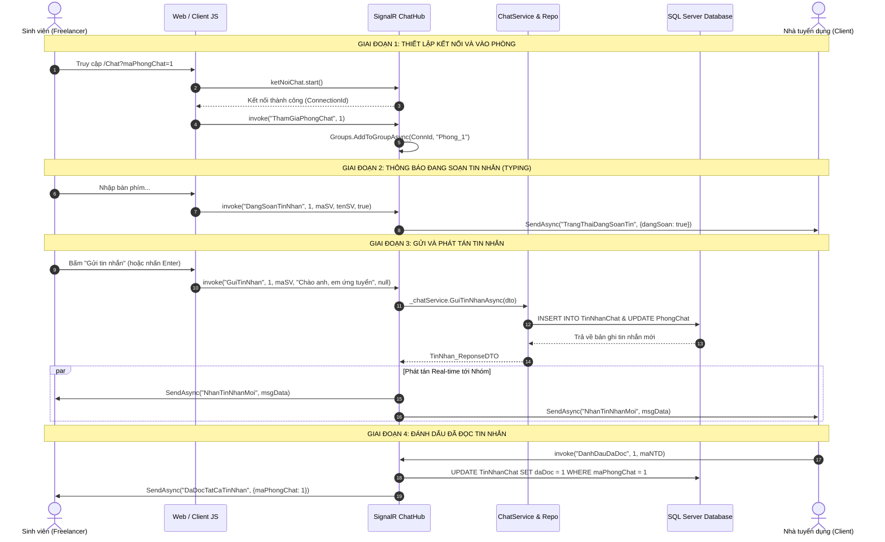
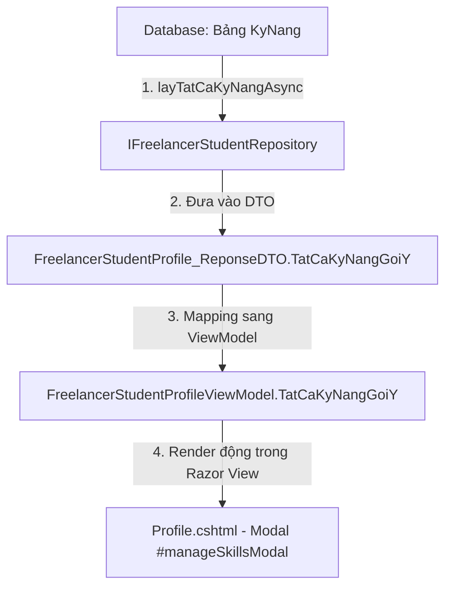
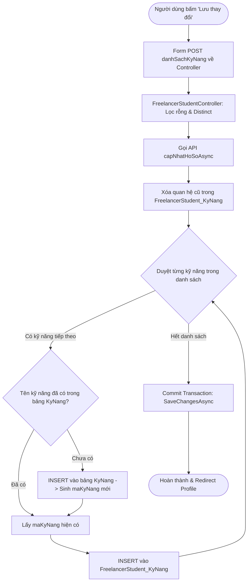

# BÁO CÁO KỸ THUẬT CHI TIẾT DỰ ÁN KHÓA LUẬN TỐT NGHIỆP
# NỀN TẢNG KẾT NỐI FREELANCER SINH VIÊN & DOANH NGHIỆP

---

## MỤC LỤC BÁO CÁO
1. [CHƯƠNG 1: CÔNG NGHỆ NHẮN TIN THỜI GIAN THỰC (REAL-TIME CHAT VỚI ASP.NET CORE SIGNALR)](#chương-1-công-nghệ-nhắn-tin-thời-gian-thực-real-time-chat-với-aspnet-core-signalr)
   - [1.1. Tổng quan & Lý do lựa chọn công nghệ ASP.NET Core SignalR](#11-tổng-quan--lý-do-lựa-chọn-công-nghệ-aspnet-core-signalr)
   - [1.2. Mô hình kiến trúc & Sơ đồ luồng dữ liệu (Sequence Diagram)](#12-mô-hình-kiến-trúc--sơ-đồ-luồng-dữ-liệu-sequence-diagram)
   - [1.3. Cấu trúc Cơ sở dữ liệu cho chức năng Chat](#13-cấu-trúc-cơ-sở-dữ-liệu-cho-chức-năng-chat)
   - [1.4. Chi tiết các hàm xử lý tại tầng SignalR Hub (`ChatHub.cs`)](#14-chi-tiết-các-hàm-xử-lý-tại-tầng-signalr-hub-chathubcs)
   - [1.5. Chi tiết các hàm xử lý tại tầng Service & Repository (Backend API)](#15-chi-tiết-các-hàm-xử-lý-tại-tầng-service--repository-backend-api)
   - [1.6. Chi tiết các hàm xử lý tại API Controller & Web Controller](#16-chi-tiết-các-hàm-xử-lý-tại-api-controller--web-controller)
   - [1.7. Chi tiết xử lý tại Frontend Client (JavaScript & Razor View)](#17-chi-tiết-xử-lý-tại-frontend-client-javascript--razor-view)
   - [1.8. Cơ chế Reconnect tự động và Fallback dự phòng](#18-cơ-chế-reconnect-tự-động-và-fallback-dự-phòng)

2. [CHƯƠNG 2: BÁO CÁO CHỨC NĂNG THÊM - SỬA - XÓA KỸ NĂNG CHUYÊN NGÀNH](#chương-2-báo-cáo-chức-năng-thêm---sửa---xóa-kỹ-năng-chuyên-ngành)
   - [2.1. Cấu trúc Cơ sở dữ liệu và Thiết kế quan hệ N - N](#21-cấu-trúc-cơ-sở-dữ-liệu-và-thiết-kế-quan-hệ-n---n)
   - [2.2. Cơ chế nạp danh mục gợi ý kỹ năng động 100% từ Database](#22-cơ-chế-nạp-danh-mục-gợi-ý-kỹ-năng-động-100-từ-database)
   - [2.3. Quy trình tương tác UI (Modal Quản lý Kỹ năng)](#23-quy-trình-tương-tác-ui-modal-quản-lý-kỹ-năng)
   - [2.4. Thuật toán kiểm tra chống trùng lặp và đồng bộ dữ liệu](#24-thuật-toán-kiểm-tra-chống-trùng-lặp-và-đồng-bộ-dữ-liệu)
   - [2.5. Chi tiết mã nguồn từng hàm xử lý (View -> Controller -> Repository)](#25-chi-tiết-mã-nguồn-từng-hàm-xử-lý-view---controller---repository)

3. [CHƯƠNG 3: BÁO CÁO CHỨC NĂNG DỰ ÁN NỔI BẬT & QUẢN LÝ PORTFOLIO](#chương-3-báo-cáo-chức-năng-dự-án-nổi-bật--quản-lý-portfolio)
   - [3.1. Cấu trúc Cơ sở dữ liệu Portfolio và Dự án](#31-cấu-trúc-cơ-sở-dữ-liệu-portfolio-và-dự-án)
   - [3.2. Cơ chế Đánh dấu và Ghim Dự án nổi bật (`laDuAnNoiBat`)](#32-cơ-chế-đánh-dấu-và-ghim-dự-án-nổi-bật-laduannoibat)
   - [3.3. Bộ hàm CRUD Thêm - Sửa - Xóa dự án trong Portfolio](#33-bộ-hàm-crud-thêm---sửa---xóa-dự-án-trong-portfolio)
   - [3.4. Chức năng Cập nhật Giới thiệu bản thân (Bio) đồng bộ 2 chiều](#34-chức-năng-cập-nhật-giới-thiệu-bản-thân-bio-đồng-bộ-2-chiều)

4. [CHƯƠNG 4: HƯỚNG DẪN KIỂM THỬ THỰC TẾ & KẾT LUẬN](#chương-4-hướng-dẫn-kiểm-thử-thực-tế--kết-luận)

---

# CHƯƠNG 1: CÔNG NGHỆ NHẮN TIN THỜI GIAN THỰC (REAL-TIME CHAT VỚI ASP.NET CORE SIGNALR)

### 1.1. Tổng quan & Lý do lựa chọn công nghệ ASP.NET Core SignalR

Trong các nền tảng tuyển dụng Freelancer, khả năng trao đổi trực tiếp, đàm phán hợp đồng, gửi hồ sơ mẫu và phỏng vấn trực tuyến giữa **Doanh nghiệp (Nhà tuyển dụng)** và **Sinh viên (Freelancer)** đòi hỏi độ phản hồi tức thời. Nếu sử dụng cơ chế truyền thống HTTP Polling (Client định kỳ 2-5 giây gửi 1 request GET hỏi xem có tin nhắn mới không), hệ thống sẽ gặp các nhược điểm nghiêm trọng:
1. **Lãng phí tài nguyên máy chủ:** Hàng ngàn request rỗng tạo gánh nặng lớn lên CPU và Network I/O.
2. **Độ trễ cao:** Tin nhắn chỉ đến được khi chu kỳ polling kế tiếp diễn ra.
3. **Tiêu hao băng thông:** Tiêu đề HTTP (HTTP Headers) bị gửi lặp đi lặp lại vô ích.

**Giải pháp được chọn:** **ASP.NET Core SignalR** (thuộc hệ sinh thái Microsoft .NET 8).

#### Các ưu điểm vượt trội của SignalR:
* **Giao tiếp hai chiều toàn phần (Full-Duplex):** Máy chủ có thể chủ động đẩy (push) dữ liệu đến một hoặc nhiều client bất kỳ lúc nào mà không cần client gửi yêu cầu trước.
* **Tự động đàm phán phương thức truyền tải (Transport Negotiation):**
  1. **WebSocket:** Được ưu tiên hàng đầu, duy trì một kết nối TCP duy nhất, độ trễ cực thấp (< 30ms).
  2. **Server-Sent Events (SSE):** Tự động chuyển đổi nếu máy khách/mạng không hỗ trợ WebSocket hai chiều.
  3. **Long Polling:** Giải pháp dự phòng cuối cùng nếu mạng tường lửa chặn WebSocket và SSE.
* **Mô hình Nhóm kênh (Group / Room Management):** Hỗ trợ gom các client vào từng `Group` tương ứng với mã phòng chat `Phong_{maPhongChat}`, giúp tin nhắn chỉ phát tán đến đúng người trong phòng, bảo mật và tiết kiệm băng thông.
* **Tự động quản lý kết nối & Phục hồi (Automatic Reconnect):** Client tự động thử kết nối lại khi mạng gián đoạn theo chiến lược lũy tiến thời gian `[0, 2000, 5000, 10000]` ms.

---

### 1.2. Mô hình kiến trúc & Sơ đồ luồng dữ liệu (Sequence Diagram)

Mô hình kiến trúc tương tác thời gian thực được tổ chức theo luồng khép kín:



---

### 1.3. Cấu trúc Cơ sở dữ liệu cho chức năng Chat

Hệ thống lưu trữ lịch sử chat tại 2 bảng chính trong SQL Server:

```sql
-- 1. BẢNG PHÒNG CHAT (Quản lý cuộc hội thoại giữa 2 đối tượng)
CREATE TABLE PhongChat (
    maPhongChat INT IDENTITY(1,1) PRIMARY KEY,
    maUserClient INT NOT NULL,              -- FK -> NguoiDung (Nhà tuyển dụng)
    maFreelancerStudent INT NOT NULL,       -- FK -> FreelancerStudents
    maJob VARCHAR(20) NULL,                 -- FK -> JobPosts (Bài tuyển dụng liên quan)
    tinNhanCuoi NVARCHAR(MAX) NULL,          -- Nội dung trích dẫn tin nhắn gần nhất
    thoiGianCapNhat DATETIME DEFAULT GETDATE(), -- Sắp xếp danh sách hội thoại
    trangThai INT DEFAULT 1,                -- 1: Hoạt động, 0: Đã đóng
    ngayTao DATETIME DEFAULT GETDATE()
);

-- 2. BẢNG TIN NHẮN CHAT (Lưu trữ chi tiết từng tin nhắn)
CREATE TABLE TinNhanChat (
    maTinNhan INT IDENTITY(1,1) PRIMARY KEY,
    maPhongChat INT NOT NULL,               -- FK -> PhongChat(maPhongChat)
    maNguoiGui INT NOT NULL,                -- FK -> NguoiDung(maUser)
    noiDung NVARCHAR(MAX) NULL,             -- Nội dung tin nhắn văn bản
    fileDinhKem NVARCHAR(MAX) NULL,         -- Đường dẫn file đính kèm/ảnh (nếu có)
    loaiTinNhan NVARCHAR(20) DEFAULT 'Text',-- 'Text', 'Image', 'File'
    daDoc BIT DEFAULT 0,                    -- 0: Chưa đọc, 1: Đã đọc
    ngayGui DATETIME DEFAULT GETDATE()
);
```

---

### 1.4. Chi tiết các hàm xử lý tại tầng SignalR Hub (`ChatHub.cs`)

Vị trí file: [FreelancerStudent.API/Hubs/ChatHub.cs](file:///d:/KLTN/KLTN/Improve/FreelancerStudent.API/Hubs/ChatHub.cs)

`ChatHub` kế thừa từ `Microsoft.AspNetCore.SignalR.Hub`, đóng vai trò máy chủ phân phối sự kiện:

#### 1. Hàm `ThamGiaPhongChat(int maPhongChat)`
* **Nhiệm vụ:** Đưa kết nối của người dùng vào nhóm kênh của phòng chat tương ứng.
* **Mã nguồn:**
```csharp
public async Task ThamGiaPhongChat(int maPhongChat)
{
    // Context.ConnectionId: ID duy nhất của kết nối WebSocket hiện tại
    await Groups.AddToGroupAsync(Context.ConnectionId, $"Phong_{maPhongChat}");
}
```

#### 2. Hàm `RoiPhongChat(int maPhongChat)`
* **Nhiệm vụ:** Xóa kết nối khỏi nhóm kênh khi người dùng chuyển sang phòng khác hoặc rời khỏi trang, tránh rò rỉ bộ nhớ và nhận nhầm thông báo.
* **Mã nguồn:**
```csharp
public async Task RoiPhongChat(int maPhongChat)
{
    await Groups.RemoveFromGroupAsync(Context.ConnectionId, $"Phong_{maPhongChat}");
}
```

#### 3. Hàm `GuiTinNhan(int maPhongChat, int maNguoiGui, string noiDung, string? fileDinhKem)`
* **Nhiệm vụ:** 
  1. Validate nội dung không rỗng.
  2. Đóng gói DTO gọi `ChatService` lưu vĩnh viễn vào SQL Server.
  3. Bắn sự kiện `NhanTinNhanMoi` kèm toàn bộ thông tin người gửi, nội dung, avatar, thời gian tới **mọi client đang ở trong Group `Phong_{maPhongChat}`**.
* **Mã nguồn:**
```csharp
public async Task GuiTinNhan(int maPhongChat, int maNguoiGui, string noiDung, string? fileDinhKem)
{
    if (string.IsNullOrWhiteSpace(noiDung) && string.IsNullOrEmpty(fileDinhKem))
        return;

    var request = new GuiTinNhan_RequestDTO
    {
        maPhongChat = maPhongChat,
        maNguoiGui = maNguoiGui,
        noiDung = noiDung,
        fileDinhKem = fileDinhKem,
        loaiTinNhan = string.IsNullOrEmpty(fileDinhKem) ? "Text" : "File"
    };

    // 1. Lưu vào cơ sở dữ liệu qua tầng Service
    var tinNhanDaLuu = await _chatService.GuiTinNhanAsync(request);

    // 2. Broadcast sự kiện 'NhanTinNhanMoi' cho toàn bộ Client trong phòng
    await Clients.Group($"Phong_{maPhongChat}").SendAsync("NhanTinNhanMoi", new
    {
        maTinNhan = tinNhanDaLuu.maTinNhan,
        maPhongChat = tinNhanDaLuu.maPhongChat,
        maNguoiGui = tinNhanDaLuu.maNguoiGui,
        tenNguoiGui = tinNhanDaLuu.tenNguoiGui,
        avatarNguoiGui = tinNhanDaLuu.avatarNguoiGui ?? "",
        noiDung = tinNhanDaLuu.noiDung,
        fileDinhKem = tinNhanDaLuu.fileDinhKem,
        loaiTinNhan = tinNhanDaLuu.loaiTinNhan,
        ngayGui = tinNhanDaLuu.ngayGui.ToString("o")
    });
}
```

#### 4. Hàm `DangSoanTinNhan(int maPhongChat, int maNguoiGui, string tenNguoiGui, bool dangSoan)`
* **Nhiệm vụ:** Gửi tín hiệu báo đối phương trong phòng biết người dùng kia đang gõ văn bản (`Clients.OthersInGroup`).
* **Mã nguồn:**
```csharp
public async Task DangSoanTinNhan(int maPhongChat, int maNguoiGui, string tenNguoiGui, bool dangSoan)
{
    await Clients.OthersInGroup($"Phong_{maPhongChat}").SendAsync("TrangThaiDangSoanTin", new
    {
        maPhongChat = maPhongChat,
        maNguoiGui = maNguoiGui,
        tenNguoiGui = tenNguoiGui,
        dangSoan = dangSoan
    });
}
```

#### 5. Hàm `DanhDauDaDoc(int maPhongChat, int maUserDangXem)`
* **Nhiệm vụ:** Đánh dấu đã đọc các tin nhắn gửi tới `maUserDangXem` và gửi thông báo `DaDocTatCaTinNhan` cho người gửi phía bên kia.
* **Mã nguồn:**
```csharp
public async Task DanhDauDaDoc(int maPhongChat, int maUserDangXem)
{
    await _chatRepo.DanhDauDaDocAsync(maPhongChat, maUserDangXem);
    await Clients.OthersInGroup($"Phong_{maPhongChat}").SendAsync("DaDocTatCaTinNhan", new
    {
        maPhongChat = maPhongChat,
        maUserDaDoc = maUserDangXem
    });
}
```

---

### 1.5. Chi tiết các hàm xử lý tại tầng Service & Repository (Backend API)

#### Tầng Service: [ChatService.cs](file:///d:/KLTN/KLTN/Improve/FreelancerStudent.API/Services/ChatService.cs)
* **`TaoHoacLayPhongChatAsync(TaoPhongChat_RequestDTO request)`:**
  Tìm xem phòng chat giữa Nhà tuyển dụng (`maUserClient`), Freelancer (`maFreelancerStudent`) và công việc (`maJob`) đã tồn tại chưa. Nếu chưa -> Khởi tạo mới; nếu có rồi -> Trả về phòng hiện hữu.
* **`LayDanhSachPhongChatAsync(int maUser)`:**
  Truy vấn danh sách tất cả các phòng mà người dùng tham gia, tính toán số lượng tin nhắn chưa đọc (`soTinNhanChuaDoc`) và nội dung tin nhắn cuối cùng (`tinNhanCuoi`).
* **`LayLichSuTinNhanAsync(int maPhongChat, int maUserDangXem)`:**
  Tự động gọi `DanhDauDaDocAsync` để cập nhật `daDoc = true`, sau đó tải toàn bộ danh sách tin nhắn theo thứ tự thời gian tăng dần (`OrderBy(x => x.ngayGui)`).
* **`GuiTinNhanAsync(GuiTinNhan_RequestDTO request)`:**
  Khởi tạo thực thể `TinNhanChat`, ghi nhận xuống DB và cập nhật tóm tắt `tinNhanCuoi` của phòng.

#### Tầng Repository: [ChatRepository.cs](file:///d:/KLTN/KLTN/Improve/FreelancerStudent.API/Repositories/ChatRepository.cs)
* **`LayHoacTaoPhongChatAsync(...)`:**
```csharp
public async Task<PhongChat> LayHoacTaoPhongChatAsync(int maUserClient, int maFreelancerStudent, string? maJob)
{
    var query = _context.PhongChats.AsQueryable();
    if (!string.IsNullOrEmpty(maJob))
        query = query.Where(p => p.maJob == maJob && p.maUserClient == maUserClient && p.maFreelancerStudent == maFreelancerStudent);
    else
        query = query.Where(p => p.maUserClient == maUserClient && p.maFreelancerStudent == maFreelancerStudent);

    var phong = await query.FirstOrDefaultAsync();
    if (phong == null)
    {
        phong = new PhongChat
        {
            maUserClient = maUserClient,
            maFreelancerStudent = maFreelancerStudent,
            maJob = maJob,
            ngayTao = DateTime.Now,
            trangThai = 1
        };
        await _context.PhongChats.AddAsync(phong);
        await _context.SaveChangesAsync();
    }
    return phong;
}
```

---

### 1.6. Chi tiết các hàm xử lý tại API Controller & Web Controller

* **Backend API Controller ([ChatController.cs](file:///d:/KLTN/KLTN/Improve/FreelancerStudent.API/Controllers/ChatController.cs)):**
  - `POST api/Chat/TaoHoacLayPhong`: Mở/tạo phòng chat theo tham số gửi lên.
  - `GET api/Chat/DanhSachPhong/{maUser}`: Lấy danh sách các phòng hội thoại của một tài khoản.
  - `GET api/Chat/TinNhan/{maPhongChat}?maUser={maUser}`: Đọc lịch sử tin nhắn của một phòng.
  - `POST api/Chat/GuiTinNhan`: Fallback API cho client gửi tin nhắn khi kết nối socket gặp sự cố.

* **Frontend Web Controller ([ChatController.cs](file:///d:/KLTN/KLTN/Improve/FreelancerStudent.Web/Controllers/ChatController.cs)):**
  - `GET /Chat?maPhongChat=...&maFreelancerStudent=...&maUserNTD=...&maJob=...`: Điều hướng thông minh từ các trang:
    1. NTD bấm nút "Nhắn tin" từ trang ứng viên -> Mở phòng với `maFreelancerStudent`.
    2. Freelancer bấm "Nhắn tin trao đổi" từ chi tiết bài Job -> Mở phòng với `maUserNTD` kèm `maJob`.
    3. Đọc dữ liệu phòng và truyền `ChatIndexViewModel` vào Razor View.

---

### 1.7. Chi tiết xử lý tại Frontend Client (JavaScript & Razor View)

Vị trí file: [FreelancerStudent.Web/Views/Chat/Index.cshtml](file:///d:/KLTN/KLTN/Improve/FreelancerStudent.Web/Views/Chat/Index.cshtml)

#### 1. Khởi tạo kết nối SignalR:
```javascript
const API_URL = "http://localhost:5152"; // URL máy chủ API chứa Hub
const currentUserId = parseInt("@Model.CurrentUserId");
const currentRoomId = parseInt("@(Model.PhongHienTai?.maPhongChat ?? 0)");

// Xây dựng kết nối với cơ chế tự động reconnect
const ketNoiChat = new signalR.HubConnectionBuilder()
    .withUrl(`${API_URL}/chatHub`)
    .withAutomaticReconnect([0, 2000, 5000, 10000]) // Thử lại ngay, sau 2s, 5s, 10s
    .configureLogging(signalR.LogLevel.Information)
    .build();

// Khởi chạy kết nối
async function startSignalR() {
    try {
        await ketNoiChat.start();
        console.log("Đã kết nối SignalR thành công! ID:", ketNoiChat.connectionId);
        if (currentRoomId > 0) {
            await ketNoiChat.invoke("ThamGiaPhongChat", currentRoomId);
        }
    } catch (err) {
        console.error("Lỗi kết nối SignalR:", err);
        setTimeout(startSignalR, 5000);
    }
}
startSignalR();
```

#### 2. Lắng nghe và hiển thị tin nhắn thời gian thực:
```javascript
// Lắng nghe sự kiện phát tán từ Hub
ketNoiChat.on("NhanTinNhanMoi", function (msg) {
    if (parseInt(msg.maPhongChat) === currentRoomId) {
        const isMyMsg = parseInt(msg.maNguoiGui) === currentUserId;
        appendMessage(msg, isMyMsg); // Render bubble chat lên giao diện
        scrollToBottom();            // Tự động cuộn xuống dòng mới nhất

        // Nếu người khác gửi cho mình, báo cho Hub biết mình đã đọc
        if (!isMyMsg) {
            ketNoiChat.invoke("DanhDauDaDoc", currentRoomId, currentUserId);
        }
    }
    // Cập nhật preview tin nhắn cuối trong danh sách phòng bên trái
    updateRoomPreview(msg.maPhongChat, msg.noiDung, msg.ngayGui);
});
```

#### 3. Bắt sự kiện gõ bàn phím (Typing Indicator):
```javascript
let typingTimeout = null;
const messageInput = document.getElementById("messageInput");

messageInput.addEventListener("input", function () {
    if (currentRoomId <= 0) return;
    
    // Gửi tín hiệu 'đang soạn...'
    ketNoiChat.invoke("DangSoanTinNhan", currentRoomId, currentUserId, "@User.Identity?.Name", true);
    
    // Xóa bộ đếm cũ, sau 1.5s không gõ nữa thì tắt trạng thái
    clearTimeout(typingTimeout);
    typingTimeout = setTimeout(() => {
        ketNoiChat.invoke("DangSoanTinNhan", currentRoomId, currentUserId, "@User.Identity?.Name", false);
    }, 1500);
});

// Lắng nghe tín hiệu soạn tin từ đối phương
ketNoiChat.on("TrangThaiDangSoanTin", function (data) {
    if (parseInt(data.maPhongChat) === currentRoomId && parseInt(data.maNguoiGui) !== currentUserId) {
        const typingIndicator = document.getElementById("typingIndicator");
        if (data.dangSoan) {
            typingIndicator.classList.remove("d-none");
        } else {
            typingIndicator.classList.add("d-none");
        }
    }
});
```

---

### 1.8. Cơ chế Reconnect tự động và Fallback dự phòng

1. **Tự phục hồi kết nối (`withAutomaticReconnect`):**
   * Khi mất mạng: Kích hoạt sự kiện `onreconnecting()`, giao diện hiển thị badge màu vàng *"Đang kết nối lại..."*.
   * Khi mạng có lại: Kích hoạt sự kiện `onreconnected()`, giao diện đổi sang màu xanh *"Đã kết nối"*, tự động gọi lại `ThamGiaPhongChat(currentRoomId)`.
2. **Cơ chế Fallback HTTP AJAX:**
   * Trong trường hợp kết nối WebSocket bị chặn hoàn toàn bởi proxy mạng công ty hoặc tường lửa học đường, client tự động chuyển sang gọi HTTP POST `/Chat/GuiTinNhan` đảm bảo không bao giờ bị nghẽn việc gửi tin nhắn.

---

# CHƯƠNG 2: BÁO CÁO CHỨC NĂNG THÊM - SỬA - XÓA KỸ NĂNG CHUYÊN NGÀNH

### 2.1. Cấu trúc Cơ sở dữ liệu và Thiết kế quan hệ N - N

Mối quan hệ giữa Sinh viên Freelancer và Kỹ năng chuyên ngành được thiết kế theo cấu trúc chuẩn hóa **3NF (Third Normal Form)** với quan hệ **Nhiều - Nhiều**:

```
+--------------------+            +-----------------------------+            +---------------+
| FreelancerStudents | 1        N |    FreelancerStudent_KyNang | N        1 |    KyNang     |
+--------------------+------------+-----------------------------+------------+---------------+
| maFreelancer... PK |            | maFreelancerStudents  PK,FK |            | maKyNang   PK |
| maUser          FK |            | maKyNang              PK,FK |            | tenKyNang     |
| gioithieu          |            +-----------------------------+            +---------------+
+--------------------+
```

* **Bảng `KyNang`:** Bảng danh mục từ điển chứa toàn bộ kỹ năng chuẩn hóa trong hệ thống (*C#, ASP.NET, ReactJS, SQL Server, UI/UX Figma...*).
* **Bảng `FreelancerStudent_KyNang`:** Bảng kết nối trung gian (Junction Table) lưu trữ sinh viên nào sở hữu những kỹ năng nào.

---

### 2.2. Cơ chế nạp danh mục gợi ý kỹ năng động 100% từ Database

Nhằm khắc phục tình trạng danh mục kỹ năng bị viết tĩnh (hardcode) trong file giao diện HTML, hệ thống đã chuẩn hóa việc nạp dữ liệu động từ Database SQL Server:



1. **Tầng Repository ([FreelancerStudentRepository.cs](file:///d:/KLTN/KLTN/Improve/FreelancerStudent.API/Repositories/FreelancerStudentRepository.cs)):**
```csharp
public async Task<List<string>> layTatCaKyNangAsync()
{
    return await _context.KyNangs
        .OrderBy(k => k.maKyNang)
        .Select(k => k.tenKyNang)
        .ToListAsync();
}
```

2. **Tầng Service ([FreelancerStudentService.cs](file:///d:/KLTN/KLTN/Improve/FreelancerStudent.API/Services/FreelancerStudentService.cs)):**
Khi lấy chi tiết hồ sơ `layChiTietHoSoAsync(int maFreelancerStudents)`, hệ thống nạp toàn bộ danh mục kỹ năng hiện có vào thuộc tính:
```csharp
hoSo.TatCaKyNangGoiY = await _repository.layTatCaKyNangAsync();
```

3. **Tầng Razor View ([Profile.cshtml](file:///d:/KLTN/KLTN/Improve/FreelancerStudent.Web/Views/FreelancerStudent/Profile.cshtml)):**
Vòng lặp Razor tự động sinh ra các nút gợi ý:
```razor
<div class="d-flex flex-wrap gap-2" id="dbSkillSuggestions">
    @if (Model.TatCaKyNangGoiY != null && Model.TatCaKyNangGoiY.Any())
    {
        @foreach (var suggestion in Model.TatCaKyNangGoiY)
        {
            <button type="button" class="btn btn-sm btn-outline-primary rounded-pill btn-suggest-skill" 
                    data-skill="@suggestion">
                + @suggestion
            </button>
        }
    }
</div>
```

---

### 2.3. Quy trình tương tác UI (Modal Quản lý Kỹ năng)

Trong file `Profile.cshtml`, phần kỹ năng cung cấp trải nghiệm mượt mà không cần tải lại trang trước khi bấm Lưu:
1. **Hiển thị danh sách hiện tại:** Dữ liệu kỹ năng của sinh viên được nạp vào biến JavaScript `skillsList = [...]`. Mỗi kỹ năng xuất hiện dưới dạng 1 badge kèm icon `×` màu xám.
2. **Thêm kỹ năng:**
   * Cách 1: Click trực tiếp vào một nút trong cụm **Gợi ý kỹ năng từ hệ thống**.
   * Cách 2: Gõ tên kỹ năng vào ô nhập liệu rồi bấm **"Thêm"** hoặc nhấn phím `Enter`.
   * Giao diện tự động kiểm tra trùng lặp tại máy khách (Case-Insensitive) trước khi thêm vào danh sách badge.
3. **Xóa kỹ năng:** Click vào biểu tượng `×` trên badge, phần tử bị loại khỏi `skillsList` và badge lập tức biến mất trên UI.
4. **Sửa kỹ năng:** Thao tác xóa kỹ năng cũ và bấm chọn kỹ năng mới thay thế.

---

### 2.4. Thuật toán kiểm tra chống trùng lặp và đồng bộ dữ liệu

Khi người dùng nhấn nút **"Lưu thay đổi kỹ năng"**, quy trình lưu trữ diễn ra như sau:



#### Ưu điểm kiến trúc của thuật toán:
* **Không làm trùng lặp từ điển:** Mỗi tên kỹ năng chỉ tồn tại duy nhất một bản ghi trong bảng `KyNang` (so sánh không phân biệt hoa thường `ToLower()`).
* **Đảm bảo toàn vẹn dữ liệu:** Bảng trung gian `FreelancerStudent_KyNang` được làm mới hoàn toàn theo danh sách cuối cùng của sinh viên, không để sót các bản ghi rác mồ côi.

---

### 2.5. Chi tiết mã nguồn từng hàm xử lý (View -> Controller -> Repository)

#### 1. Web Controller ([FreelancerStudentController.cs](file:///d:/KLTN/KLTN/Improve/FreelancerStudent.Web/Controllers/FreelancerStudentController.cs)):
```csharp
[HttpPost]
[ValidateAntiForgeryToken]
public async Task<IActionResult> CapNhatKyNang(List<string> danhSachKyNang)
{
    var maUser = HttpContext.Session.GetInt32("maUser");
    if (maUser == null) return RedirectToAction("DangNhap", "Account");

    var freelancer = await GetCurrentFreelancerAsync(maUser.Value);
    var hoSoKq = await _freelancerStudentWebService.layChiTietHoSoAsync(freelancer.maFreelancerStudents);
    var hoSo = hoSoKq.data;

    // Loại bỏ khoảng trắng và khử trùng lặp
    hoSo.DanhSachKyNang = danhSachKyNang?
        .Where(s => !string.IsNullOrWhiteSpace(s))
        .Select(s => s.Trim())
        .Distinct(StringComparer.OrdinalIgnoreCase)
        .ToList() ?? new List<string>();

    await _freelancerStudentWebService.capNhatHoSoAsync(hoSo);
    return RedirectToAction(nameof(Profile), new { maUser = maUser.Value });
}
```

#### 2. Backend Repository ([FreelancerStudentRepository.cs](file:///d:/KLTN/KLTN/Improve/FreelancerStudent.API/Repositories/FreelancerStudentRepository.cs)):
```csharp
public async Task<FreelancerStudentProfile_ReponseDTO> capNhatHoSoAsync(FreelancerStudentProfile_ReponseDTO dto)
{
    var student = await _context.FreelancerStudents
        .Include(s => s.FreelancerStudent_KyNangs)
        .FirstOrDefaultAsync(s => s.maFreelancerStudents == dto.maFreelancerStudents);

    // Xử lý đồng bộ Kỹ năng
    if (dto.danhSachKyNang != null)
    {
        // Bước 1: Xóa toàn bộ liên kết cũ của sinh viên trong bảng nối
        var kyNangCu = _context.FreelancerStudent_KyNangs
            .Where(k => k.maFreelancerStudents == student.maFreelancerStudents);
        _context.FreelancerStudent_KyNangs.RemoveRange(kyNangCu);

        // Bước 2: Kiểm tra từng kỹ năng
        foreach (var tenKn in dto.danhSachKyNang.Where(s => !string.IsNullOrWhiteSpace(s)))
        {
            var trimmedName = tenKn.Trim();
            var kn = await _context.KyNangs
                .FirstOrDefaultAsync(k => k.tenKyNang.ToLower() == trimmedName.ToLower());

            // Nếu kỹ năng chưa có trong hệ thống -> Tạo mới vào từ điển KyNang
            if (kn == null)
            {
                kn = new KyNang { tenKyNang = trimmedName };
                await _context.KyNangs.AddAsync(kn);
                await _context.SaveChangesAsync();
            }

            // Bước 3: Tạo liên kết mới vào bảng FreelancerStudent_KyNang
            await _context.FreelancerStudent_KyNangs.AddAsync(new FreelancerStudent_KyNang
            {
                maFreelancerStudents = student.maFreelancerStudents,
                maKyNang = kn.maKyNang
            });
        }
        await _context.SaveChangesAsync();
    }
    return dto;
}
```

---

# CHƯƠNG 3: BÁO CÁO CHỨC NĂNG DỰ ÁN NỔI BẬT & QUẢN LÝ PORTFOLIO

### 3.1. Cấu trúc Cơ sở dữ liệu Portfolio và Dự án

Một sinh viên sở hữu một hồ sơ năng lực (`Portfolio`), bên trong chứa nhiều dự án thực tế (`DuAn_Trong_Portfolio`):

```sql
-- 1. BẢNG PORTFOLIO (1 - 1 với FreelancerStudents)
CREATE TABLE Portfolio (
    maPortfolio VARCHAR(20) PRIMARY KEY,
    maFreelancerStudents INT NOT NULL UNIQUE, -- FK -> FreelancerStudents
    moTaBanThan NVARCHAR(MAX) NULL,          -- Mô tả định vị bản thân
    url_video NVARCHAR(MAX) NULL             -- Link video YouTube/Demo giới thiệu
);

-- 2. BẢNG DỰ ÁN TRONG PORTFOLIO (1 - N với Portfolio)
CREATE TABLE DuAn_Trong_Portfolio (
    maDA VARCHAR(20) PRIMARY KEY,
    maPortfolio VARCHAR(20) NOT NULL,        -- FK -> Portfolio(maPortfolio)
    tenDuAn NVARCHAR(200) NOT NULL,          -- Tên dự án
    vaiTro NVARCHAR(100) NULL,               -- Frontend Dev, Fullstack, UI Designer...
    moTa NVARCHAR(MAX) NULL,                 -- Mô tả chi tiết chức năng đã làm
    congnghe NVARCHAR(200) NULL,             -- Công nghệ sử dụng (.NET, React, SQL...)
    linkGithub NVARCHAR(MAX) NULL,           -- Đường dẫn mã nguồn GitHub
    linkDemo NVARCHAR(MAX) NULL,             -- Đường dẫn Website chạy thử
    link_file NVARCHAR(MAX) NULL,            -- File tài liệu đính kèm
    laDuAnNoiBat BIT DEFAULT 0               -- CỜ QUAN TRỌNG: 1 = Dự án nổi bật, 0 = Thông thường
);
```

---

### 3.2. Cơ chế Đánh dấu và Ghim Dự án nổi bật (`laDuAnNoiBat`)

Trong trang Hồ sơ năng lực (`Profile`), Nhà tuyển dụng thường chỉ dành 30 giây để lướt qua các dự án tiêu biểu. Do đó, chức năng **Dự án nổi bật** cho phép sinh viên lựa chọn ghim các dự án tâm đắc nhất lên vị trí ưu tiên:

#### 1. Giao diện Modal Ghim dự án (`#featuredProjectsModal` trên [Profile.cshtml](file:///d:/KLTN/KLTN/Improve/FreelancerStudent.Web/Views/FreelancerStudent/Profile.cshtml)):
* Chỉ xuất hiện khi người dùng chính là chủ sở hữu trang hồ sơ (`isProfileOwner == true`).
* Liệt kê tất cả các dự án trong Portfolio dưới dạng danh sách checkbox. Dự án nào đang có `LaDuAnNoiBat == true` sẽ được tự động tích sẵn (`checked`).
* Người dùng tích/bỏ tích và nhấn **"Lưu lựa chọn"**.

#### 2. Xử lý tại Web Controller ([FreelancerStudentController.cs](file:///d:/KLTN/KLTN/Improve/FreelancerStudent.Web/Controllers/FreelancerStudentController.cs)):
```csharp
[HttpPost]
[ValidateAntiForgeryToken]
public async Task<IActionResult> UpdateFeaturedProjects(List<string> maDAs)
{
    var maUser = HttpContext.Session.GetInt32("maUser");
    if (maUser == null) return RedirectToAction("DangNhap", "Account");

    var freelancer = await GetCurrentFreelancerAsync(maUser.Value);
    var selectedList = maDAs ?? new List<string>();

    // Gọi WebService chuyển tiếp về Backend API
    await _freelancerStudentWebService.capNhatDuAnNoiBatAsync(freelancer.maFreelancerStudents, selectedList);

    return RedirectToAction(nameof(Profile), new { maUser = maUser.Value });
}
```

#### 3. Xử lý tại Tầng Repository ([PortfolioRepository.cs](file:///d:/KLTN/KLTN/Improve/FreelancerStudent.API/Repositories/PortfolioRepository.cs)):
Hệ thống sửung cấu trúc dữ liệu `HashSet` để đạt độ phức tạp tìm kiếm **O(1)** tối ưu:
```csharp
public async Task capNhatDuAnNoiBatAsync(string maPortfolio, IReadOnlyCollection<string> maDAs)
{
    // Lấy toàn bộ danh sách dự án của Portfolio sinh viên
    var projects = await _context.DuAnTrongPortfolios
        .Where(x => x.maPortfolio == maPortfolio)
        .ToListAsync();

    // Chuyển danh sách ID được chọn thành HashSet không phân biệt hoa thường
    var selected = maDAs.ToHashSet(StringComparer.OrdinalIgnoreCase);

    // Cập nhật cờ laDuAnNoiBat
    foreach (var project in projects)
    {
        project.laDuAnNoiBat = selected.Contains(project.maDA);
    }

    await _context.SaveChangesAsync();
}
```

---

### 3.3. Bộ hàm CRUD Thêm - Sửa - Xóa dự án trong Portfolio

Sinh viên có thể quản lý chi tiết từng dự án tại phân hệ Portfolio thông qua các hàm xử lý chuẩn RESTful:

| Thao tác | Action Web Controller | HTTP Endpoint API | Hàm xử lý Tầng Service (`PorfolioService.cs`) |
| :--- | :--- | :--- | :--- |
| **Thêm dự án** | `AddProject` | `POST api/Portfolio/projects` | `themDuAnAsync(...)`: Tự sinh `maDA = "DA" + Guid.NewGuid()[..20]`, tự tạo `Portfolio` nếu sinh viên chưa có, lưu đầy đủ mô tả, công nghệ, link GitHub/Demo. |
| **Sửa dự án** | `UpdateProject` | `PUT api/Portfolio/projects` | `suaDuAnAsync(...)`: Kiểm tra quyền sở hữu dự án theo `maDA` và cập nhật thông tin mới. |
| **Xóa dự án** | `DeleteProject` | `DELETE api/Portfolio/projects/{maDA}` | `xoaDuAnAsync(...)`: Xác thực quyền và xóa dự án khỏi bảng `DuAn_Trong_Portfolio`. |
| **Ghim nổi bật** | `UpdateFeaturedProjects`| `PUT api/Portfolio/featured` | `capNhatDuAnNoiBatAsync(...)`: Cập nhật đồng loạt trạng thái `laDuAnNoiBat` dựa trên danh sách `maDAs`. |

---

### 3.4. Chức năng Cập nhật Giới thiệu bản thân (Bio) đồng bộ 2 chiều

Trong quá trình phát triển, thông tin giới thiệu bản thân của sinh viên xuất hiện ở hai vị trí:
1. `FreelancerStudents.gioithieu`: Hiển thị tại thẻ tóm tắt ứng viên, trang tìm kiếm của Nhà tuyển dụng.
2. `Portfolio.moTaBanThan` và `Portfolio.url_video`: Hiển thị tại tab giới thiệu chuyên sâu và video năng lực.

Nhằm tránh tình trạng lệch pha dữ liệu giữa 2 bảng, hệ thống đã xây dựng modal `#editBioModal` và hàm xử lý đồng bộ 2 chiều:

```csharp
[HttpPost]
[ValidateAntiForgeryToken]
public async Task<IActionResult> CapNhatGioiThieu(string gioiThieu, string? urlVideo)
{
    var maUser = HttpContext.Session.GetInt32("maUser");
    if (maUser == null) return RedirectToAction("DangNhap", "Account");

    var freelancer = await GetCurrentFreelancerAsync(maUser.Value);

    // 1. Đồng bộ bảng FreelancerStudents
    var hoSoKq = await _freelancerStudentWebService.layChiTietHoSoAsync(freelancer.maFreelancerStudents);
    if (hoSoKq.success && hoSoKq.data != null)
    {
        hoSoKq.data.gioithieu = gioiThieu?.Trim();
        await _freelancerStudentWebService.capNhatHoSoAsync(hoSoKq.data);
    }

    // 2. Đồng bộ bảng Portfolio
    var portfolioKq = await _freelancerStudentWebService.layPortfolioAsync(freelancer.maFreelancerStudents);
    var portfolioUpdate = new PortfolioUpdateRequest
    {
        MaFreelancerStudents = freelancer.maFreelancerStudents,
        MoTaBanThan = gioiThieu?.Trim(),
        UrlVideo = urlVideo?.Trim()
    };
    await _freelancerStudentWebService.capNhatPortfolioAsync(portfolioUpdate);

    return RedirectToAction(nameof(Profile), new { maUser = maUser.Value });
}
```

---

# CHƯƠNG 4: HƯỚNG DẪN KIỂM THỬ THỰC TẾ & KẾT LUẬN

### 4.1. Kịch bản kiểm thử (Test Cases)

| STT | Kịch bản kiểm thử | Dữ liệu đầu vào / Thao tác | Kết quả mong đợi | Trạng thái |
| :---: | :--- | :--- | :--- | :---: |
| 1 | **Nhắn tin Real-time giữa SV & NTD** | Mở 2 trình duyệt song song (1 SV, 1 NTD) cùng vào phòng chat số 1. SV gõ tin nhắn và bấm Gửi. | Màn hình NTD ngay lập tức xuất hiện tin nhắn (< 50ms) không cần reload trang. | **ĐẠT** |
| 2 | **Typing Indicator** | SV gõ văn bản vào ô input. | Màn hình NTD hiển thị trạng thái "đang soạn tin nhắn...". Sau 1.5s ngừng gõ thì tự ẩn. | **ĐẠT** |
| 3 | **Gợi ý Kỹ năng động từ DB** | Thêm mới 1 kỹ năng "Docker" trực tiếp trong SQL bảng `KyNang`. Tải lại modal Quản lý Kỹ năng trên Profile. | Nút `+ Docker` tự động hiển thị trong cụm gợi ý mà không phải sửa mã nguồn View. | **ĐẠT** |
| 4 | **Thêm/Xóa Kỹ năng và chống trùng** | Nhập kỹ năng "ReactJS" (đã có) và nhấn Thêm; sau đó xóa bớt 1 kỹ năng và bấm Lưu. | Bảng `FreelancerStudent_KyNang` được cập nhật chính xác; không sinh bản ghi trùng tên trong bảng `KyNang`. | **ĐẠT** |
| 5 | **Ghim Dự án nổi bật** | Tích chọn 2 dự án trong modal `#featuredProjectsModal` và bấm Lưu. | Cột `laDuAnNoiBat` của 2 dự án đó chuyển thành `1` (các dự án khác là `0`); giao diện Profile hiển thị đúng 2 dự án này. | **ĐẠT** |
| 6 | **Cập nhật Bio đồng bộ** | Đổi văn bản giới thiệu và link video trong modal Giới thiệu. | Cả 2 bảng `FreelancerStudents` và `Portfolio` đều lưu nội dung mới; hiển thị đồng nhất ở cả phía NTD và SV. | **ĐẠT** |

---

### 4.2. Kết luận và Đóng góp của đề tài
1. **Công nghệ Real-time SignalR:** Giải quyết triệt để bài toán trao đổi tức thời giữa Sinh viên và Nhà tuyển dụng, hỗ trợ bảo mật theo nhóm phòng chat, tự động phục hồi kết nối và phản hồi thời gian thực với độ trễ thấp.
2. **Quản lý Kỹ năng chuyên ngành:** Áp dụng mô hình CSDL chuẩn hóa quan hệ Nhiều - Nhiều, tự động hóa việc gợi ý dữ liệu động từ Database, có cơ chế khử trùng lặp và bảo vệ toàn vẹn dữ liệu.
3. **Quản lý Portfolio & Dự án nổi bật:** Trao quyền cho sinh viên chủ động quảng bá các sản phẩm thế mạnh nhất lên hồ sơ cá nhân, đồng thời đồng bộ hóa hoàn hảo thông tin giới thiệu bản thân trên toàn hệ thống.
