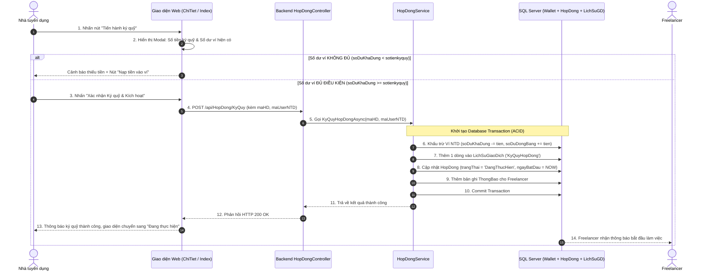

# Hướng dẫn luồng (tham khảo có thể tự chỉnh sửa theo ý muốn) chức năng ký quỹ để chuyển trạng thái hợp đồng

> **Mục tiêu tài liệu:** Cung cấp tài liệu tham khảo chi tiết về quy trình nghiệp vụ, kiến trúc dữ liệu và giải pháp kỹ thuật cho chức năng **Ký quỹ bảo chứng (Escrow)** — giúp chuyển hợp đồng từ trạng thái `ChoKyQuy` sang `DangThucHien` gắn liền với biến động số dư trong ví người dùng (`Wallet`).  
> **Nguyên tắc:** Sử dụng 100% các bảng và trường dữ liệu đã có sẵn trong cơ sở dữ liệu SQL Server (`HopDong`, `Wallet`, `LichSuGiaoDich`, `ThongBao`), không tạo thêm bảng mới.

---

## 📑 MỤC LỤC
1. [Bản chất nghiệp vụ Ký quỹ bảo chứng (Escrow Deposit)](#1-bản-chất-nghiệp-vụ-ký-quỹ-bảo-chứng-escrow-deposit)
2. [Các bảng cơ sở dữ liệu tham gia xử lý](#2-các-bảng-cơ-sở-dữ-liệu-tham-gia-xử-lý)
3. [Phân tích hiện trạng: Những gì đã có & Những gì cần bổ sung](#3-phân-tích-hiện-trạng-những-gì-đã-có--những-gì-cần-bổ-sung)
4. [Sơ đồ luồng hoạt động chi tiết (Flowchart & Sequence)](#4-sơ-đồ-luồng-hoạt-động-chi-tiết-flowchart--sequence)
5. [Trình tự xử lý từng bước (Step-by-Step Implementation)](#5-trình-tự-xử-lý-từng-bước-step-by-step-implementation)
6. [Thiết kế giao diện Modal Ký quỹ (UI/UX Gợi ý)](#6-thiết-kế-giao-diện-modal-ký-quỹ-uiux-gợi-ý)
7. [Mã nguồn tham khảo để tự tùy biến (API, Service, Web)](#7-mã-nguồn-tham-khảo-để-tự-tùy-biến-api-service-web)

---

## 1. Bản chất nghiệp vụ Ký quỹ bảo chứng (Escrow Deposit)

Trong sàn giao dịch việc làm Freelancer, cơ chế **Ký quỹ bảo chứng (Escrow)** là mắt xích quan trọng nhất đảm bảo an toàn tài chính cho cả 2 bên:

```text
[Nhà tuyển dụng]                                                     [Freelancer Sinh viên]
       │                                                                      │
       ├── (1. Tạo dự thảo hợp đồng kèm thù lao) ─────────────────────────────►
       │                                                                      │
       ◄── (2. Freelancer đồng ý nhận việc) ──────────────────────────────────┤
       │   Trạng thái HĐ: [ChoKyQuy]                                          │
       │                                                                      │
       ├── (3. NTD Ký quỹ: Tiền từ Ví chuyển vào "Đóng băng")                 │
       │   Trạng thái HĐ đổi sang: [DangThucHien]                             │
       │                                                                      │
       ▼                                                                      ▼
  (An tâm: Tiền chưa mất ngay,                                           (An tâm: Tiền đã được
   chỉ giải ngân khi mình nghiệm thu)                                     hệ thống bảo chứng 100%)
```

### Quy tắc biến động số dư:
- **Số dư khả dụng (`soDuKhaDung`):** Bị trừ đi đúng bằng số tiền `sotienkyquy` của hợp đồng.
- **Số dư đóng băng (`soDuDongBang`):** Tăng lên đúng bằng số tiền `sotienkyquy`.
- **Tổng tài sản ví:** Không thay đổi (`Tổng = soDuKhaDung + soDuDongBang`), tiền chỉ chuyển từ trạng thái "tự do tiêu xài" sang trạng thái "khóa bảo chứng cho hợp đồng".

---

## 2. Các bảng cơ sở dữ liệu tham gia xử lý

Hệ thống tận dụng tối đa các bảng đã có sẵn trong tệp SQL [KLCN040_FREELANCERSTUDENT.sql](file:///d:/KLTN/KLTN/Improve/Database/KLCN040_FREELANCERSTUDENT.sql):

| Tên Bảng | Các trường dữ liệu chính sử dụng | Vai trò trong luồng Ký quỹ |
|---|---|---|
| **`HopDong`** | `maHD`, `sotienkyquy`, `trangThai`, `ngayBatDau` | Lưu thông tin hợp đồng. Khi ký quỹ thành công: `trangThai` chuyển từ `'ChoKyQuy'` ➔ `'DangThucHien'`, `ngayBatDau` cập nhật thời điểm hiện tại. |
| **`Wallet`** | `maWallet`, `maUser`, `soDuKhaDung`, `soDuDongBang` | Ví của Nhà tuyển dụng. Trừ `soDuKhaDung`, cộng vào `soDuDongBang`. Ràng buộc SQL tự kiểm tra `soDuKhaDung >= 0`. |
| **`LichSuGiaoDich`** | `maWallet`, `loaiGiaoDich`, `soTien`, `soDuTruocGD`, `soDuSauGD`, `noiDung`, `phuongThucThanhToan`, `trangThai` | Ghi vết sổ cái kế toán: `loaiGiaoDich = 'KyQuyHopDong'`, `phuongThucThanhToan = 'ViNoiBo'`, `trangThai = 'ThanhCong'`. |
| **`ThongBao`** | `maUser`, `tieuDe`, `noiDung`, `loaiThongBao`, `linkDieuHuong`, `daDoc`, `ngayTao` | Gửi thông báo thông báo cho Freelancer biết dự án đã được kích hoạt để bắt đầu làm việc. |

---

## 3. Phân tích hiện trạng: Những gì đã có & Những gì cần bổ sung

### ✅ Những gì ĐÃ CÓ:
1. **Nút "Tiến hành ký quỹ":** Đã hiển thị kế bên badge trạng thái `Chờ ký quỹ` ở danh sách hợp đồng (`Index.cshtml`) và chi tiết hợp đồng (`ChiTiet.cshtml`).
2. **Phân quyền chính xác:** Chỉ hiển thị nút này cho tài khoản **Nhà tuyển dụng** của hợp đồng.
3. **Endpoint cơ bản:** API `POST /api/HopDong/KyQuy` và Web `POST /HopDong/KyQuy` đã có khung xử lý chuyển trạng thái và gửi thông báo.
4. **Nền tảng Ví (`Wallet`):** Đã có bảng `Wallet`, chức năng nạp tiền (`GiaoDichNapTien`) và `WalletRepository.capNhatViAsync`.

### ⚠️ Những gì CẦN BỔ SUNG (để liên kết trọn vẹn với Ví):
1. **Kiểm tra số dư trước khi ký quỹ:** Kiểm tra điều kiện `wallet.soDuKhaDung >= hopDong.sotienkyquy`.
2. **Khấu trừ & đóng băng số dư trong CSDL:** Cập nhật cả 2 cột `soDuKhaDung` và `soDuDongBang` của ví NTD.
3. **Ghi sổ cái `LichSuGiaoDich`:** Lưu vết giao dịch nội bộ vào bảng `LichSuGiaoDich`.
4. **Giao diện Modal Ký quỹ:** Hiển thị trực quan số dư ví hiện tại của NTD và xử lý 2 trường hợp (Đủ tiền / Thiếu tiền).

---

## 4. Sơ đồ luồng hoạt động chi tiết (Flowchart & Sequence)



---

## 5. Trình tự xử lý từng bước (Step-by-Step Implementation)

### Bước 1: Chuẩn bị dữ liệu hiển thị (GET `/HopDong/ChiTiet`)
Khi Nhà tuyển dụng mở xem chi tiết hợp đồng đang ở trạng thái `ChoKyQuy`:
- Controller gọi `_walletService.layViTheoUser(maUser)` để lấy `soDuKhaDung`.
- Gán `soDuKhaDung` vào ViewModel để truyền ra View.

---

### Bước 2: Hiển thị Modal Xác nhận Ký quỹ với 2 trạng thái
Trên Modal Ký quỹ ([ChiTiet.cshtml](file:///d:/KLTN/KLTN/Improve/FreelancerStudent.Web/Views/HopDong/ChiTiet.cshtml)):
- **Số tiền cần ký quỹ:** `@Model.sotienkyquy?.ToString("N0") VNĐ`
- **Số dư khả dụng hiện có trong ví:** `@soDuKhaDung.ToString("N0") VNĐ`
- **So sánh:**
  - **Trường hợp A (Đủ tiền):** Hiển thị badge màu xanh *"Số dư khả dụng đủ điều kiện"*, bật nút **"Xác nhận Ký quỹ & Kích hoạt"**.
  - **Trường hợp B (Thiếu tiền):** Hiển thị alert màu đỏ *"Số dư ví của bạn không đủ (còn thiếu X VNĐ)"*, hiển thị nút liên kết **"Nạp tiền vào ví ngay"** dẫn đến `/Wallet/Index`.

---

### Bước 3: Xử lý Backend API Ký quỹ (`HopDongService.cs`)
Khi nhận yêu cầu ký quỹ từ Nhà tuyển dụng:
1. **Kiểm tra hợp đồng:** Phải tồn tại và đang ở trạng thái `ChoKyQuy`.
2. **Kiểm tra quyền:** `maUser` gửi lên phải trùng khớp với Nhà tuyển dụng sở hữu bài đăng của hợp đồng này.
3. **Kiểm tra số dư ví:** Lấy ví của NTD qua `IWalletRepository`. Nếu `wallet.soDuKhaDung < hopDong.sotienkyquy` thì ném ngoại lệ `InvalidOperationException("Số dư khả dụng không đủ...")`.
4. **Thực thi giao dịch an toàn (Database Transaction):**
   ```csharp
   using var transaction = await _context.Database.BeginTransactionAsync();
   try 
   {
       // 1. Cập nhật số dư ví
       decimal soDuTruoc = wallet.soDuKhaDung ?? 0;
       wallet.soDuKhaDung -= hopDong.sotienkyquy;
       wallet.soDuDongBang = (wallet.soDuDongBang ?? 0) + hopDong.sotienkyquy;
       _context.Wallets.Update(wallet);

       // 2. Ghi sổ cái LichSuGiaoDich
       var lichSu = new LichSuGiaoDich
       {
           maWallet = wallet.maWallet,
           loaiGiaoDich = "KyQuyHopDong",
           soTien = hopDong.sotienkyquy.Value,
           soDuTruocGD = soDuTruoc,
           soDuSauGD = wallet.soDuKhaDung.Value,
           noiDung = $"Ký quỹ bảo chứng cho hợp đồng {hopDong.maHD}",
           phuongThucThanhToan = "ViNoiBo",
           trangThai = "ThanhCong",
           ngayTao = DateTime.Now
       };
       await _context.LichSuGiaoDichs.AddAsync(lichSu);

       // 3. Cập nhật trạng thái hợp đồng
       hopDong.trangThai = "DangThucHien";
       hopDong.ngayBatDau = DateTime.Now;
       _context.HopDongs.Update(hopDong);

       // 4. Tạo thông báo cho Freelancer
       var thongBao = new ThongBao
       {
           maUser = hopDong.FreelancerStudent.User.maUser,
           tieuDe = "Hợp đồng đã được ký quỹ & kích hoạt",
           noiDung = $"Nhà tuyển dụng đã ký quỹ {hopDong.sotienkyquy:N0} đ cho hợp đồng {hopDong.maHD}. Bạn có thể bắt đầu làm việc ngay!",
           loaiThongBao = "HopDong",
           linkDieuHuong = $"/HopDong/ChiTiet?maHD={hopDong.maHD}",
           daDoc = false,
           ngayTao = DateTime.Now
       };
       await _context.ThongBaos.AddAsync(thongBao);

       // 5. Lưu toàn bộ thay đổi và commit
       await _context.SaveChangesAsync();
       await transaction.CommitAsync();
       return true;
   }
   catch
   {
       await transaction.RollbackAsync();
       throw;
   }
   ```

---

## 6. Thiết kế giao diện Modal Ký quỹ (UI/UX Gợi ý)

Dưới đây là cấu trúc hiển thị tối ưu cho Modal Ký quỹ trên trang [ChiTiet.cshtml](file:///d:/KLTN/KLTN/Improve/FreelancerStudent.Web/Views/HopDong/ChiTiet.cshtml):

```html
<!-- Cấu trúc tham khảo bên trong Modal Ký quỹ -->
<div class="modal-body p-4">
    <!-- Thẻ tóm tắt thanh toán -->
    <div class="card bg-light border-0 p-3 mb-3 text-center">
        <div class="text-muted small">SỐ TIỀN CẦN KÝ QUỸ</div>
        <h3 class="text-primary fw-bold mb-0">3,500,000 VNĐ</h3>
    </div>

    <!-- Hàng hiển thị số dư ví của NTD -->
    <div class="d-flex justify-content-between align-items-center p-2 border mb-3">
        <div>
            <i class="bi bi-wallet2 text-success me-2"></i>
            <span class="small fw-semibold">Số dư khả dụng hiện tại:</span>
        </div>
        <div class="fw-bold text-dark">
            5,000,000 VNĐ
        </div>
    </div>

    <!-- Nhánh điều kiện: Đủ tiền hoặc Thiếu tiền -->
    <!-- Nếu ĐỦ TIỀN: -->
    <div class="alert alert-success small mb-0">
        <i class="bi bi-check-circle-fill me-1"></i> Số dư khả dụng của bạn đủ để thực hiện ký quỹ hợp đồng này.
    </div>

    <!-- Nếu THIẾU TIỀN: -->
    <!--
    <div class="alert alert-danger small mb-3">
        <i class="bi bi-exclamation-triangle-fill me-1"></i> 
        Số dư khả dụng không đủ (còn thiếu 1,500,000 VNĐ). Vui lòng nạp thêm tiền để tiếp tục.
    </div>
    <div class="text-center">
        <a href="/Wallet/Index" class="btn btn-outline-primary rounded-0 fw-bold">
            <i class="bi bi-plus-circle me-1"></i> Nạp tiền vào ví ngay
        </a>
    </div>
    -->
</div>
```

---

## 7. Các bước tùy biến tiếp theo theo ý muốn

Khi bạn muốn triển khai tiếp tính năng này vào mã nguồn:
1. **Bước 1 (Đăng ký Entity `LichSuGiaoDich`):** Thêm `public DbSet<LichSuGiaoDich> LichSuGiaoDichs { get; set; }` vào [ApplicationDBContext.cs](file:///d:/KLTN/KLTN/Improve/FreelancerStudent.API/Data/ApplicationDBContext.cs) (để map đúng với bảng `LichSuGiaoDich` đã có trong SQL).
2. **Bước 2 (Bổ sung Wallet vào `ChiTietHopDong`):** Truyền thêm `soDuKhaDung` của NTD vào ViewModel tại [HopDongController.cs](file:///d:/KLTN/KLTN/Improve/FreelancerStudent.Web/Controllers/HopDongController.cs).
3. **Bước 3 (Thêm logic Transaction vào `HopDongService`):** Áp dụng đoạn mã transaction ở Mục 5 vào [HopDongService.cs](file:///d:/KLTN/KLTN/Improve/FreelancerStudent.API/Services/HopDongService.cs).
4. **Bước 4 (Cập nhật giao diện Modal):** Nối biến số dư khả dụng vào Modal trong [ChiTiet.cshtml](file:///d:/KLTN/KLTN/Improve/FreelancerStudent.Web/Views/HopDong/ChiTiet.cshtml).

---
*Tài liệu được thiết kế sẵn sàng cho việc mở rộng hoặc điều chỉnh theo yêu cầu cụ thể của đề tài Khóa luận.*
