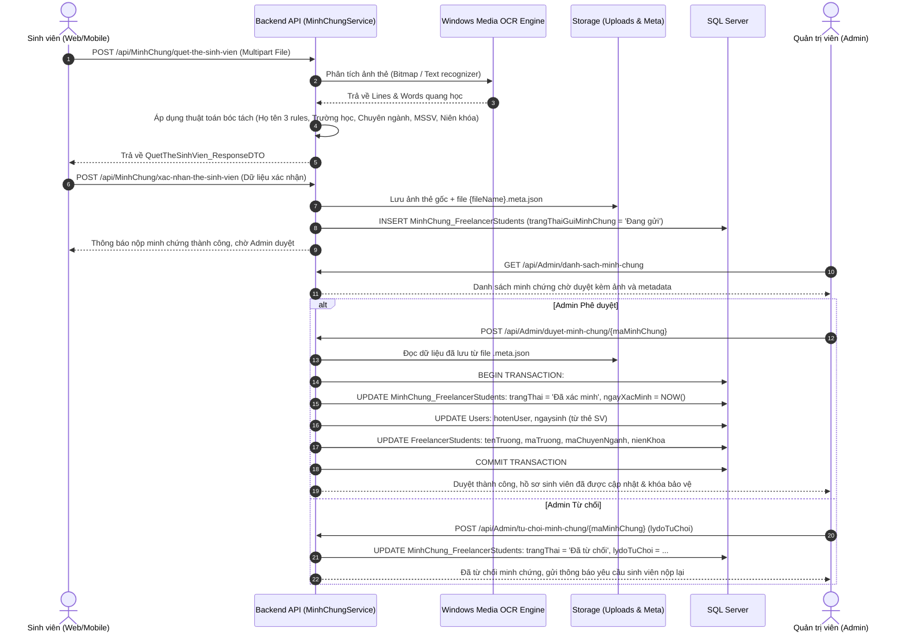
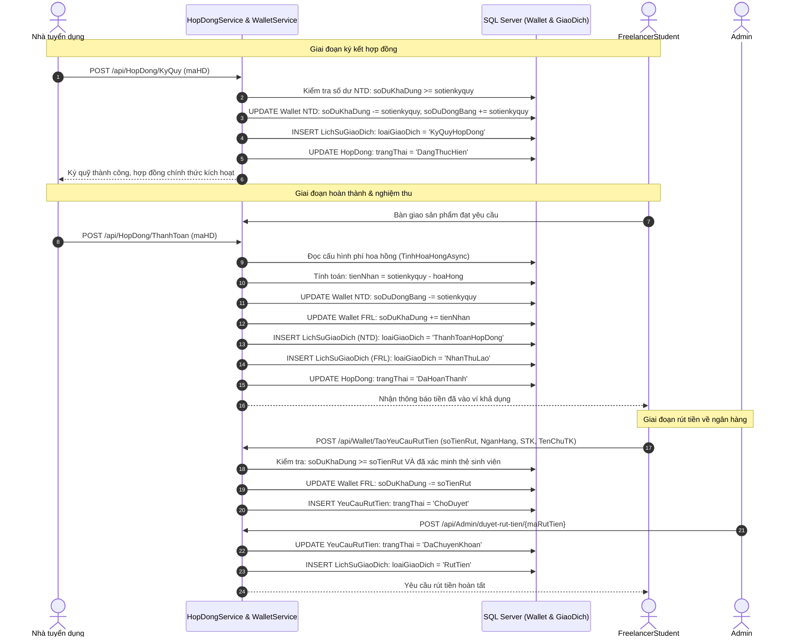
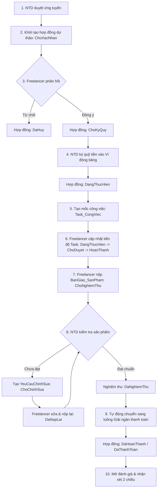

# TỔNG KẾT TOÀN DIỆN 4 NHÓM CHỨC NĂNG NỀN TẢNG FREELANCERSTUDENT

Tài liệu này tổng hợp chi tiết kiến trúc, công nghệ, danh sách file, luồng nghiệp vụ thực tế, lược đồ cơ sở dữ liệu và trạng thái kiểm thử cho 4 nhóm chức năng cốt lõi của nền tảng FreelancerStudent:
1. **Xác minh sinh viên bằng thẻ sinh viên (OCR, thẩm định Admin & bảo vệ hồ sơ)**
2. **Gợi ý kỹ năng cho FreelancerStudent (NLP từ khóa, quy tắc & liên kết hồ sơ)**
3. **Thanh toán & Ví tiền cho FreelancerStudent (Ký quỹ Escrow, giải ngân, hoa hồng & rút tiền)**
4. **Các mốc công việc trong luồng hợp đồng (Quản trị Task, bàn giao sản phẩm & nghiệm thu)**

---

## BẢNG TỔNG HỢP CÔNG NGHỆ & THƯ VIỆN SỬ DỤNG THỰC TẾ

| Thành phần | Công nghệ / Thư viện | Vai trò thực tế trong hệ thống |
|---|---|---|
| **Backend API** | .NET 10.0 (ASP.NET Core Web API), C# | Cung cấp RESTful API, xử lý nghiệp vụ, xác thực JWT, điều hướng giao dịch |
| **Frontend Web** | ASP.NET Core MVC 10.0, Razor Pages, Bootstrap 5, Vanilla JS | Giao diện Web cho Sinh viên, Nhà tuyển dụng và Quản trị viên (Admin) |
| **Mobile App** | Flutter 3.x, Dart, Provider / MVVM | Ứng dụng di động dành cho Sinh viên và Nhà tuyển dụng |
| **Database** | Microsoft SQL Server (Relational DB) | Lưu trữ tập trung 38 bảng thực thể dùng chung giữa Web và Mobile |
| **ORM / Data Access** | Entity Framework Core 10.0 (Code First / DbContext) | Tương tác dữ liệu, Transaction quản lý số dư và trạng thái hợp đồng |
| **OCR & Trích xuất** | Windows.Media.Ocr (WinRT API) + ZXing.Net | Nhận diện ký tự quang học thẻ sinh viên và quét mã Barcode/QR |
| **Xử lý Ngôn ngữ** | Regex Unicode Normalization (Không dấu) + Weighted Dictionary | Phân tích từ khóa tiêu đề/mô tả bài đăng để đề xuất kỹ năng |
| **Realtime** | ASP.NET Core SignalR | Thông báo thời gian thực về duyệt thẻ, cập nhật task, ký quỹ và thanh toán |
| **Bảo mật** | BCrypt.Net-Next, Claims-based Authorization, Safe Transaction | Băm mật khẩu, phân quyền Role (1: Sinh viên, 2: Tuyển dụng, 3: Admin) |

---

# PHẦN 1: NHÓM CHỨC NĂNG 1 — XÁC MINH SINH VIÊN BẰNG THẺ SINH VIÊN

### 1.1. Mục tiêu & Nguyên tắc nghiệp vụ
- Xác thực danh tính sinh viên đang theo học tại các trường Đại học/Cao đẳng tại Việt Nam.
- Ngăn chặn tài khoản giả mạo ứng tuyển các công việc học thuật / dự án sinh viên.
- **Bảo vệ tính toàn vẹn dữ liệu:** Sau khi thẻ sinh viên được Admin duyệt, các thông tin định danh cốt lõi (Họ tên, Mã trường, Tên trường, Chuyên ngành, Niên khóa) sẽ bị khóa chỉnh sửa (Read-only) trên cả Web và Mobile.
- **Điều kiện tiên quyết (Pre-condition):** Sinh viên bắt buộc phải có trạng thái minh chứng `Đã xác minh` mới được phép nộp hồ sơ ứng tuyển (`UngTuyen`) hoặc tạo yêu cầu rút tiền (`YeuCauRutTien`).

### 1.2. Danh sách file thêm mới và chỉnh sửa

#### Phía FreelancerStudent.API:
- [MinhChungController.cs](file:///d:/KLTN/KLTN/Improve/FreelancerStudent.API/Controllers/MinhChungController.cs): Tiếp nhận upload ảnh thẻ sinh viên, gọi OCR trích xuất thông tin, lưu minh chứng và cung cấp API kiểm tra trạng thái xác thực.
- [MinhChungService.cs](file:///d:/KLTN/KLTN/Improve/FreelancerStudent.API/Services/MinhChungService.cs): Xử lý toàn bộ logic lưu file, gọi `Windows.Media.Ocr`, bộ bóc tách thông tin nâng cao (Họ tên, Trường, Ngành/Chuyên ngành, MSSV, Niên khóa), tạo file metadata `.meta.json`, và cập nhật thông tin vào DB.
- [IMinhChungService.cs](file:///d:/KLTN/KLTN/Improve/FreelancerStudent.API/Services/Interfaces/IMinhChungService.cs): Interface định nghĩa các nghiệp vụ minh chứng.
- [QuetTheSinhVien_ResponseDTO.cs](file:///d:/KLTN/KLTN/Improve/FreelancerStudent.API/DTOs/ReponseDTOs/QuetTheSinhVien_ResponseDTO.cs): DTO chứa dữ liệu bóc tách được từ ảnh thẻ sinh viên.
- [XacNhanTheSinhVien_RequestDTO.cs](file:///d:/KLTN/KLTN/Improve/FreelancerStudent.API/DTOs/RequestDTOs/XacNhanTheSinhVien_RequestDTO.cs): DTO xác nhận thông tin thẻ và lưu trữ minh chứng.
- [MinhChung_FreelancerStudents.cs](file:///d:/KLTN/KLTN/Improve/FreelancerStudent.API/Models/MinhChung_FreelancerStudents.cs): Entity ánh xạ bảng `MinhChung_FreelancerStudents`.
- [UngTuyenController.cs](file:///d:/KLTN/KLTN/Improve/FreelancerStudent.API/Controllers/UngTuyenController.cs): Kiểm tra `KiemTraTrangThaiXacThucAsync` trước khi chấp nhận hồ sơ ứng tuyển.
- [AdminController.cs](file:///d:/KLTN/KLTN/Improve/FreelancerStudent.API/Controllers/AdminController.cs): Endpoint cho Admin duyệt (`DuyetMinhChung`) hoặc từ chối (`TuChoiMinhChung`).
- [AdminService.cs](file:///d:/KLTN/KLTN/Improve/FreelancerStudent.API/Services/AdminService.cs): Thực hiện cập nhật DB Transaction khi duyệt minh chứng: đổi trạng thái `Đã xác minh`, cập nhật các trường hồ sơ sinh viên từ file `.meta.json`.

#### Phía FreelancerStudent.Web:
- [MinhChung.cshtml](file:///d:/KLTN/KLTN/Improve/FreelancerStudent.Web/Views/Account/MinhChung.cshtml): Giao diện Wizard 4 bước: (1) Hướng dẫn & chụp ảnh -> (2) Phân tích OCR trực quan -> (3) Đối chiếu và xác nhận thông tin -> (4) Hoàn tất & theo dõi trạng thái.
- [AccountController.cs](file:///d:/KLTN/KLTN/Improve/FreelancerStudent.Web/Controllers/AccountController.cs): Điều hướng trang nộp minh chứng, kiểm tra trạng thái xác thực.
- [MinhChungWebService.cs](file:///d:/KLTN/KLTN/Improve/FreelancerStudent.Web/Services/MinhChungWebService.cs): HTTP Client gửi dữ liệu minh chứng sang API Backend.
- [Profile.cshtml](file:///d:/KLTN/KLTN/Improve/FreelancerStudent.Web/Views/FreelancerStudent/Profile.cshtml): Khóa `disabled`/`readonly` các trường Họ tên, Trường, Ngành khi tài khoản đã xác minh, kèm huy hiệu tick xanh "Đã xác minh sinh viên".

#### Phía Mobile (Flutter):
- [man_hinh_minh_chung_the_sv.dart](file:///d:/KLTN/KLTN/Improve/Mobile/freelancerstudent/lib/views/profile/man_hinh_minh_chung_the_sv.dart): Màn hình chụp/tải ảnh thẻ sinh viên, hiển thị kết quả phân tích OCR và gửi xác nhận.
- [dich_vu_minh_chung.dart](file:///d:/KLTN/KLTN/Improve/Mobile/freelancerstudent/lib/services/dich_vu_minh_chung.dart): Service gọi API xác minh và kiểm tra trạng thái minh chứng.
- [man_hinh_chinh_sua_ho_so.dart](file:///d:/KLTN/KLTN/Improve/Mobile/freelancerstudent/lib/views/profile/man_hinh_chinh_sua_ho_so.dart): Khóa chỉnh sửa các trường đã xác thực.
- [bang_ung_tuyen_cong_viec.dart](file:///d:/KLTN/KLTN/Improve/Mobile/freelancerstudent/lib/views/job_detail/bang_ung_tuyen_cong_viec.dart): Kiểm tra trạng thái xác thực trước khi mở modal ứng tuyển.

### 1.3. Luồng xử lý chi tiết (Workflow)

### 1.4. Thuật toán OCR & Khôi phục dữ liệu thẻ sinh viên
- **Xử lý Họ và tên không nhãn:** Thẻ sinh viên Việt Nam hầu hết không in chữ `Họ và tên:`. Hệ thống áp dụng 3 quy tắc:
  1. *Quy tắc 1:* Tìm dòng chứa nhãn `Họ và tên`, `Họ tên`, `Full name`.
  2. *Quy tắc 2:* Tìm dòng chữ IN HOA ngay sau tiêu đề `THẺ SINH VIÊN` / `STUDENT CARD`.
  3. *Quy tắc 3:* Quét dòng chữ IN HOA nằm ngay phía trên dòng chứa `Ngày sinh:` / `DOB`.
  4. *Khôi phục nguyên âm tiếng Việt:* Xử lý ký tự bị lỗi do Windows OCR tiếng Anh (ví dụ: `Lé Nhu't Thién` $\rightarrow$ `Lê Nhựt Thiên`, `Trån Vän Tin` $\rightarrow$ `Trần Văn Tín`).
- **Từ điển nhận diện Trường học:** Tích hợp từ điển đối soát hơn 25 trường Đại học lớn tại Việt Nam, sửa lỗi nhận diện quang học (ví dụ: `TRUONG HQC...` $\rightarrow$ `Trường Đại học Công nghệ TP.HCM (HUTECH)`).
- **Phân định Chuyên ngành vs Ngành:** Ưu tiên bóc tách nhãn `Chuyên ngành:` trước `Ngành:`. Nếu hệ thống chưa có chuyên ngành trong DB, hàm `TimHoacTaoChuyenNganhAsync` sẽ tự động cấp mã và lưu mới vào bảng `ChuyenNganh`.

---

# PHẦN 2: NHÓM CHỨC NĂNG 2 — GỢI Ý KỸ NĂNG CHO FREELANCERSTUDENT

### 2.1. Mục tiêu & Nguyên tắc nghiệp vụ
- Hỗ trợ Nhà tuyển dụng tạo bài đăng nhanh chóng: khi gõ tiêu đề hoặc mô tả tuyển dụng, hệ thống tự động phân tích ngữ nghĩa từ khóa và gợi ý danh sách kỹ năng liên quan dưới dạng các tag/badge bấm chọn.
- Hỗ trợ Sinh viên hoàn thiện hồ sơ: gợi ý toàn bộ danh mục kỹ năng chuẩn có sẵn trong hệ thống (`TatCaKyNangGoiY`) để sinh viên thêm nhanh vào hồ sơ cá nhân.
- Gợi ý việc làm phù hợp cho FreelancerStudent dựa trên tỷ lệ trùng khớp giữa kỹ năng sinh viên sở hữu (`FreelancerStudent_KyNang`) và kỹ năng yêu cầu trong bài đăng tuyển dụng (`JobPost.kynangyeucau`).

### 2.2. Danh sách file liên quan

#### Phía FreelancerStudent.API:
- [KyNangGoiYService.cs](file:///d:/KLTN/KLTN/Improve/FreelancerStudent.API/Services/KyNangGoiYService.cs): Cốt lõi xử lý đề xuất kỹ năng: chuẩn hóa xâu không dấu, quét từ điển quy tắc ánh xạ (`DanhSachQuyTac`), chấm điểm trọng số phù hợp (`diemPhuHop`), và truy vấn bảng `KyNang` trong SQL Server.
- [IKyNangGoiYService.cs](file:///d:/KLTN/KLTN/Improve/FreelancerStudent.API/Services/Interfaces/IKyNangGoiYService.cs): Interface định nghĩa hàm `GoiYKyNangTheoVanBanAsync`.
- [JobPostController.cs](file:///d:/KLTN/KLTN/Improve/FreelancerStudent.API/Controllers/JobPostController.cs): Endpoint `GET /api/JobPost/GoiYKyNangTheoTieuDe?tieuDe=...&moTa=...`.
- [FreelancerStudentService.cs](file:///d:/KLTN/KLTN/Improve/FreelancerStudent.API/Services/FreelancerStudentService.cs): Nạp danh sách kỹ năng toàn hệ thống vào trường `TatCaKyNangGoiY` khi tải hồ sơ sinh viên.
- [JobPostService.cs](file:///d:/KLTN/KLTN/Improve/FreelancerStudent.API/Services/JobPostService.cs): Hàm `layDanhSachJobGoiYChoUserAsync` tính tỷ lệ phần trăm khớp kỹ năng giữa bài đăng và sinh viên.
- [KyNangGoiY_ResponseDTO.cs](file:///d:/KLTN/KLTN/Improve/FreelancerStudent.API/DTOs/ReponseDTOs/KyNangGoiY_ResponseDTO.cs): DTO chứa `maKyNang`, `tenKyNang`, `diemPhuHop`, `lyDo`.
- [Seed_KyNang_BoSung.sql](file:///d:/KLTN/KLTN/Improve/Database/Seed_KyNang_BoSung.sql): Kịch bản bổ sung danh mục kỹ năng chuẩn theo từng nhóm ngành nghề vào bảng `KyNang`.

#### Phía FreelancerStudent.Web:
- [Create.cshtml](file:///d:/KLTN/KLTN/Improve/FreelancerStudent.Web/Views/JobPost/Create.cshtml) & [Edit.cshtml](file:///d:/KLTN/KLTN/Improve/FreelancerStudent.Web/Views/JobPost/Edit.cshtml): Javascript debounce 350ms bắt sự kiện nhập tiêu đề, tự động gọi API và vẽ các button kỹ năng đề xuất.
- [Profile.cshtml](file:///d:/KLTN/KLTN/Improve/FreelancerStudent.Web/Views/FreelancerStudent/Profile.cshtml): Hiển thị đám mây kỹ năng gợi ý từ `Model.TatCaKyNangGoiY` để sinh viên nhấn chọn thêm nhanh vào hồ sơ.
- [JobPostWebService.cs](file:///d:/KLTN/KLTN/Improve/FreelancerStudent.Web/Services/JobPostWebService.cs): Proxy HTTP client gọi API gợi ý kỹ năng.

#### Phía Mobile (Flutter):
- [man_hinh_tao_bai_dang_tuyen_dung.dart](file:///d:/KLTN/KLTN/Improve/Mobile/freelancerstudent/lib/views/employer/man_hinh_tao_bai_dang_tuyen_dung.dart): Debounce 400ms trên `_titleController`, hiển thị `ActionChip` kỹ năng gợi ý.
- [man_hinh_ho_so.dart](file:///d:/KLTN/KLTN/Improve/Mobile/freelancerstudent/lib/views/profile/man_hinh_ho_so.dart): Danh sách kỹ năng chọn nhanh khi cập nhật hồ sơ cá nhân.

### 2.3. Cơ chế xử lý dữ liệu và thuật toán gợi ý thực tế
1. **Chuẩn hóa văn bản:** Văn bản nhập vào được chuẩn hóa qua hàm `ChuanHoaKhongDau()` (loại bỏ toàn bộ dấu Unicode tiếng Việt, đưa về chữ thường).
2. **Bộ quy tắc ánh xạ nhóm ngành (Dictionary Mapping):**
   - Nhóm `DoHoa_UIUX`: từ khóa (*logo, banner, poster, figma, photoshop, illustrator, canva, ui/ux*) $\rightarrow$ Gợi ý: Photoshop, Illustrator, Figma, Canva, Thiết kế logo.
   - Nhóm `LapTrinhWeb`: từ khóa (*website, web, react, nodejs, asp.net, frontend, backend, html, css*) $\rightarrow$ Gợi ý: ReactJS, ASP.NET Core, JavaScript, HTML5/CSS3, SQL Server.
   - Nhóm `LapTrinhMobile`: từ khóa (*mobile, app, flutter, react native, android, ios*) $\rightarrow$ Gợi ý: Flutter, Dart, Android Studio, Swift, Firebase.
   - Nhóm `Marketing_SEO`: từ khóa (*marketing, seo, fanpage, content, ads, quang cao*) $\rightarrow$ Gợi ý: Content Writing, SEO, Facebook Ads, Google Ads.
   - Nhóm `DichThuat_Content`: từ khóa (*dich thuat, viet bai, copywriter, tieng anh*) $\rightarrow$ Gợi ý: Dịch thuật tiếng Anh, Biên tập nội dung, Copywriting.
3. **Chấm điểm trọng số:**
   - Khớp từ khóa trong Tiêu đề: gán trọng số `1.0`.
   - Khớp từ khóa trong Mô tả: gán trọng số `0.6`.
4. **Đối chiếu Database SQL Server:** Lọc kết quả qua bảng `KyNang` trong CSDL để đảm bảo chỉ những kỹ năng có mã khóa chính (`maKyNang`) hợp lệ mới được trả về Frontend.

---

# PHẦN 3: NHÓM CHỨC NĂNG 3 — THANH TOÁN CHO FREELANCERSTUDENT

### 3.1. Các vai trò & Cấu trúc tài chính thực tế
- **Nhà tuyển dụng:** Nạp tiền vào Ví (`Wallet`), tiến hành ký quỹ tiền hợp đồng khi phê duyệt hợp đồng dự thảo.
- **FreelancerStudent:** Nhận tiền thù lao về Ví sau khi sản phẩm bàn giao được Nhà tuyển dụng nghiệm thu thành công. Có quyền tạo yêu cầu rút tiền về tài khoản ngân hàng cá nhân.
- **Admin:** Quản lý cấu hình tỷ lệ hoa hồng dự án (`CauHinhPhiHoaHong_PhiDangBai`), duyệt hoặc từ chối các yêu cầu rút tiền (`YeuCauRutTien`), xem thống kê biến động số dư toàn hệ thống.
- **Bảng CSDL cốt lõi:**
  - `Wallet`: Lưu `soDuKhaDung` (số dư dùng để rút/chi tiêu) và `soDuDongBang` (tiền ký quỹ đang bị khóa trong các hợp đồng đang thực hiện).
  - `LichSuGiaoDich`: Ghi nhận nhật ký tài chính bất biến với các loại giao dịch: `NapTien`, `RutTien`, `KyQuyHopDong`, `NhanThuLao`, `ThanhToanHopDong`, `HoanTienKyQuy`.
  - `YeuCauRutTien`: Quản lý yêu cầu chuyển khoản ra ngân hàng ngoài với 3 trạng thái: `ChoDuyet`, `DaChuyenKhoan`, `TuChoi`.
  - `CauHinhPhiHoaHong_PhiDangBai`: Thiết lập tỷ lệ chiết khấu sàn (mặc định phần trăm hoặc số tiền cố định).

### 3.2. Danh sách file liên quan

#### Phía FreelancerStudent.API:
- [HopDongService.cs](file:///d:/KLTN/KLTN/Improve/FreelancerStudent.API/Services/HopDongService.cs): Thực hiện hàm `KyQuyHopDongAsync` (chuyển tiền khả dụng sang đóng băng) và `ThanhToanHopDongAsync` (giải ngân ký quỹ, trừ hoa hồng, cộng tiền cho Freelancer).
- [WalletService.cs](file:///d:/KLTN/KLTN/Improve/FreelancerStudent.API/Services/WalletService.cs): Quản lý số dư, nạp tiền, gửi yêu cầu rút tiền, và truy vấn lịch sử giao dịch ví.
- [WalletController.cs](file:///d:/KLTN/KLTN/Improve/FreelancerStudent.API/Controllers/WalletController.cs): Cung cấp các endpoint ví: `/api/Wallet/ThongTinVi`, `/api/Wallet/TaoYeuCauRutTien`, `/api/Wallet/LichSuGiaoDich`.
- [AdminService.cs](file:///d:/KLTN/KLTN/Improve/FreelancerStudent.API/Services/AdminService.cs): Xử lý duyệt rút tiền (`DuyetRutTienAsync`) và từ chối rút tiền (`TuChoiRutTienAsync`) kèm hoàn trả số dư ví.

#### Phía FreelancerStudent.Web:
- [WalletController.cs](file:///d:/KLTN/KLTN/Improve/FreelancerStudent.Web/Controllers/WalletController.cs): Điều hướng trang tổng quan ví tiền, nạp tiền và rút tiền.
- [Index.cshtml](file:///d:/KLTN/KLTN/Improve/FreelancerStudent.Web/Views/Wallet/Index.cshtml): Giao diện hiển thị số dư khả dụng, số dư đóng băng, form yêu cầu rút tiền và bảng lịch sử giao dịch.
- [ThanhToan.cshtml](file:///d:/KLTN/KLTN/Improve/FreelancerStudent.Web/Views/HopDong/ThanhToan.cshtml): Màn hình xác nhận nghiệm thu và giải ngân hợp đồng cho Freelancer.

#### Phía Mobile (Flutter):
- [man_hinh_vi_tien.dart](file:///d:/KLTN/KLTN/Improve/Mobile/freelancerstudent/lib/views/wallet/man_hinh_vi_tien.dart): Màn hình ví tiền tổng quan.
- [man_hinh_rut_tien.dart](file:///d:/KLTN/KLTN/Improve/Mobile/freelancerstudent/lib/views/wallet/man_hinh_rut_tien.dart): Form tạo yêu cầu rút tiền về ngân hàng.
- [man_hinh_lich_su_giao_dich.dart](file:///d:/KLTN/KLTN/Improve/Mobile/freelancerstudent/lib/views/wallet/man_hinh_lich_su_giao_dich.dart): Danh sách lịch sử giao dịch theo định dạng thời gian thực.
- [dich_vu_vi_tien.dart](file:///d:/KLTN/KLTN/Improve/Mobile/freelancerstudent/lib/services/dich_vu_vi_tien.dart): Client gọi API ví và giao dịch.

### 3.3. Luồng ký quỹ & giải ngân thực tế (Escrow Flow)

---

# PHẦN 4: NHÓM CHỨC NĂNG 4 — CÁC MỐC CÔNG VIỆC TRONG LUỒNG HỢP ĐỒNG

### 4.1. Cấu trúc dữ liệu & phân cấp quản lý công việc
Hệ thống quản lý công việc theo mô hình phân cấp 3 tầng rõ ràng:
1. **Hợp đồng (`HopDong`):** Thực thể cấp cao nhất đại diện cho thỏa thuận giữa Nhà tuyển dụng và FreelancerStudent gắn liền với một `JobPost`.
2. **Giai đoạn hợp đồng (`GiaiDoan_HopDong`):** Phân chia tiến độ dự án thành các mốc thời gian lớn (Milestones), có tên giai đoạn, mô tả, hạn chót (`hanChot`) và trạng thái (`ChuaDat`, `ChoDuyet`, `DaNghiemThu`).
3. **Đầu việc con (`Task_CongViec`):** Các nhiệm vụ cụ thể trực thuộc hợp đồng hoặc trực thuộc một giai đoạn (`maGiaiDoan`). Có tên task, mô tả, hạn hoàn thành (`hanHoanThanh`) và trạng thái (`ChuaThucHien`, `DangThucHien`, `ChoDuyet`, `HoanThanh`).
4. **Bàn giao sản phẩm (`BanGiao_SanPham`):** Lưu trữ các đợt nộp sản phẩm hoàn thiện của Freelancer (`phienBan`, `fileSanPhamUrl`, `linkDemo`, `motaBanGiao`) với trạng thái `ChoNghiemThu`, `YeuCauChinhSua`, `DaNghiemThu`.
5. **Yêu cầu chỉnh sửa (`YeuCauChinhSua`):** Ghi nhận phản hồi yêu cầu làm lại sản phẩm từ Nhà tuyển dụng khi sản phẩm chưa đạt (`ChoChinhSua`, `DaNopLai`, `DaNghiemThu`).

### 4.2. Danh sách file liên quan

#### Phía FreelancerStudent.API:
- [HopDongController.cs](file:///d:/KLTN/KLTN/Improve/FreelancerStudent.API/Controllers/HopDongController.cs): Khởi tạo dự thảo hợp đồng, xác nhận, ký quỹ và kết thúc hợp đồng.
- [TaskCongViecController.cs](file:///d:/KLTN/KLTN/Improve/FreelancerStudent.API/Controllers/TaskCongViecController.cs): Quản lý CRUD task công việc và cập nhật trạng thái tiến độ.
- [BanGiaoSanPhamController.cs](file:///d:/KLTN/KLTN/Improve/FreelancerStudent.API/Controllers/BanGiaoSanPhamController.cs): Tiếp nhận sản phẩm bàn giao, gửi yêu cầu chỉnh sửa và nghiệm thu sản phẩm.
- [BanGiaoSanPhamService.cs](file:///d:/KLTN/KLTN/Improve/FreelancerStudent.API/Services/BanGiaoSanPhamService.cs): Xử lý logic bàn giao sản phẩm và quản lý vòng đời yêu cầu chỉnh sửa.
- [HopDongService.cs](file:///d:/KLTN/KLTN/Improve/FreelancerStudent.API/Services/HopDongService.cs): Điều phối trạng thái hợp đồng kết hợp cùng task và bàn giao.

#### Phía FreelancerStudent.Web:
- [ChiTiet.cshtml](file:///d:/KLTN/KLTN/Improve/FreelancerStudent.Web/Views/HopDong/ChiTiet.cshtml): Giao diện chi tiết hợp đồng, danh sách task công việc, thanh tiến độ % hoàn thành, lịch sử bàn giao và khu vực trao đổi.
- [TaoHopDong.cshtml](file:///d:/KLTN/KLTN/Improve/FreelancerStudent.Web/Views/HopDong/TaoHopDong.cshtml): Form khởi tạo hợp đồng dự thảo kèm số tiền ký quỹ và thời hạn.
- [BanGiaoSanPhamController.cs](file:///d:/KLTN/KLTN/Improve/FreelancerStudent.Web/Controllers/BanGiaoSanPhamController.cs): Điều hướng nộp và xem xét bàn giao sản phẩm.

#### Phía Mobile (Flutter):
- [man_hinh_chi_tiet_hop_dong.dart](file:///d:/KLTN/KLTN/Improve/Mobile/freelancerstudent/lib/views/hop_dong/man_hinh_chi_tiet_hop_dong.dart): Màn hình xem chi tiết điều khoản hợp đồng và trạng thái thanh toán.
- [man_hinh_tien_do.dart](file:///d:/KLTN/KLTN/Improve/Mobile/freelancerstudent/lib/views/tien_do/man_hinh_tien_do.dart): Quản lý danh sách task công việc theo trạng thái kéo thả / check-list.
- [man_hinh_ban_giao_san_pham.dart](file:///d:/KLTN/KLTN/Improve/Mobile/freelancerstudent/lib/views/hop_dong/man_hinh_ban_giao_san_pham.dart): Màn hình nộp link demo, file đính kèm và xem phản hồi chỉnh sửa.

### 4.3. Quy trình thực tế từng bước (End-to-End Workflow)

---

# PHẦN 5: BẢNG ĐỐI CHIẾU THAY ĐỔI & LỊCH SỬ COMMIT LIÊN QUAN

| Nhóm chức năng | File thay đổi chính | Nội dung thay đổi thực tế | Commit liên quan | Trạng thái triển khai |
|---|---|---|---|---|
| **Xác minh sinh viên** | `MinhChungController.cs`, `MinhChungService.cs`, `MinhChung.cshtml`, `man_hinh_minh_chung_the_sv.dart`, `dich_vu_minh_chung.dart` | Upload ảnh thẻ SV, OCR quang học 3 rules (Họ tên, Trường, Ngành/Chuyên ngành, MSSV, Niên khóa), lưu metadata, Admin duyệt/từ chối, khóa readonly hồ sơ, chặn ứng tuyển khi chưa xác minh | Các commit chuẩn bị và commit hiện tại | **Đã hoàn thành & Đã kiểm thử thành công** |
| **Gợi ý kỹ năng** | `KyNangGoiYService.cs`, `JobPostController.cs`, `JobPostWebService.cs`, `Profile.cshtml`, `Create.cshtml`, `man_hinh_tao_bai_dang_tuyen_dung.dart` | Thuật toán gợi ý theo tiêu đề bài tuyển dụng (debouncing, NLP không dấu, từ điển 5 nhóm ngành), gợi ý kỹ năng mẫu cho hồ sơ sinh viên qua `TatCaKyNangGoiY` | `ea52980` và commit hiện tại | **Đã hoàn thành & Đã kiểm thử thành công** |
| **Thanh toán & Ví** | `HopDongService.cs`, `WalletService.cs`, `WalletController.cs`, `Index.cshtml`, `ThanhToan.cshtml`, `man_hinh_vi_tien.dart`, `man_hinh_rut_tien.dart` | Cơ chế ví tiền nội bộ, luồng ký quỹ Escrow đóng băng, giải ngân thù lao, tự động trừ hoa hồng nền tảng, tạo & duyệt yêu cầu rút tiền | `2835bbc` và commit hiện tại | **Đã hoàn thành & Đã kiểm thử thành công** |
| **Mốc công việc & Hợp đồng** | `HopDongController.cs`, `TaskCongViecController.cs`, `BanGiaoSanPhamController.cs`, `BanGiaoSanPhamService.cs`, `ChiTiet.cshtml`, `man_hinh_chi_tiet_hop_dong.dart`, `man_hinh_ban_giao_san_pham.dart` | Quản trị tiến độ hợp đồng, phân chia task công việc, nộp phiên bản bàn giao sản phẩm, xử lý chu trình yêu cầu chỉnh sửa và nghiệm thu | `4c4fb32`, `73c4a75` và commit hiện tại | **Đã hoàn thành & Đã kiểm thử thành công** |
| **Tài liệu dự án** | `TongKetChucNang.md`, `TongKetChucNang_XacMinhSinhVien.md`, `TONG_KET_TOAN_BO_TIEN_TRINH_DU_AN.md` | Tổng kết toàn diện kiến trúc, quy trình nghiệp vụ, lược đồ sequence/mermaid và hướng dẫn vận hành | Commit hiện tại | **Đã hoàn thành** |

---

# PHẦN 6: CÁC VẤN ĐỀ TỒN ĐỌNG & HƯỚNG PHÁT TRIỂN TIẾP THEO

1. **Hỗ trợ thêm các định dạng thẻ sinh viên dạng thẻ từ không in chữ:**
   - Một số trường Đại học phát hành thẻ sinh viên tích hợp thẻ ATM hoặc chỉ có mã vạch/QR code mà không in niên khóa hoặc chuyên ngành. Hệ thống cần tiếp tục tối ưu hóa bộ giải mã barcode/QR để đọc dữ liệu khi chữ in bị mờ.
2. **Cổng thanh toán tự động (Payment Gateway Integration):**
   - Hiện tại luồng Nạp tiền và Rút tiền đang sử dụng phương thức chuyển khoản nội bộ / VietQR xác nhận thủ công hoặc bán tự động. Trong tương lai có thể tích hợp trực tiếp Webhook từ VNPay/MoMo/PayOS để tự động hóa 100% giao dịch nạp và rút tiền mà không cần Admin duyệt tay.
3. **Bộ lọc kỹ năng nâng cao (AI Embedding / Vector Search):**
   - Chức năng gợi ý kỹ năng hiện tại hoạt động rất hiệu quả và chuẩn xác dựa trên từ điển quy tắc kết hợp bảng kỹ năng trong CSDL. Khi hệ sinh thái mở rộng với hàng nghìn kỹ năng đa dạng, có thể xem xét bổ sung mô hình semantic embedding để nhận diện các từ đồng nghĩa chưa có trong từ điển.
