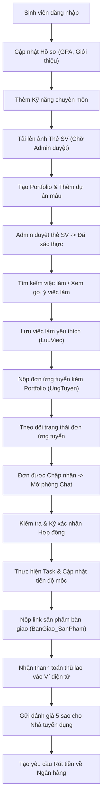
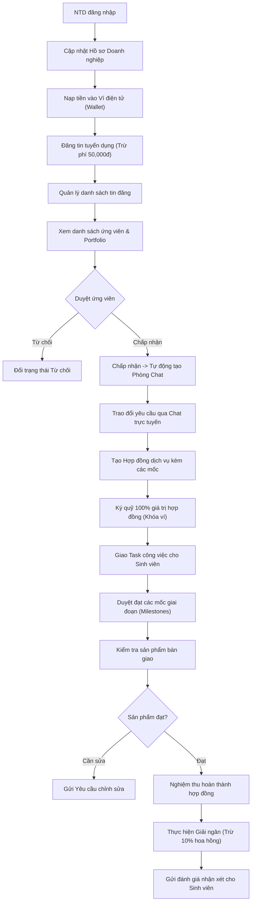
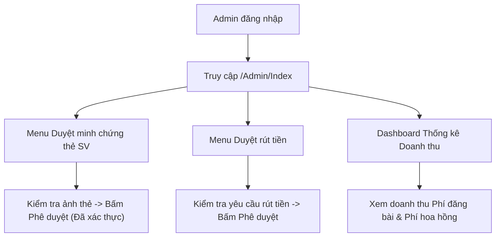
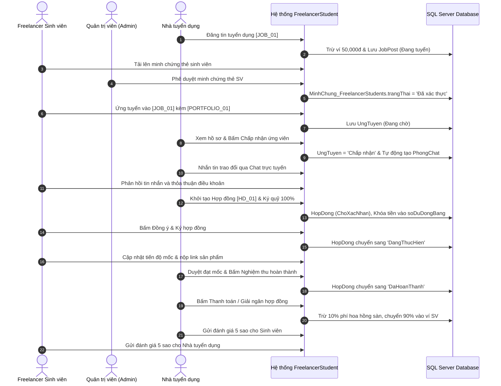
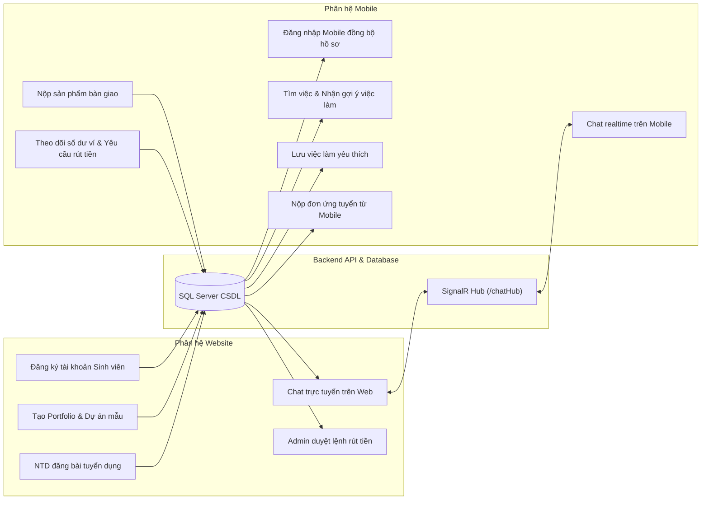

# BÁO CÁO RÀ SOÁT TOÀN DIỆN HỆ THỐNG VÀ BỘ TEST CASE KIỂM THỬ HỆ THỐNG FREELANCERSTUDENT

**Dự án:** Hệ thống Kết nối Việc làm Freelancer Sinh viên (`FreelancerStudent`)  
**Phạm vi rà soát:**
- Backend API: `D:\KLTN\KLTN\Improve\FreelancerStudent.API`
- Website: `D:\KLTN\KLTN\Improve\FreelancerStudent.Web`
- Mobile: `D:\KLTN\KLTN\Improve\Mobile\freelancerstudent`
- Cơ sở dữ liệu: `D:\KLTN\KLTN\Improve\Database\KLCN040_FREELANCERSTUDENT.sql`

**Nguyên tắc thực hiện:**
1. **Không tự sáng tạo:** Không tự đặt thêm Controller, Action, API Endpoint, trang giao diện, nút bấm, bảng hoặc cột CSDL không tồn tại trong mã nguồn.
2. **Tiêu chuẩn 2 điều kiện:** Chỉ đưa vào Test Case những chức năng đồng thời đáp ứng: **(1) Có giao diện người dùng thực tế** và **(2) Có mã nguồn xử lý nghiệp vụ thực tế**.
3. **Luồng sử dụng thực tế:** Bộ Test Case được xây dựng theo chuỗi sử dụng từ Đăng ký, Đăng nhập, Thiết lập hồ sơ, Quản lý tin, Ứng tuyển, Ký kết hợp đồng, Bàn giao đến Nghiệm thu, Thanh toán và Đánh giá.
4. **Dữ liệu mẫu chung:** Sử dụng các biến mẫu `[...]` cho toàn bộ tài khoản và dữ liệu nghiệp vụ, không mặc định thông tin cá nhân của bất kỳ thành viên nào.

---

# PHẦN 1. KẾT QUẢ RÀ SOÁT PROJECT

## 1.1. Phân hệ Backend API (`FreelancerStudent.API`)

Phân hệ Backend được xây dựng trên nền tảng **ASP.NET Core 8.0 Web API**, quản trị dữ liệu thông qua **Entity Framework Core** kết nối SQL Server bằng `AppDbContext`. Kiến trúc hệ thống phân tầng rõ ràng: `Controllers` $\rightarrow$ `Services` (Interfaces & Implementations) $\rightarrow$ `AppDbContext` $\rightarrow$ Database.

Hệ thống cung cấp **18 API Controllers** và **1 SignalR Hub (`ChatHub` tại `/chatHub`)**:

1. **`AuthController` (`api/Auth`)**:
   - `POST api/Auth/DangNhap`: Tiếp nhận `DangNhap_RequestDTO` (`tentaikhoan`, `matkhau`), kiểm tra tài khoản, so sánh mật khẩu băm BCrypt, kiểm tra trạng thái tài khoản (`status == 'ACTIVE'`), cấp phát JWT Bearer Token kèm thông tin vai trò.
   - `POST api/Auth/dangky`: Tiếp nhận `DangKy_RequestDTO`, tạo bản ghi trong bảng `Users`, tự động khởi tạo bản ghi trong `Wallet` (số dư 0đ) và hồ sơ tương ứng trong `FreelancerStudents` (nếu vai trò SV) hoặc `NhaTuyenDung` (nếu vai trò NTD).
   - `GET api/Auth/ThongTinTaiKhoan`: Trả về thông tin chi tiết của người dùng đang đăng nhập dựa trên Claims của JWT Token.
   - `PUT api/Auth/CapNhatThongTinTaiKhoan`: Cập nhật `hovaten`, `sodienthoai` trong bảng `Users`.
   - `POST api/Auth/CapNhatAvatar`: Tiếp nhận file ảnh multipart, lưu trữ vào `/uploads/avatars/` và cập nhật đường dẫn vào `Users.avatar`.
   - `PUT api/Auth/DoiMatKhau`: Tiếp nhận `DoiMatKhau_RequestDTO` (`matKhauHienTai`, `matKhauMoi`, `xacNhanMatKhauMoi`), xác minh mật khẩu cũ bằng BCrypt, băm mật khẩu mới và lưu vào `Users.matkhau`.
   - `POST api/Auth/forgot-password`: Endpoint tiếp nhận yêu cầu quên mật khẩu (trả về mã xác nhận mô phỏng).

2. **`JobPostController` (`api/JobPost`)**:
   - `GET api/JobPost/DanhSachJobPost`: Lấy danh sách việc làm công khai kèm tìm kiếm từ khóa, lọc theo chuyên ngành, khoảng ngân sách, phân trang.
   - `GET api/JobPost/ChiTietJobPost/{id}`: Lấy chi tiết bài tuyển dụng, thông tin doanh nghiệp, kỹ năng yêu cầu.
   - `POST api/JobPost/TaoJob`: Nhà tuyển dụng tạo tin mới (`TaoJobPost_RequestDTO`). Tự động kiểm tra số dư ví phải $\ge$ 50,000đ (phí đăng bài), trừ tiền ví `Wallet`, ghi `LichSuGiaoDich` loại `PhiDangBai`, tạo bản ghi `JobPost` ở trạng thái `Đang tuyển`.
   - `GET api/JobPost/CuaToi`: Lấy danh sách các tin tuyển dụng do chính NTD hiện tại đăng.
   - `PUT api/JobPost/CapNhat`: Chỉnh sửa nội dung bài đăng tuyển dụng.
   - `POST api/JobPost/UngTuyen`: Sinh viên gửi đơn ứng tuyển (`UngTuyen_RequestDTO`). Kiểm tra điều kiện: thẻ sinh viên đã được Admin duyệt (`trangThaiXacMinh == 'Đã xác thực'`) và niên khóa còn hạn; ghi bản ghi vào `UngTuyen` với trạng thái `Đang chờ`.
   - `GET api/JobPost/DanhSachUngTuyen/{maJobPost}`: Lấy danh sách ứng viên nộp hồ sơ vào bài đăng cụ thể.
   - `PUT api/JobPost/DuyetUngTuyen`: Nhà tuyển dụng duyệt đơn (`maUngTuyen`, `trangThai: Chấp nhận / Từ chối`). Khi `Chấp nhận`, hệ thống tự động khởi tạo phòng chat trong `PhongChat` giữa NTD và ứng viên.
   - `GET api/JobPost/GoiYChoFreelancer`: Phân tích kỹ năng của sinh viên trong `FreelancerStudent_KyNang` để gợi ý các bài đăng tuyển dụng có kỹ năng tương thích cao nhất.
   - `GET api/JobPost/GoiYKyNangTheoTieuDe`: Gợi ý kỹ năng tự động dựa trên tiêu đề bài tuyển dụng.

3. **`HopDongController` (`api/HopDong`)**:
   - `GET api/HopDong/danh-sach`: Lấy danh sách hợp đồng của Nhà tuyển dụng.
   - `GET api/HopDong/danh-sach-freelancer`: Lấy danh sách hợp đồng của Freelancer Sinh viên.
   - `GET api/HopDong/chi-tiet/{id}`: Lấy toàn bộ thông tin hợp đồng, điều khoản, số tiền ký quỹ, danh sách giai đoạn (`GiaiDoan_HopDong`) và Task công việc.
   - `POST api/HopDong/tao-moi`: NTD tạo hợp đồng từ đơn ứng tuyển đã duyệt (`TaoHopDong_RequestDTO`), lưu mốc giai đoạn, hợp đồng có trạng thái ban đầu là `ChoXacNhan`.
   - `PUT api/HopDong/ky-quy/{id}`: NTD thực hiện ký quỹ 100% giá trị hợp đồng. Tiền từ `soDuKhaDung` chuyển sang `soDuDongBang` trong bảng `Wallet`, ghi `LichSuGiaoDich` loại `KyQuyHopDong`.
   - `PUT api/HopDong/xac-nhan`: Sinh viên xác nhận đồng ý (`dongY = true`) hoặc từ chối hợp đồng. Nếu từ chối, tự động hoàn trả tiền ký quỹ từ đóng băng về khả dụng cho NTD. Nếu đồng ý và đã ký quỹ đủ, hợp đồng chuyển sang `DangThucHien`.
   - `PUT api/HopDong/danh-gia-giai-doan/{maGiaiDoan}`: NTD duyệt đạt (`Dat`) hoặc yêu cầu làm lại cho một mốc giai đoạn.
   - `PUT api/HopDong/nghiem-thu/{id}`: Nghiệm thu tổng thể dự án. Kiểm tra tất cả các giai đoạn trong `GiaiDoan_HopDong` phải có trạng thái `Dat`, sau đó chuyển hợp đồng sang `DaHoanThanh`.
   - `POST api/HopDong/thanh-toan/{id}`: NTD giải ngân. Khấu trừ 10% phí hoa hồng hệ thống, chuyển 90% thù lao còn lại vào `soDuKhaDung` của Freelancer Sinh viên, giải phóng `soDuDongBang` của NTD, chuyển hợp đồng sang `DaThanhToan`.
   - `POST api/HopDong/huy-hop-dong/{id}`: Hủy hợp đồng và tự động hoàn trả tiền ký quỹ nếu chưa có giai đoạn nào nghiệm thu.

4. **`BanGiaoSanPhamController` (`api/BanGiaoSanPham`)**:
   - `POST api/BanGiaoSanPham`: Sinh viên gửi link sản phẩm bàn giao (GitHub, Google Drive) kèm ghi chú, ghi bản ghi vào `BanGiao_SanPham` (`trangThai = 'ChoNghiemThu'`).
   - `GET api/BanGiaoSanPham/hopdong/{maHopDong}`: Lấy lịch sử bàn giao của hợp đồng.
   - `POST api/BanGiaoSanPham/yeucauchinhsua`: NTD gửi yêu cầu sửa đổi, ghi vào bảng `YeuCauChinhSua`, đổi trạng thái bàn giao thành `YeuCauChinhSua`.
   - `PUT api/BanGiaoSanPham/nghiemthu`: NTD xác nhận nghiệm thu sản phẩm bàn giao.

5. **`TaskCongViecController` (`api/TaskCongViec`)**:
   - CRUD các nhiệm vụ nhỏ thuộc hợp đồng: `GET api/TaskCongViec/hop-dong/{maHopDong}`, `POST api/TaskCongViec`, `PUT api/TaskCongViec/{id}`, `PUT api/TaskCongViec/{id}/trang-thai`, `DELETE api/TaskCongViec/{id}`. Cập nhật bảng `Task_CongViec`.

6. **`ChatController` & SignalR Hub (`api/Chat` & `/chatHub`)**:
   - `POST api/Chat/TaoHoacLayPhong`: Khởi tạo hoặc lấy `maPhongChat` giữa 2 người dùng.
   - `GET api/Chat/DanhSachPhong`: Danh sách phòng chat kèm tin nhắn cuối và người nhận.
   - `GET api/Chat/TinNhan/{phongChatId}`: Lấy lịch sử tin nhắn của phòng chat.
   - `POST api/Chat/GuiTinNhan`: Gửi tin nhắn text hoặc file đính kèm, ghi vào `TinNhanChat` và `FileGhimChat`.
   - `ChatHub`: Broadcast realtime tới connection qua phương thức `ReceiveMessage`.

7. **`WalletController` (`api/Wallet`)**:
   - `GET api/Wallet/LayViTheoUser`: Lấy số dư khả dụng (`soDuKhaDung`) và đóng băng (`soDuDongBang`).
   - `GET api/Wallet/LichSuGiaoDich`: Lấy biến động số dư từ bảng `LichSuGiaoDich`.
   - `POST api/Wallet/TaoYeuCauRutTien`: Tạo lệnh rút tiền, kiểm tra tối thiểu 50,000đ và không vượt quá số dư khả dụng, chuyển tiền sang `soDuDongBang` tạm giữ chờ Admin duyệt.
   - `GET api/Wallet/DanhSachRutTien`: Xem danh sách các yêu cầu rút tiền của tài khoản.
   - `POST api/Wallet/XacNhanRutTienMoPhong`: Hỗ trợ kiểm thử luồng rút tiền.

8. **`GiaoDichNapTienController` (`api/GiaoDichNapTien`)**:
   - `POST api/GiaoDichNapTien/TaoGiaoDich`: Tạo mã giao dịch nạp tiền, sinh QR VietQR.
   - `GET api/GiaoDichNapTien/TrangThai/{maGiaoDich}`: Kiểm tra trạng thái nạp tiền.
   - `POST api/GiaoDichNapTien/XacNhanMoPhong`: Xác nhận nạp tiền tự động trong môi trường phát triển/kiểm thử.

9. **`FreelancerStudentController` (`api/FreelancerStudent`)**:
   - `GET api/FreelancerStudent/DanhSachFreelancerStudent`: Danh sách sinh viên công khai.
   - `GET api/FreelancerStudent/Profile/{id}` & `GET api/FreelancerStudent/ChiTiet`: Chi tiết hồ sơ, điểm GPA, chuyên ngành, danh sách kỹ năng, danh mục portfolio.
   - `PUT api/FreelancerStudent/CapNhatHoSo`: Cập nhật GPA, giới thiệu bản thân.

10. **`NhaTuyenDungController` (`api/NhaTuyenDung`)**:
    - `GET api/NhaTuyenDung/DanhSachNhaTuyenDung`: Danh sách doanh nghiệp tuyển dụng.
    - `GET api/NhaTuyenDung/Profile/{id}` & `GET api/NhaTuyenDung/Profile/ByUser`: Lấy thông tin công ty, mã số thuế, website, quy mô nhân sự.

11. **`PortfolioController` (`api/Portfolio`)**:
    - Quản lý bộ hồ sơ năng lực (`Portfolio`) và dự án thành phần (`DuAn_Trong_Portfolio`). Hỗ trợ thêm, sửa, xóa dự án mẫu và link demo GitHub.

12. **`MinhChungController` (`api/MinhChung`)**:
    - `POST api/MinhChung/quet-the-sinh-vien`: Tiếp nhận ảnh thẻ sinh viên, xử lý OCR trích xuất thông tin.
    - `POST api/MinhChung/xac-nhan-the-sinh-vien`: Lưu thông tin MSSV, niên khóa và ảnh thẻ vào `MinhChung_FreelancerStudents` với trạng thái `Đang gửi`.
    - `GET api/MinhChung/chuyen-nganh`: Lấy danh sách các chuyên ngành từ bảng `ChuyenNganh`.
    - `GET api/MinhChung/lich-su`: Lịch sử các lần gửi minh chứng của sinh viên.
    - `GET api/MinhChung/thong-tin-hien-tai`: Trạng thái xác thực thẻ hiện tại của sinh viên (`Chưa xác thực`, `Đang gửi`, `Đã xác thực`, `Từ chối`).

13. **`YeuThichController` (`api/YeuThich`)**:
    - `POST api/YeuThich/luu-viec` & `DELETE api/YeuThich/bo-luu-viec`: Lưu hoặc bỏ lưu công việc vào `LuuViec_ChoFreelancer`.
    - `GET api/YeuThich/danh-sach-viec-da-luu`: Lấy danh sách các công việc đã lưu.
    - `POST api/YeuThich/luu-freelancer` & `DELETE api/YeuThich/bo-luu-freelancer`: Lưu hồ sơ sinh viên vào `FreelancerYeuThich`.
    - `GET api/YeuThich/danh-sach-freelancer-yeu-thich`: Lấy danh sách sinh viên yêu thích.

14. **`DanhGiaController` (`api/DanhGia`)**:
    - `POST api/DanhGia`: Gửi đánh giá đối tác (số sao 1-5, bình luận). Kiểm tra ràng buộc hợp đồng đã `DaThanhToan` và chặn đánh giá trùng (`UQ_DanhGia_HopDong_NguoiDanhGia`).
    - `PUT api/DanhGia/{id}`: Cho phép sửa đánh giá tối đa 1 lần, ghi nhật ký vào `DanhGia_NhanXet_LichSu`.
    - `GET api/DanhGia/hop-dong/{maHopDong}`: Lấy đánh giá của hợp đồng.
    - `GET api/DanhGia/freelancer/{maFreelancer}` & `GET api/DanhGia/nha-tuyen-dung/{maNhaTuyenDung}`: Lấy danh sách đánh giá và điểm sao trung bình.

15. **`ThongBaoController` (`api/ThongBao`)**:
    - Lấy danh sách thông báo hệ thống, đếm thông báo chưa đọc, đánh dấu đã đọc (`PUT api/ThongBao/da-doc/{id}`).

16. **`BaiDangTimViecController` (`api/BaiDangTimViec`)**:
    - Quản lý bài đăng tìm việc tự do của sinh viên: `TatCa`, `TaoBaiDang`, `CuaToi`, `CapNhat`, `DoiTrangThai`, `Xoa`.

17. **`AdminController` (`api/Admin`)**:
    - Các API quản trị nội bộ: Duyệt minh chứng thẻ SV, duyệt rút tiền, xử lý khóa tài khoản, điều chỉnh số dư, cấu hình phí hoa hồng và phí đăng bài.

18. **`WeatherForecastController`**:
    - Controller mẫu mặc định của .NET Core template, không phục vụ nghiệp vụ (loại khỏi phạm vi kiểm thử).

---

## 1.2. Phân hệ Website (`FreelancerStudent.Web`)

Phân hệ Website được xây dựng bằng kiến trúc **ASP.NET Core MVC (Razor Views)**, lưu phiên làm việc qua **Session State** và HttpContext Cookie, giao tiếp với Backend thông qua các lớp WebService (`AuthWebService`, `JobPostWebService`, `HopDongWebService`, `WalletWebService`, `DanhGiaWebService`, `AdminWebService`).

Hệ thống có **12 MVC Controllers** và **13 thư mục Views**:

| STT | MVC Controller | File Controller | Các Views (.cshtml) tương ứng | Chức năng nghiệp vụ và Thao tác giao diện thực tế |
|:---:|---|---|---|---|
| 1 | `AccountController` | `Controllers/AccountController.cs` | `Views/Account/DangNhap.cshtml`<br>`Views/Account/DangKy.cshtml`<br>`Views/Account/ThietLapTaiKhoan.cshtml`<br>`Views/Account/MinhChung.cshtml` | Form đăng nhập; Form đăng ký chọn Tab Sinh viên/NTD; Trang Thiết lập tài khoản (Form cập nhật thông tin cá nhân, form đổi mật khẩu tab Bảo mật, form cập nhật avatar); Form tải ảnh thẻ SV gửi minh chứng. |
| 2 | `FreelancerStudentController` | `Controllers/FreelancerStudentController.cs` | `Views/FreelancerStudent/HoSo.cshtml`<br>`Views/FreelancerStudent/Profile.cshtml`<br>`Views/FreelancerStudent/Portfolio.cshtml`<br>`Views/FreelancerStudent/Search.cshtml`<br>`Views/FreelancerStudent/Index.cshtml`<br>`Views/FreelancerStudent/DanhSachNopTuyen.cshtml`<br>`Views/FreelancerStudent/DangTinTimViec.cshtml`<br>`Views/FreelancerStudent/QuanLyTimViec.cshtml` | Trang Hồ sơ (Form cập nhật GPA, Lời giới thiệu, Danh sách kỹ năng, nút thêm/xóa kỹ năng); Trang Portfolio (Nút tạo portfolio, form thêm dự án mẫu); Danh sách đơn ứng tuyển đã nộp; Bộ lọc và tìm kiếm ứng viên; Đăng và quản lý bài tìm việc. |
| 3 | `JobPostController` | `Controllers/JobPostController.cs` | `Views/JobPost/Index.cshtml`<br>`Views/JobPost/Detail.cshtml`<br>`Views/JobPost/Create.cshtml`<br>`Views/JobPost/Edit.cshtml`<br>`Views/JobPost/QuanLyTinTuyenDung.cshtml`<br>`Views/JobPost/UngTuyen.cshtml`<br>`Views/JobPost/ViecDaLuu.cshtml` | Danh sách việc làm; Thanh tìm kiếm & bộ lọc chuyên ngành/ngân sách; Form đăng tin tuyển dụng (Nút gợi ý kỹ năng, nút đăng tin trừ phí 50k); Form chỉnh sửa và nút đổi trạng thái bài đăng; Form ứng tuyển (chọn portfolio, lương, thời gian); Danh sách việc đã lưu. |
| 4 | `NhaTuyenDungController` | `Controllers/NhaTuyenDungController.cs` | `Views/NhaTuyenDung/Profile.cshtml`<br>`Views/NhaTuyenDung/DanhSachUngVien.cshtml`<br>`Views/NhaTuyenDung/Search.cshtml`<br>`Views/NhaTuyenDung/FreelancerYeuThich.cshtml`<br>`Views/NhaTuyenDung/Index.cshtml` | Form cập nhật thông tin doanh nghiệp (Tên công ty, MST, website); Danh sách ứng viên theo tin tuyển dụng (Nút Chấp nhận, Từ chối, nút Tạo hợp đồng, nút Nhắn tin); Danh sách Freelancer yêu thích. |
| 5 | `HopDongController` | `Controllers/HopDongController.cs` | `Views/HopDong/Index.cshtml`<br>`Views/HopDong/TaoHopDong.cshtml`<br>`Views/HopDong/ChiTiet.cshtml`<br>`Views/HopDong/ThanhToan.cshtml` | Form tạo hợp đồng mới (thêm các mốc giai đoạn); Trang chi tiết hợp đồng (Nút Ký quỹ hợp đồng, nút Sinh viên Đồng ý ký HĐ, khu vực Task công việc kèm form Thêm Task, nút Duyệt đạt giai đoạn, nút Nghiệm thu hoàn thành, nút Thanh toán/Giải ngân). |
| 6 | `BanGiaoSanPhamController` | `Controllers/BanGiaoSanPhamController.cs` | `Views/BanGiaoSanPham/Index.cshtml` | Trang Bàn giao sản phẩm: Form nộp link sản phẩm và ghi chú; Danh sách lịch sử bàn giao; Nút gửi Yêu cầu chỉnh sửa của NTD; Nút Xác nhận nghiệm thu. |
| 7 | `ChatController` | `Controllers/ChatController.cs` | `Views/Chat/Index.cshtml` | Giao diện Chat trực tuyến (SignalR): Danh sách cuộc trò chuyện; Khung hiển thị tin nhắn; Ô nhập tin nhắn văn bản; Nút đính kèm tệp/hình ảnh; Nút Gửi tin nhắn. |
| 8 | `WalletController` | `Controllers/WalletController.cs` | `Views/Wallet/Index.cshtml` | Trang Ví điện tử: Hiển thị số dư khả dụng và số dư đóng băng; Form nạp tiền (sinh mã VietQR hoặc nạp mô phỏng); Form yêu cầu rút tiền về tài khoản ngân hàng; Bảng lịch sử giao dịch. |
| 9 | `DanhGiaController` | `Controllers/DanhGiaController.cs` | `Views/DanhGia/CongViecDaHoanThanh.cshtml`<br>`Views/DanhGia/_FormDanhGia.cshtml`<br>`Views/DanhGia/_DanhSachDanhGia.cshtml` | Trang công việc đã hoàn thành; Form đánh giá đối tác (chọn số sao 1-5, nhập nhận xét); Nút gửi đánh giá; Nút chỉnh sửa đánh giá (cho phép sửa tối đa 1 lần). |
| 10 | `AdminController` | `Controllers/AdminController.cs` | `Views/Admin/Index.cshtml`<br>`Views/Admin/DanhSachNguoiDung.cshtml`<br>`Views/Admin/DuyetMinhChung.cshtml`<br>`Views/Admin/DuyetRutTien.cshtml`<br>`Views/Admin/DieuChinhSoDu.cshtml`<br>`Views/Admin/QuanLyHopDong.cshtml`<br>`Views/Admin/XuLyTaiKhoan.cshtml`<br>`Views/Admin/CauHinhHeThong.cshtml` | Dashboard quản trị thống kê doanh thu; Danh sách duyệt minh chứng thẻ SV (Nút Duyệt/Từ chối); Danh sách duyệt yêu cầu rút tiền; Danh sách người dùng (nút khóa/mở khóa tài khoản); Form điều chỉnh số dư ví; Cấu hình phí hoa hồng và phí đăng bài. |
| 11 | `ThongBaoController` | `Controllers/ThongBaoController.cs` | `Views/ThongBao/Index.cshtml` | Danh sách thông báo hệ thống, biến động số dư, hợp đồng; Nút đánh dấu đã đọc. |
| 12 | `HomeController` | `Controllers/HomeController.cs` | `Views/Home/Index.cshtml`<br>`Views/Home/Privacy.cshtml` | Trang chủ hệ thống hiển thị việc làm mới nhất, banner và chính sách. |

---

## 1.3. Phân hệ Mobile (`Mobile/freelancerstudent`)

Ứng dụng di động được xây dựng bằng **Flutter (Dart)**, kết nối Backend thông qua `Dio` HTTP Client (`TrinhKhachApi`), lưu trữ JWT Token và Refresh Token qua `FlutterSecureStorage` (`DichVuLuuTruBaoMat`).

Hệ thống có **35 Màn hình & Widgets chuyên biệt**, kết nối đồng bộ 100% với Backend API:

| Nhóm chức năng | Tệp Màn hình Mobile | Lớp Service & API kết nối | Thao tác giao diện thực tế trên Mobile |
|---|---|---|---|
| **Xác thực & Tài khoản** | `views/auth/man_hinh_dang_nhap.dart`<br>`views/auth/man_hinh_dang_ky.dart`<br>`views/profile/man_hinh_doi_mat_khau.dart` | `DichVuXacThuc`<br>API: `api/Auth/DangNhap`, `api/Auth/dangky`, `api/Auth/DoiMatKhau` | Ô nhập tài khoản/mật khẩu, nút Đăng nhập; Form đăng ký tài khoản sinh viên; Form đổi mật khẩu; Quản lý phiên làm việc bằng Bearer Token. |
| **Hồ sơ cá nhân** | `views/profile/man_hinh_ho_so.dart`<br>`views/profile/man_hinh_chinh_sua_ho_so.dart`<br>`views/profile/man_hinh_minh_chung_the_sv.dart` | `DichVuFreelancer`, `DichVuMinhChung`<br>API: `api/FreelancerStudent/Profile`, `api/MinhChung/thong-tin-hien-tai` | Xem hồ sơ năng lực; Form chỉnh sửa GPA, giới thiệu; Quản lý kỹ năng; Màn hình xem trạng thái xác minh thẻ sinh viên (Đã xác thực / Đang gửi). |
| **Tìm việc & Chi tiết** | `views/home/man_hinh_trang_chu.dart`<br>`views/job_detail/man_hinh_chi_tiet_cong_viec.dart`<br>`views/home/widgets/bang_loc_cong_viec.dart`<br>`views/job_detail/man_hinh_cong_viec_da_luu.dart` | `DichVuCongViec`, `DichVuYeuThich`<br>API: `api/JobPost/DanhSachJobPost`, `api/JobPost/GoiYChoFreelancer`, `api/YeuThich/luu-viec` | Thanh tìm kiếm công việc; Modal bottom sheet lọc chuyên ngành; Tab việc làm gợi ý phù hợp hồ sơ; Nút bookmark lưu/bỏ lưu công việc yêu thích. |
| **Ứng tuyển** | `views/job_detail/bang_ung_tuyen_cong_viec.dart`<br>`views/applications/man_hinh_don_ung_tuyen_cua_toi.dart` | `DichVuCongViec`<br>API: `api/JobPost/UngTuyen`, `api/JobPost/DanhSachUngTuyen` | Nút "Ứng tuyển ngay" mở Bottom Sheet nộp đơn (chọn Portfolio, nhập thù lao đề xuất, thời gian, thư giới thiệu); Màn hình danh sách đơn ứng tuyển đã nộp. |
| **Hợp đồng & Tiến độ** | `views/hop_dong/man_hinh_danh_sach_hop_dong.dart`<br>`views/hop_dong/man_hinh_chi_tiet_hop_dong.dart`<br>`views/hop_dong/man_hinh_ban_giao_san_pham.dart`<br>`views/tien_do/man_hinh_tien_do.dart` | `DichVuHopDong`, `DichVuBanGiao`<br>API: `api/HopDong/danh-sach-freelancer`, `api/HopDong/xac-nhan`, `api/BanGiaoSanPham` | Danh sách hợp đồng; Xem chi tiết điều khoản; Nút "Xác nhận ký hợp đồng"; Danh sách mốc tiến độ giai đoạn; Màn hình nộp link sản phẩm bàn giao GitHub/Drive. |
| **Chat thời gian thực** | `views/chat/man_hinh_danh_sach_chat.dart`<br>`views/chat/man_hinh_chi_tiet_chat.dart` | `DichVuChat`, `DichVuChatSignalR`<br>API: `api/Chat/DanhSachPhong`, `api/Chat/TinNhan`, `/chatHub` | Danh sách hội thoại; Khung chat thời gian thực qua SignalR; Nhắn tin văn bản; Nút chọn và tải ảnh đính kèm. |
| **Ví tiền & Rút tiền** | `views/wallet/man_hinh_vi_tien.dart`<br>`views/wallet/man_hinh_lich_su_giao_dich.dart`<br>`views/wallet/man_hinh_nap_tien.dart`<br>`views/wallet/man_hinh_rut_tien.dart` | `DichVuViTien`<br>API: `api/Wallet/LayViTheoUser`, `api/Wallet/LichSuGiaoDich`, `api/Wallet/TaoYeuCauRutTien` | Màn hình hiển thị số dư ví khả dụng và đóng băng; Danh sách lịch sử giao dịch; Form rút tiền về tài khoản ngân hàng. |
| **Đánh giá đối tác** | `views/danh_gia/man_hinh_danh_gia.dart`<br>`views/danh_gia/man_hinh_danh_sach_tat_ca_danh_gia.dart` | `DichVuDanhGia`<br>API: `api/DanhGia`, `api/DanhGia/hop-dong` | Form chấm số sao (1-5 sao), ô nhập nhận xét đối tác; Nút gửi đánh giá; Màn hình danh sách các đánh giá nhận được. |
| **Bài đăng sinh viên** | `views/student_posts/man_hinh_danh_sach_bai_dang_sinh_vien.dart`<br>`views/student_posts/man_hinh_tao_bai_dang_sinh_vien.dart`<br>`views/student_posts/man_hinh_quan_ly_bai_dang_sinh_vien.dart` | `DichVuBaiDangSinhVien`<br>API: `api/BaiDangTimViec/*` | Xem, đăng tin tìm việc cá nhân và quản lý trạng thái tin của sinh viên. |

---

## 1.4. Cơ sở dữ liệu SQL Server (`KLCN040_FREELANCERSTUDENT.sql`)

Cơ sở dữ liệu gồm **40 bảng thực tế**, thiết lập toàn vẹn dữ liệu qua khóa chính (`PK`), khóa ngoại (`FK`) và các ràng buộc duy nhất (`UNIQUE`):

- **Nhóm Tài khoản & Hồ sơ:** `Users`, `Roles`, `FreelancerStudents`, `NhaTuyenDung`, `Admin`, `ChuyenNganh`, `KyNang`, `FreelancerStudent_KyNang`, `Portfolio`, `DuAn_Trong_Portfolio`, `MinhChung_FreelancerStudents`, `LichSu_XuLyTaiKhoan`.
- **Nhóm Việc làm & Ứng tuyển:** `JobPost`, `UngTuyen`, `UngThue`, `BaiDangTimViec_FreelancerStudent`, `LuuViec_ChoFreelancer`, `FreelancerYeuThich`.
- **Nhóm Hợp đồng & Công việc:** `HopDong`, `GiaiDoan_HopDong`, `Task_CongViec`, `BanGiao_SanPham`, `YeuCauChinhSua`, `YeuCauGiaHanDeadline`.
- **Nhóm Tài chính & Ví điện tử:** `Wallet`, `LichSuGiaoDich`, `YeuCauNapTien`, `YeuCauRutTien`, `GiaoDichNapTien`, `DieuChinhSoDu`, `TaiKhoanNganHang`, `CauHinhPhiHoaHong_PhiDangBai`.
- **Nhóm Tương tác & Đánh giá:** `PhongChat`, `TinNhanChat`, `FileGhimChat`, `DanhGia_NhanXet`, `DanhGia_NhanXet_LichSu`, `ThongBao`.
- **Nhóm Tranh chấp & Hỗ trợ (Chưa có UI):** `TranhChap`, `BANGCHUNG_TRANHCHAP`, `YeuCauHoTro`.

---

# PHẦN 2. DANH MỤC CHỨC NĂNG ĐÃ XÁC MINH

Căn cứ vào nguyên tắc kiểm toán: **Chỉ đưa vào danh sách đủ điều kiện kiểm thử những chức năng có giao diện người dùng thực tế và có mã nguồn xử lý nghiệp vụ kết nối với Backend/Database.**

### 2.1. Danh mục chức năng ĐỦ ĐIỀU KIỆN KIỂM THỬ (Có Giao diện & Xử lý thực tế)

| STT | Mã chức năng | Tên chức năng | Phân hệ | Căn cứ mã nguồn xác minh |
|:---:|:---:|---|:---:|---|
| 1 | `CN_CB_01` | Đăng ký tài khoản (Sinh viên & NTD) | Website & Mobile | Web: `AccountController.DangKy`, View `DangKy.cshtml`. Mobile: `man_hinh_dang_ky.dart`. API: `POST api/Auth/dangky`. DB: `Users`, `Wallet`, `FreelancerStudents`, `NhaTuyenDung`. |
| 2 | `CN_CB_02` | Đăng nhập tài khoản | Website & Mobile | Web: `AccountController.DangNhap`, View `DangNhap.cshtml`. Mobile: `man_hinh_dang_nhap.dart`. API: `POST api/Auth/DangNhap`. DB: `Users`. |
| 3 | `CN_CB_03` | Đăng xuất tài khoản | Website & Mobile | Web: Header dropdown, `AccountController.DangXuat`. Mobile: Menu `man_hinh_ho_so.dart`, xóa Bearer Token. |
| 4 | `CN_CB_04` | Đổi mật khẩu tài khoản | Website & Mobile | Web: `Views/Account/ThietLapTaiKhoan.cshtml` (tab Bảo mật), `AccountController.DoiMatKhau`. Mobile: `man_hinh_doi_mat_khau.dart`. API: `PUT api/Auth/DoiMatKhau`. DB: `Users.matkhau`. |
| 5 | `CN_CB_05` | Phân quyền người dùng (Role-based) | Toàn hệ thống | Phân quyền 3 vai trò (`1: Sinh viên`, `2: NTD`, `3: Admin`). Web chặn route `/Admin`, Mobile chuyển layout tương ứng vai trò, API kiểm tra `[Authorize(Roles = "...")]`. |
| 6 | `CN_W1_01` | Xem và lựa chọn Chuyên ngành | Website | Dropdown chọn Chuyên ngành tại form Đăng ký (`DangKy.cshtml`) và bộ lọc tìm kiếm (`JobPost/Index.cshtml`). API: `GET api/MinhChung/chuyen-nganh`. DB: `ChuyenNganh`. |
| 7 | `CN_W1_02` | Quản lý tài khoản cá nhân | Website | `Views/Account/ThietLapTaiKhoan.cshtml`, `AccountController.CapNhatThongTinTaiKhoan`, `CapNhatAvatar`. DB: `Users`. |
| 8 | `CN_W1_03` | Quản lý hồ sơ Sinh viên | Website | `Views/FreelancerStudent/HoSo.cshtml`, các action `CapNhatGPA`, `CapNhatGioiThieu`, `CapNhatThongTinCoBan`. DB: `FreelancerStudents`. |
| 9 | `CN_W1_04` | Quản lý Kỹ năng chuyên môn | Website | `Views/FreelancerStudent/HoSo.cshtml`, form thêm/xóa kỹ năng, `FreelancerStudentController.CapNhatKyNang`. DB: `FreelancerStudent_KyNang`. |
| 10 | `CN_W1_05` | Tải lên Minh chứng thẻ Sinh viên | Website | `Views/Account/MinhChung.cshtml`, `FreelancerStudent/GuiMinhChung`, tải 2 mặt thẻ. DB: `MinhChung_FreelancerStudents`. |
| 11 | `CN_W1_06` | Quản lý Portfolio & Dự án mẫu | Website | `Views/FreelancerStudent/Portfolio.cshtml`, các action `AddProject`, `UpdateProject`, `DeleteProject`. DB: `Portfolio`, `DuAn_Trong_Portfolio`. |
| 12 | `CN_W1_07` | Tìm kiếm và xem chi tiết việc làm | Website | `Views/JobPost/Index.cshtml`, `Views/JobPost/Detail.cshtml`, tìm từ khóa, lọc chuyên ngành/ngân sách. |
| 13 | `CN_W1_08` | Quản lý ứng tuyển (Nộp đơn & Theo dõi) | Website | `Views/JobPost/UngTuyen.cshtml`, `JobPostController.UngTuyen`, `Views/FreelancerStudent/DanhSachNopTuyen.cshtml`. DB: `UngTuyen`. |
| 14 | `CN_W2_01` | Quản lý hồ sơ Nhà tuyển dụng | Website | `Views/NhaTuyenDung/Profile.cshtml`, `NhaTuyenDungController.Profile` (Xem, cập nhật thông tin công ty, MST, website). DB: `NhaTuyenDung`. |
| 15 | `CN_W2_02` | Đăng tin tuyển dụng (Gợi ý kỹ năng, trừ phí) | Website | `Views/JobPost/Create.cshtml`, `JobPostController.Create`, kiểm tra số dư ví $\ge$ 50k, trừ phí đăng bài. DB: `JobPost`, `Wallet`. |
| 16 | `CN_W2_03` | Quản lý tin tuyển dụng (Sửa tin, đổi trạng thái) | Website | `Views/JobPost/QuanLyTinTuyenDung.cshtml`, `JobPostController.Edit`, `DoiTrangThai`. DB: `JobPost`. |
| 17 | `CN_W2_04` | Quản lý ứng viên & Duyệt đơn ứng tuyển | Website | `Views/NhaTuyenDung/DanhSachUngVien.cshtml`, xem Portfolio, chấp nhận/từ chối đơn. DB: `UngTuyen`, tự động tạo `PhongChat`. |
| 18 | `CN_W2_05` | Tìm kiếm Freelancer & Lưu yêu thích | Website | `Views/FreelancerStudent/Search.cshtml`, `Views/NhaTuyenDung/FreelancerYeuThich.cshtml`, `ToggleLuuFreelancer`. DB: `FreelancerYeuThich`. |
| 19 | `CN_W2_06` | Trao đổi qua Chat trực tuyến | Website | `Views/Chat/Index.cshtml`, `ChatController.Index`, `GuiTinNhan`, SignalR `/chatHub`, file đính kèm `FileGhimChat`. DB: `PhongChat`, `TinNhanChat`. |
| 20 | `CN_W3_01` | Tạo và xem chi tiết Hợp đồng | Website | `Views/HopDong/TaoHopDong.cshtml`, `Views/HopDong/ChiTiet.cshtml`, `HopDongController.TaoHopDong`. DB: `HopDong`. |
| 21 | `CN_W3_02` | Ký quỹ hợp đồng và Sinh viên ký xác nhận | Website | `Views/HopDong/ChiTiet.cshtml`, `HopDongController.KyQuy` (trừ ví đóng băng), `HopDongController.XacNhan` (chuyển sang `DangThucHien`). |
| 22 | `CN_W3_03` | Quản lý mốc tiến độ & Task công việc | Website | `Views/HopDong/ChiTiet.cshtml`, `HopDongController.ThemTask`, `CapNhatTrangThaiTask`, `DanhGiaGiaiDoan`. DB: `GiaiDoan_HopDong`, `Task_CongViec`. |
| 23 | `CN_W3_04` | Quản lý bàn giao, yêu cầu sửa & nghiệm thu | Website | `Views/BanGiaoSanPham/Index.cshtml`, `TaoBanGiao`, `GuiYeuCau` (sửa), `NghiemThu` (hoàn thành hợp đồng). DB: `BanGiao_SanPham`, `YeuCauChinhSua`. |
| 24 | `CN_W3_05` | Thanh toán / Giải ngân (Trừ 10% hoa hồng) | Website | `Views/HopDong/ThanhToan.cshtml`, `HopDongController.XacNhanThanhToan`, `WalletController.Index`. DB: `HopDong.trangThai = 'DaThanhToan'`, `Wallet`. |
| 25 | `CN_W3_06` | Đánh giá đối tác 2 chiều | Website | `Views/DanhGia/CongViecDaHoanThanh.cshtml`, `_FormDanhGia.cshtml`, `DanhGiaController.Gui`. Chặn đánh giá trùng, sửa tối đa 1 lần. DB: `DanhGia_NhanXet`. |
| 26 | `CN_ADM_01` | Phê duyệt minh chứng thẻ Sinh viên | Website | `Views/Admin/DuyetMinhChung.cshtml`, `AdminController.DuyetMinhChung`, `XuLyMinhChung`. DB: `MinhChung_FreelancerStudents`. |
| 27 | `CN_ADM_02` | Quản lý giao dịch ví & Phê duyệt rút tiền | Website | `Views/Admin/DuyetRutTien.cshtml`, `AdminController.XuLyRutTien`, `DieuChinhSoDu`. DB: `YeuCauRutTien`, `Wallet`. |
| 28 | `CN_ADM_03` | Thống kê Dashboard doanh thu & Người dùng | Website | `Views/Admin/Index.cshtml`, `AdminController.Index`. Truy vấn tổng hợp doanh thu phí đăng bài và phí hoa hồng. |
| 29 | `CN_M4_01` | Hồ sơ năng lực Sinh viên trên Mobile | Mobile | `views/profile/man_hinh_ho_so.dart`, `man_hinh_chinh_sua_ho_so.dart`. API: `api/FreelancerStudent/Profile`, `CapNhatHoSo`. |
| 30 | `CN_M4_02` | Xem minh chứng thẻ SV đã duyệt trên Mobile | Mobile | `views/profile/man_hinh_minh_chung_the_sv.dart`. API: `api/MinhChung/thong-tin-hien-tai`. DB: `MinhChung_FreelancerStudents`. |
| 31 | `CN_M4_03` | Tìm kiếm việc làm & Việc làm gợi ý trên Mobile | Mobile | `views/home/man_hinh_trang_chu.dart`, `bang_loc_cong_viec.dart`. API: `api/JobPost/DanhSachJobPost`, `api/JobPost/GoiYChoFreelancer`. |
| 32 | `CN_M4_04` | Lưu việc làm yêu thích trên Mobile | Mobile | Nút lưu trên thẻ công việc, `views/job_detail/man_hinh_cong_viec_da_luu.dart`. API: `api/YeuThich/luu-viec`. DB: `LuuViec_ChoFreelancer`. |
| 33 | `CN_M4_05` | Ứng tuyển công việc trên Mobile | Mobile | `views/job_detail/bang_ung_tuyen_cong_viec.dart`, `views/applications/man_hinh_don_ung_tuyen_cua_toi.dart`. API: `POST api/JobPost/UngTuyen`. |
| 34 | `CN_M4_06` | Chat trực tiếp thời gian thực trên Mobile | Mobile | `views/chat/man_hinh_danh_sach_chat.dart`, `views/chat/man_hinh_chi_tiet_chat.dart`. API: `api/Chat/*`, SignalR `/chatHub`. |
| 35 | `CN_M4_07` | Xem và xác nhận Hợp đồng trên Mobile | Mobile | `views/hop_dong/man_hinh_danh_sach_hop_dong.dart`, `views/hop_dong/man_hinh_chi_tiet_hop_dong.dart`. API: `api/HopDong/xac-nhan`. |
| 36 | `CN_M4_08` | Cập nhật tiến độ & Nộp sản phẩm trên Mobile | Mobile | `views/tien_do/man_hinh_tien_do.dart`, `views/hop_dong/man_hinh_ban_giao_san_pham.dart`. API: `POST api/BanGiaoSanPham`. |
| 37 | `CN_M4_09` | Theo dõi ví & Gửi yêu cầu rút tiền trên Mobile | Mobile | `views/wallet/man_hinh_vi_tien.dart`, `man_hinh_rut_tien.dart`, `man_hinh_lich_su_giao_dich.dart`. API: `api/Wallet/*`. |
| 38 | `CN_M4_10` | Đánh giá Nhà tuyển dụng trên Mobile | Mobile | `views/danh_gia/man_hinh_danh_gia.dart`. API: `POST api/DanhGia`. DB: `DanhGia_NhanXet`. |

---

### 2.2. Danh mục chức năng CHƯA ĐỦ ĐIỀU KIỆN KIỂM THỬ (Không tạo Test Case chính thức)

1. **Quản lý Thêm / Sửa / Xóa Chuyên ngành (Admin CRUD Chuyên ngành):**
   - *Hiện trạng:* CSDL có bảng `ChuyenNganh`, API `MinhChungController` có `GET api/MinhChung/chuyen-nganh` để nạp dữ liệu. Tuy nhiên trên Website Admin **chưa triển khai giao diện Thêm, Sửa, Xóa chuyên ngành**.
   - *Phân loại:* **`NOT IMPLEMENTED`** (Chưa có giao diện). Không xây dựng Test Case.

2. **Quản lý Phản ánh / Tranh chấp hợp đồng (Dispute Resolution):**
   - *Hiện trạng:* CSDL có các bảng `TranhChap`, `BANGCHUNG_TRANHCHAP`, `YeuCauHoTro`. Tuy nhiên, trên cả Website và Mobile đều **chưa có form hoặc nút bấm gửi đơn tranh chấp/khiếu nại** (chỉ có trạng thái hiển thị text `DangTranhChap`).
   - *Phân loại:* **`NOT IMPLEMENTED`** (Chưa có giao diện người dùng). Không xây dựng Test Case.

3. **Quên mật khẩu qua Email (Password Recovery):**
   - *Hiện trạng:* Mobile có màn hình `man_hinh_quen_mat_khau.dart` gọi `api/Auth/forgot-password`, nhưng API chỉ trả về OTP mô phỏng trong chuỗi kết quả JSON, chưa cấu hình SMTP gửi email thật.
   - *Phân loại:* **`PARTIAL`** (Giao diện chưa hoàn thiện xử lý thực tế). Không xây dựng Test Case chính thức.

---

# PHẦN 3. SƠ ĐỒ VÀ MÔ TẢ LUỒNG KIỂM THỬ

Hệ thống được thiết kế theo các luồng nghiệp vụ liên kết chặt chẽ. Dưới đây là các sơ đồ thể hiện trình tự thực thi thực tế:

### 3.1. Sơ đồ Luồng Đăng ký và Đăng nhập hệ thống

```mermaid
flowchart TD
    A["Bắt đầu"] --> B["Truy cập /Account/Register"]
    B --> C{"Chọn loại tài khoản"}
    C -->|Sinh viên| D["Nhập thông tin SV & Chọn Chuyên ngành"]
    C -->|Nhà tuyển dụng| E["Nhập thông tin Doanh nghiệp & MST"]
    D --> F["Gửi đăng ký -> Tạo User, Wallet(0đ), FreelancerStudent"]
    E --> G["Gửi đăng ký -> Tạo User, Wallet(0đ), NhaTuyenDung"]
    F --> H["Truy cập /Account/Login"]
    G --> H
    H --> I["Nhập tài khoản & Mật khẩu"]
    I --> J{"Xác thực BCrypt"}
    J -->|Hợp lệ| K["Tạo Session & Cấp Bearer Token"]
    J -->|Không hợp lệ| L["Báo lỗi đăng nhập"]
    K --> M{"Kiểm tra Vai trò (maRole)"}
    M -->|maRole = 1 (Sinh viên)| N["Chuyển hướng Menu Freelancer Student"]
    M -->|maRole = 2 (NTD)| O["Chuyển hướng Menu Nhà tuyển dụng"]
    M -->|maRole = 3 (Admin)| P["Chuyển hướng Phân hệ Quản trị /Admin"]
```

---

### 3.2. Sơ đồ Luồng nghiệp vụ Freelancer Sinh viên



---

### 3.3. Sơ đồ Luồng nghiệp vụ Nhà tuyển dụng



---

### 3.4. Sơ đồ Luồng Quản trị viên (Admin)



---

### 3.5. Sơ đồ Luồng phối hợp E2E giữa Freelancer và Nhà tuyển dụng



---

### 3.6. Sơ đồ Luồng liên kết đa nền tảng Website ↔ Mobile




# PHẦN 4. BỘ TEST CASE KIỂM THỬ HỆ THỐNG THEO LUỒNG NGHIỆP VỤ

*(Bộ Test Case được tổ chức theo 6 luồng nghiệp vụ thực tế từ Đăng ký, Đăng nhập đến toàn bộ quy trình sử dụng. Sử dụng biến mẫu `[...]` cho toàn bộ tài khoản và dữ liệu nghiệp vụ để người kiểm thử tự quyết định giá trị cụ thể)*

Cấu trúc bảng 8 cột bắt buộc:
`| Mã Test Case | Tên chức năng & Mục tiêu | Điều kiện tiền đề | Dữ liệu đầu vào (Input) | Các bước thực hiện (Steps) | Kết quả mong đợi (Expected) | Kết quả thực tế (Actual) | Trạng thái |`

---

## 4.1. LUỒNG 1: XÁC THỰC & KHỞI TẠO TÀI KHOẢN (ĐĂNG KÝ, ĐĂNG NHẬP, ĐỔI MẬT KHẨU, PHÂN QUYỀN)

| Mã Test Case | Tên chức năng & Mục tiêu | Điều kiện tiền đề | Dữ liệu đầu vào (Input) | Các bước thực hiện (Steps) | Kết quả mong đợi (Expected) | Kết quả thực tế (Actual) | Trạng thái |
|:---:|---|---|---|---|---|:---:|:---:|
| `TC_AUTH_01` | **Đăng ký tài khoản Freelancer Sinh viên mới trên Website**<br>*(Mục tiêu: Tạo mới tài khoản sinh viên, tự động sinh ví 0đ và bản ghi hồ sơ sinh viên)*<br><br>**Bằng chứng mã nguồn:**<br>• View: `FreelancerStudent.Web/Views/Account/DangKy.cshtml`<br>• Controller: `AccountController.DangKy`<br>• API: `POST api/Auth/dangky`<br>• DB: `Users`, `Wallet`, `FreelancerStudents` | Trình duyệt chưa đăng nhập tài khoản nào. Đang mở trang `/Account/DangKy`. | • Tab chọn: `Sinh viên`<br>• Tên đăng nhập: `[TK_FREELANCER]`<br>• Mật khẩu / Xác nhận: `[MK_FREELANCER]` (tối thiểu 6 ký tự)<br>• Họ và tên: `[HO_TEN_FL]`<br>• Email: `[EMAIL_FL]`<br>• Số điện thoại: `[SDT_FL]`<br>• Chuyên ngành: Chọn `[CHUYEN_NGANH_FL]` từ dropdown<br>• Trường học: `[TRUONG_HOC_FL]`<br>• Niên khóa: `[NIEN_KHOA_FL]` | Bước 1: Truy cập `http://localhost:5290/Account/DangKy`.<br>Bước 2: Chọn tab **Sinh viên**.<br>Bước 3: Nhập đầy đủ các trường thông tin theo biến mẫu đầu vào.<br>Bước 4: Nhấn nút **Đăng ký**. | • Giao diện: Hiển thị thông báo *"Đăng ký thành công!"* và tự động chuyển hướng về trang đăng nhập `/Account/DangNhap`.<br>• Database: Bảng `Users` sinh bản ghi với `tentaikhoan = [TK_FREELANCER]`, `maRole = 1`, `status = 'ACTIVE'`, mật khẩu được băm BCrypt; bảng `Wallet` tự động tạo ví với `soDuKhaDung = 0`, `soDuDongBang = 0`; bảng `FreelancerStudents` tạo hồ sơ liên kết. |  | NOT TESTED |
| `TC_AUTH_02` | **Đăng ký tài khoản Nhà tuyển dụng mới trên Website**<br>*(Mục tiêu: Tạo tài khoản doanh nghiệp, tự động sinh ví 0đ và bản ghi hồ sơ NTD)*<br><br>**Bằng chứng mã nguồn:**<br>• View: `FreelancerStudent.Web/Views/Account/DangKy.cshtml`<br>• Controller: `AccountController.DangKy`<br>• API: `POST api/Auth/dangky`<br>• DB: `Users`, `Wallet`, `NhaTuyenDung` | Trình duyệt chưa đăng nhập. Đang mở trang `/Account/DangKy`. | • Tab chọn: `Nhà tuyển dụng`<br>• Tên đăng nhập: `[TK_NTD]`<br>• Mật khẩu / Xác nhận: `[MK_NTD]`<br>• Họ tên đại diện: `[HO_TEN_NTD]`<br>• Tên công ty: `[TEN_CONG_TY]`<br>• Mã số thuế: `[MST_CONG_TY]`<br>• Email: `[EMAIL_NTD]`<br>• Số điện thoại: `[SDT_NTD]`<br>• Địa chỉ: `[DIA_CHI_NTD]` | Bước 1: Truy cập `/Account/DangKy`, chọn tab **Nhà tuyển dụng**.<br>Bước 2: Điền đầy đủ thông tin doanh nghiệp và người đại diện.<br>Bước 3: Nhấn nút **Đăng ký**. | • Giao diện: Thông báo đăng ký thành công và chuyển hướng về `/Account/DangNhap`.<br>• Database: Bảng `Users` sinh bản ghi với `maRole = 2`, `status = 'ACTIVE'`; bảng `Wallet` tạo ví với số dư 0đ; bảng `NhaTuyenDung` lưu thông tin công ty và MST. |  | NOT TESTED |
| `TC_AUTH_03` | **Đăng nhập Website thành công với vai trò Freelancer Sinh viên**<br>*(Mục tiêu: Xác thực danh tính sinh viên, tạo Session và cấp quyền truy cập phân hệ SV)*<br><br>**Bằng chứng mã nguồn:**<br>• View: `FreelancerStudent.Web/Views/Account/DangNhap.cshtml`<br>• Controller: `AccountController.DangNhap`<br>• API: `POST api/Auth/DangNhap`<br>• DB: `Users` (`status == 'ACTIVE'`) | Tài khoản `[TK_FREELANCER]` đã đăng ký thành công ở `TC_AUTH_01`. | • Tên đăng nhập: `[TK_FREELANCER]`<br>• Mật khẩu: `[MK_FREELANCER]` | Bước 1: Truy cập `http://localhost:5290/Account/DangNhap`.<br>Bước 2: Nhập tên đăng nhập `[TK_FREELANCER]` và mật khẩu `[MK_FREELANCER]`.<br>Bước 3: Nhấn nút **Đăng nhập**. | • Đăng nhập thành công, hệ thống lưu Session `maUser`, `tentaikhoan`, `maRole = 1`.<br>• Điều hướng về trang chủ `Home/Index`.<br>• Header hiển thị tên `[HO_TEN_FL]`, số dư ví `0 đ` và menu chức năng Sinh viên (`Hồ sơ`, `Việc đã lưu`, `Lịch sử ứng tuyển`, `Hợp đồng`). |  | NOT TESTED |
| `TC_AUTH_04` | **Đăng nhập Website thành công với vai trò Nhà tuyển dụng**<br>*(Mục tiêu: Xác thực danh tính NTD, tạo Session và cấp quyền truy cập phân hệ NTD)*<br><br>**Bằng chứng mã nguồn:**<br>• View: `FreelancerStudent.Web/Views/Account/DangNhap.cshtml`<br>• Controller: `AccountController.DangNhap`<br>• API: `POST api/Auth/DangNhap`<br>• DB: `Users` (`maRole == 2`) | Tài khoản `[TK_NTD]` đã đăng ký thành công ở `TC_AUTH_02`. | • Tên đăng nhập: `[TK_NTD]`<br>• Mật khẩu: `[MK_NTD]` | Bước 1: Mở trình duyệt, truy cập `/Account/DangNhap`.<br>Bước 2: Nhập `[TK_NTD]` và mật khẩu `[MK_NTD]`.<br>Bước 3: Nhấn nút **Đăng nhập**. | • Đăng nhập thành công, lưu Session `maRole = 2`.<br>• Điều hướng về trang chủ, Header hiển thị tên công ty `[TEN_CONG_TY]`, menu NTD (`Đăng tin`, `Quản lý tin`, `Hợp đồng`, `Ví điện tử`). |  | NOT TESTED |
| `TC_AUTH_05` | **Đăng xuất tài khoản và kiểm tra bảo mật phiên làm việc trên Website**<br>*(Mục tiêu: Xóa sạch Session và Cookie xác thực, chặn quay lại trang yêu cầu đăng nhập)*<br><br>**Bằng chứng mã nguồn:**<br>• View: `Views/Shared/_Layout.cshtml`<br>• Controller: `AccountController.DangXuat`<br>• Logic: `HttpContext.Session.Clear()` | Đang trong phiên đăng nhập hợp lệ của tài khoản bất kỳ. | Thao tác: Nhấn nút **Đăng xuất**. | Bước 1: Nhấn vào menu tài khoản tại góc trên bên phải thanh điều hướng Header.<br>Bước 2: Nhấn vào mục **Đăng xuất**.<br>Bước 3: Thử nhấn nút Back trên trình duyệt hoặc gõ trực tiếp URL `/FreelancerStudent/HoSo`. | • Toàn bộ Session bị xóa hoàn toàn.<br>• Hệ thống chuyển hướng về trang `/Account/DangNhap`.<br>• Khi cố truy cập lại trang nội bộ, hệ thống tự động chặn và điều hướng về trang đăng nhập. |  | NOT TESTED |
| `TC_AUTH_06` | **Đổi mật khẩu tài khoản thành công trên Website**<br>*(Mục tiêu: Xác thực mật khẩu cũ và băm BCrypt mật khẩu mới vào CSDL)*<br><br>**Bằng chứng mã nguồn:**<br>• View: `Views/Account/ThietLapTaiKhoan.cshtml` (tab `baomat`)<br>• Controller: `AccountController.DoiMatKhau`<br>• API: `PUT api/Auth/DoiMatKhau`<br>• DB: `Users.matkhau` | Đăng nhập tài khoản `[TK_FREELANCER]` với mật khẩu ban đầu `[MK_FREELANCER]`. | • Mật khẩu hiện tại: `[MK_FREELANCER]`<br>• Mật khẩu mới: `[MK_MOI_FREELANCER]`<br>• Xác nhận mật khẩu mới: `[MK_MOI_FREELANCER]` | Bước 1: Truy cập `/Account/ThietLapTaiKhoan?tab=baomat`.<br>Bước 2: Nhập đầy đủ 3 trường mật khẩu theo dữ liệu đầu vào.<br>Bước 3: Nhấn nút **Cập nhật mật khẩu**.<br>Bước 4: Đăng xuất và đăng nhập lại bằng `[MK_MOI_FREELANCER]`. | • Giao diện hiển thị thông báo *"Đổi mật khẩu thành công!"*.<br>• Trong CSDL: Bảng `Users` cập nhật chuỗi băm mới tại cột `matkhau`.<br>• Đăng nhập thành công với mật khẩu mới; mật khẩu cũ không còn hiệu lực. |  | NOT TESTED |
| `TC_AUTH_07` | **Kiểm tra phân quyền truy cập hệ thống (Role-based Authorization)**<br>*(Mục tiêu: Chặn tài khoản Sinh viên và NTD truy cập phân hệ Quản trị Admin)*<br><br>**Bằng chứng mã nguồn:**<br>• Filter: Kiểm tra vai trò trong `AdminController.cs`<br>• Action: `AdminController.Index` (yêu cầu `maRole == 3`) | Đang đăng nhập tài khoản Sinh viên `[TK_FREELANCER]` (`maRole = 1`). | Truy cập URL quản trị: `http://localhost:5290/Admin/Index` hoặc `/Admin/DuyetMinhChung`. | Bước 1: Khi đang đăng nhập tài khoản sinh viên, gõ trực tiếp URL `/Admin/Index` vào thanh địa chỉ trình duyệt.<br>Bước 2: Nhấn Enter để gửi yêu cầu. | • Hệ thống từ chối quyền truy cập.<br>• Chuyển hướng người dùng về trang thông báo lỗi hoặc trang chủ, kèm thông báo không có quyền quản trị. |  | NOT TESTED |
| `TC_AUTH_08` | **Đăng nhập và xác thực phiên làm việc trên ứng dụng Mobile Flutter**<br>*(Mục tiêu: Cấp phát Bearer Token, lưu vào Secure Storage và mở màn hình theo vai trò)*<br><br>**Bằng chứng mã nguồn:**<br>• Mobile Screen: `lib/views/auth/man_hinh_dang_nhap.dart`<br>• Service: `DichVuXacThuc.dangNhap`<br>• Storage: `DichVuLuuTruBaoMat`<br>• API: `POST api/Auth/DangNhap` | Ứng dụng Mobile Flutter đã khởi chạy, trỏ đúng địa chỉ máy chủ API. Tài khoản `[TK_FREELANCER]` đã tồn tại. | • Tên đăng nhập: `[TK_FREELANCER]`<br>• Mật khẩu: `[MK_MOI_FREELANCER]` (hoặc `[MK_FREELANCER]`) | Bước 1: Mở ứng dụng Mobile, màn hình `ManHinhDangNhap` xuất hiện.<br>Bước 2: Nhập thông tin tài khoản và mật khẩu.<br>Bước 3: Nhấn nút **Đăng nhập**. | • Đăng nhập thành công, nhận JWT Bearer Token và lưu an toàn vào `FlutterSecureStorage`.<br>• Ứng dụng tự động điều hướng vào màn hình `ManHinhTrangChu` dành riêng cho Sinh viên. |  | NOT TESTED |

---

## 4.2. LUỒNG 2: NGHIỆP VỤ NHÀ TUYỂN DỤNG TRÊN WEBSITE (HỒ SƠ, NẠP TIỀN VÍ, ĐĂNG TIN & QUẢN LÝ TIN)

| Mã Test Case | Tên chức năng & Mục tiêu | Điều kiện tiền đề | Dữ liệu đầu vào (Input) | Các bước thực hiện (Steps) | Kết quả mong đợi (Expected) | Kết quả thực tế (Actual) | Trạng thái |
|:---:|---|---|---|---|---|:---:|:---:|
| `TC_NTD_01` | **Xem và cập nhật thông tin hồ sơ doanh nghiệp Nhà tuyển dụng**<br>*(Mục tiêu: Cập nhật thông tin pháp lý doanh nghiệp trong bảng `NhaTuyenDung`)*<br><br>**Bằng chứng mã nguồn:**<br>• View: `Views/NhaTuyenDung/Profile.cshtml`<br>• Controller: `NhaTuyenDungController.Profile`<br>• DB: Bảng `NhaTuyenDung` (`tenCongTy`, `maSoThue`, `diaChi`, `website`, `quyMoNhanSu`) | Đăng nhập tài khoản `[TK_NTD]` (từ `TC_AUTH_04`). | • Tên công ty: `[TEN_CONG_TY]`<br>• Quy mô: `[QUY_MO_NTD]`<br>• Website: `[WEBSITE_NTD]`<br>• Giới thiệu: `[GIOI_THIEU_NTD]` | Bước 1: Truy cập menu Doanh nghiệp $
ightarrow$ `/NhaTuyenDung/Profile`.<br>Bước 2: Cập nhật các trường thông tin theo biến mẫu đầu vào.<br>Bước 3: Nhấn nút **Lưu thay đổi**. | • Hệ thống hiển thị thông báo cập nhật hồ sơ doanh nghiệp thành công.<br>• Trong CSDL: Bảng `NhaTuyenDung` lưu đúng các thông tin mới được chỉnh sửa. |  | NOT TESTED |
| `TC_NTD_02` | **Tạo yêu cầu nạp tiền vào Ví điện tử và mô phỏng nạp tiền thành công**<br>*(Mục tiêu: Tăng số dư khả dụng `soDuKhaDung` của NTD để chuẩn bị kinh phí đăng tin và ký quỹ)*<br><br>**Bằng chứng mã nguồn:**<br>• View: `Views/Wallet/Index.cshtml`<br>• Controller: `WalletController.TaoGiaoDich`, `XacNhanNapTienMoPhong`<br>• API: `POST api/GiaoDichNapTien/TaoGiaoDich`, `POST api/GiaoDichNapTien/XacNhanMoPhong`<br>• DB: `Wallet`, `LichSuGiaoDich`, `YeuCauNapTien` | Đang đăng nhập tài khoản `[TK_NTD]`. Số dư ví hiện tại là 0 VNĐ. | • Số tiền nạp: `5,000,000 VNĐ`<br>• Phương thức: Chuyển khoản ngân hàng (VietQR) | Bước 1: Truy cập trang Ví điện tử `/Wallet/Index`.<br>Bước 2: Nhập số tiền `5,000,000`, nhấn **Tạo giao dịch nạp tiền**.<br>Bước 3: Tại màn hình hiển thị mã QR, nhấn nút **Xác nhận nạp tiền mô phỏng (Test Mode)**. | • Giao diện Ví cập nhật: **Số dư khả dụng = `5,000,000 đ`**, Số dư đóng băng = `0 đ`.<br>• Database: Bảng `Wallet` cập nhật `soDuKhaDung = 5000000.0000`; bảng `LichSuGiaoDich` ghi nhận 1 bản ghi loại `NapTien` với `soTien = 5000000`, `trangThai = 'ThanhCong'`. |  | NOT TESTED |
| `TC_NTD_03` | **Đăng tin tuyển dụng mới với gợi ý kỹ năng tự động và khấu trừ phí đăng bài**<br>*(Mục tiêu: Tạo bản ghi `JobPost`, trừ 50,000đ phí đăng tin trong ví NTD)*<br><br>**Bằng chứng mã nguồn:**<br>• View: `Views/JobPost/Create.cshtml`<br>• Controller: `JobPostController.Create`, `GoiYKyNang`<br>• DB: `JobPost`, `Wallet.soDuKhaDung`, `LichSuGiaoDich` | Tài khoản `[TK_NTD]` có số dư khả dụng $\ge$ 50,000 VNĐ (đã có từ `TC_NTD_02`). | • Tiêu đề: `[JOB_01_TIEU_DE]`<br>• Chuyên ngành: Chọn chuyên ngành phù hợp<br>• Mô tả & Yêu cầu: `[JOB_01_MO_TA]`<br>• Ngân sách: `[JOB_01_NGAN_SACH]` (`1,500,000đ - 2,000,000đ`)<br>• Hạn nộp hồ sơ: `+14 ngày`<br>• Số lượng tuyển: `1` | Bước 1: Truy cập `/JobPost/Create`.<br>Bước 2: Nhập tiêu đề, nhấn nút **Gợi ý kỹ năng tự động** để hệ thống tự điền kỹ năng yêu cầu.<br>Bước 3: Điền các thông tin ngân sách, hạn nộp, mô tả.<br>Bước 4: Nhấn nút **Đăng tin tuyển dụng**. | • Thông báo đăng bài thành công, bài đăng chuyển sang trạng thái **Đang tuyển**.<br>• Trong CSDL: Bảng `JobPost` sinh bản ghi mới; ví `Wallet` của NTD bị trừ đúng `50,000 VNĐ` (còn `4,950,000 VNĐ`); bảng `LichSuGiaoDich` ghi nhận loại `PhiDangBai`. |  | NOT TESTED |
| `TC_NTD_04` | **Quản lý danh sách tin tuyển dụng, chỉnh sửa nội dung và đóng tin tuyển dụng**<br>*(Mục tiêu: Kiểm tra quản lý vòng đời tin tuyển dụng của NTD)*<br><br>**Bằng chứng mã nguồn:**<br>• View: `Views/JobPost/QuanLyTinTuyenDung.cshtml`, `Views/JobPost/Edit.cshtml`<br>• Controller: `JobPostController.QuanLyTinTuyenDung`, `JobPostController.Edit`, `DoiTrangThai`<br>• DB: Bảng `JobPost` | Tài khoản `[TK_NTD]` đã có tin tuyển dụng tạo từ `TC_NTD_03`. | • Nội dung chỉnh sửa: Thêm yêu cầu bổ sung vào mô tả.<br>• Thao tác trạng thái: Đổi trạng thái bài đăng. | Bước 1: Truy cập `/JobPost/QuanLyTinTuyenDung`.<br>Bước 2: Nhấn nút **Chỉnh sửa** tại tin tuyển dụng, thay đổi mô tả và nhấn **Lưu thay đổi**.<br>Bước 3: Nhấn nút đổi trạng thái (hoặc Đóng tin). | • Tin tuyển dụng được cập nhật nội dung mới thành công.<br>• Trạng thái tin chuyển sang **Đã đóng**, không còn hiển thị trong kết quả tìm việc công khai của sinh viên. |  | NOT TESTED |

---

## 4.3. LUỒNG 3: NGHIỆP VỤ FREELANCER SINH VIÊN TRÊN WEBSITE (HỒ SƠ, KỸ NĂNG, MINH CHỨNG, PORTFOLIO & ỨNG TUYỂN)

| Mã Test Case | Tên chức năng & Mục tiêu | Điều kiện tiền đề | Dữ liệu đầu vào (Input) | Các bước thực hiện (Steps) | Kết quả mong đợi (Expected) | Kết quả thực tế (Actual) | Trạng thái |
|:---:|---|---|---|---|---|:---:|:---:|
| `TC_FL_01` | **Xem và cập nhật thông tin tài khoản cá nhân (Họ tên, SĐT, Avatar)**<br>*(Mục tiêu: Cập nhật thông tin định danh người dùng trong bảng `Users`)*<br><br>**Bằng chứng mã nguồn:**<br>• View: `Views/Account/ThietLapTaiKhoan.cshtml`<br>• Controller: `AccountController.CapNhatThongTinTaiKhoan`, `CapNhatAvatar`<br>• DB: Bảng `Users` (`hovaten`, `sodienthoai`, `avatar`) | Đang đăng nhập tài khoản `[TK_FREELANCER]` (từ `TC_AUTH_03`). | • Họ và tên: `[HO_TEN_FL]`<br>• Số điện thoại: `[SDT_FL]`<br>• Tệp ảnh đại diện: `[AVATAR_FILE]` | Bước 1: Truy cập `/Account/ThietLapTaiKhoan`.<br>Bước 2: Nhập họ tên `[HO_TEN_FL]`, số điện thoại `[SDT_FL]` và bấm **Lưu thông tin**.<br>Bước 3: Chọn tệp ảnh `[AVATAR_FILE]` để cập nhật ảnh đại diện. | • Giao diện thông báo lưu thông tin thành công.<br>• Database: Bảng `Users` cập nhật đúng `hovaten`, `sodienthoai` và đường dẫn ảnh `/uploads/avatars/...`. |  | NOT TESTED |
| `TC_FL_02` | **Cập nhật hồ sơ năng lực Sinh viên (Điểm GPA, Lời giới thiệu)**<br>*(Mục tiêu: Cập nhật thông tin học tập của sinh viên trong bảng `FreelancerStudents`)*<br><br>**Bằng chứng mã nguồn:**<br>• View: `Views/FreelancerStudent/HoSo.cshtml`<br>• Controller: `FreelancerStudentController.CapNhatGPA`, `CapNhatGioiThieu`<br>• DB: `FreelancerStudents` (`gpa`, `gioiThieu`) | Đang đăng nhập tài khoản `[TK_FREELANCER]`. | • Điểm GPA: `[GPA_FL]` (ví dụ: `3.65`)<br>• Giới thiệu: `[GIOI_THIEU_FL]` | Bước 1: Truy cập `/FreelancerStudent/HoSo`.<br>Bước 2: Tại ô điểm GPA, nhập `[GPA_FL]` và bấm nút **Cập nhật GPA**.<br>Bước 3: Nhập nội dung giới thiệu bản thân và bấm **Lưu giới thiệu**. | • Giao diện hiển thị thông báo cập nhật hồ sơ thành công.<br>• Database: Cột `gpa` trong `FreelancerStudents` có giá trị `3.65`, cột `gioiThieu` cập nhật đúng chuỗi văn bản. |  | NOT TESTED |
| `TC_FL_03` | **Thêm mới và quản lý Kỹ năng chuyên môn trong Hồ sơ Sinh viên**<br>*(Mục tiêu: Thiết lập danh sách kỹ năng chuyên môn làm căn cứ gợi ý việc làm)*<br><br>**Bằng chứng mã nguồn:**<br>• View: `Views/FreelancerStudent/HoSo.cshtml`<br>• Controller: `FreelancerStudentController.CapNhatKyNang`<br>• DB: Bảng `FreelancerStudent_KyNang`, `KyNang` | Đang đăng nhập tài khoản `[TK_FREELANCER]`. Đang mở trang `/FreelancerStudent/HoSo`. | • Kỹ năng 1: `[KY_NANG_01]` — Mức độ: `Thành thạo`<br>• Kỹ năng 2: `[KY_NANG_02]` — Mức độ: `Khá` | Bước 1: Tại trang Hồ sơ, cuộn xuống mục **Kỹ năng chuyên môn**.<br>Bước 2: Chọn `[KY_NANG_01]`, chọn mức độ `Thành thạo` và bấm **Thêm kỹ năng**.<br>Bước 3: Chọn tiếp `[KY_NANG_02]`, chọn mức độ `Khá` và bấm **Thêm kỹ năng**. | • Danh sách kỹ năng của sinh viên hiển thị đầy đủ 2 kỹ năng kèm mức độ thành thạo.<br>• Database: Bảng `FreelancerStudent_KyNang` sinh 2 bản ghi mới liên kết với `maFreelancer`. |  | NOT TESTED |
| `TC_FL_04` | **Tải lên Minh chứng thẻ Sinh viên chờ Quản trị viên phê duyệt**<br>*(Mục tiêu: Gửi ảnh thẻ SV 2 mặt để kích hoạt trạng thái chờ xác thực `Đang gửi`)*<br><br>**Bằng chứng mã nguồn:**<br>• View: `Views/Account/MinhChung.cshtml`<br>• Controller: `FreelancerStudentController.GuiMinhChung`<br>• DB: Bảng `MinhChung_FreelancerStudents` (`trangThaiXacMinh = N'Đang gửi'`) | Tài khoản `[TK_FREELANCER]` chưa xác thực thẻ SV (`trangThaiXacMinh == 'Chưa xác thực'`). | • Mã số sinh viên: `[MSSV_FL]`<br>• Ảnh mặt trước: `the_sv_mat_truoc.jpg`<br>• Ảnh mặt sau: `the_sv_mat_sau.jpg` | Bước 1: Truy cập trang Gửi minh chứng `/FreelancerStudent/GuiMinhChung` (hoặc `/Account/MinhChung`).<br>Bước 2: Nhập MSSV `[MSSV_FL]`, chọn 2 tệp ảnh thẻ sinh viên.<br>Bước 3: Nhấn nút **Gửi xác minh**. | • Giao diện: Thông báo gửi minh chứng thành công, trạng thái hiển thị là **Đang gửi**.<br>• Database: Bảng `MinhChung_FreelancerStudents` sinh bản ghi mới với `mssv = [MSSV_FL]`, đường dẫn 2 ảnh và `trangThaiXacMinh = N'Đang gửi'`. |  | NOT TESTED |
| `TC_FL_05` | **Tạo mới Portfolio và thêm dự án mẫu tiêu biểu**<br>*(Mục tiêu: Xây dựng hồ sơ năng lực thực tế để đính kèm vào đơn ứng tuyển)*<br><br>**Bằng chứng mã nguồn:**<br>• View: `Views/FreelancerStudent/Portfolio.cshtml`<br>• Controller: `FreelancerStudentController.Portfolio`, `AddProject`<br>• DB: Bảng `Portfolio`, `DuAn_Trong_Portfolio` | Đang đăng nhập tài khoản `[TK_FREELANCER]`. | • Tên Portfolio: `[PORTFOLIO_01]`<br>• Mô tả: `[PORTFOLIO_MO_TA]`<br>• Dự án mẫu: Tên dự án: `[DU_AN_MAU_TEN]`, Link Demo: `[DU_AN_MAU_LINK]`, Công nghệ: `[DU_AN_MAU_CONG_NGHE]` | Bước 1: Truy cập `/FreelancerStudent/Portfolio`.<br>Bước 2: Nhấn **Tạo Portfolio mới**, nhập tên `[PORTFOLIO_01]` và nhấn Lưu.<br>Bước 3: Nhấn **Thêm dự án vào Portfolio**, nhập thông tin dự án mẫu và nhấn **Lưu dự án**. | • Giao diện: Portfolio `[PORTFOLIO_01]` hiển thị cùng 1 dự án mẫu bên trong.<br>• Database: Bảng `Portfolio` và bảng `DuAn_Trong_Portfolio` sinh các bản ghi tương ứng. |  | NOT TESTED |
| `TC_FL_06` | **Tìm kiếm việc làm theo từ khóa, lọc theo Chuyên ngành và xem chi tiết**<br>*(Mục tiêu: Tìm kiếm tin tuyển dụng từ CSDL và điều hướng chi tiết công việc)*<br><br>**Bằng chứng mã nguồn:**<br>• View: `Views/JobPost/Index.cshtml`, `Views/JobPost/Detail.cshtml`<br>• Controller: `JobPostController.Index`, `JobPostController.Detail`<br>• DB: Bảng `JobPost` (`status = N'Đang tuyển'`) | Đã có tin tuyển dụng `[JOB_01_TIEU_DE]` đang ở trạng thái `Đang tuyển` (tạo từ `TC_NTD_03`). | • Từ khóa tìm kiếm: Từ khóa chứa trong `[JOB_01_TIEU_DE]`<br>• Chuyên ngành: Chọn chuyên ngành tương ứng | Bước 1: Truy cập trang Tìm việc làm `/JobPost/Index`.<br>Bước 2: Nhập từ khóa tìm kiếm, chọn chuyên ngành và bấm nút **Tìm việc**.<br>Bước 3: Tại danh sách kết quả, chạm vào tin tuyển dụng `[JOB_01_TIEU_DE]` để mở chi tiết. | • Kết quả hiển thị đúng bài đăng `[JOB_01_TIEU_DE]` của doanh nghiệp `[TEN_CONG_TY]`.<br>• Trang chi tiết `/JobPost/Detail/{id}` hiển thị đầy đủ ngân sách, hạn nộp, mô tả và nút **Ứng tuyển ngay**. |  | NOT TESTED |
| `TC_FL_07` | **Sinh viên nộp đơn ứng tuyển vào tin tuyển dụng và theo dõi danh sách đơn nộp**<br>*(Mục tiêu: Khởi tạo bản ghi `UngTuyen` kèm Portfolio và kiểm tra điều kiện thẻ SV)*<br><br>**Bằng chứng mã nguồn:**<br>• View: `Views/JobPost/UngTuyen.cshtml`, `Views/FreelancerStudent/DanhSachNopTuyen.cshtml`<br>• Controller: `JobPostController.UngTuyen`, `FreelancerStudentController.DanhSachNopTuyen`<br>• DB: Bảng `UngTuyen` (`status = N'Đang chờ'`), `ThongBao` | Tài khoản `[TK_FREELANCER]` đã được Admin phê duyệt thẻ SV ở `TC_ADM_01`. Đang mở chi tiết tin tuyển dụng `[JOB_01_TIEU_DE]`. | • Chọn Portfolio: `[PORTFOLIO_01]` (tạo từ `TC_FL_05`)<br>• Mức lương đề xuất: `[LUONG_DE_XUAT]` (ví dụ: `2,000,000 VNĐ`)<br>• Thời gian hoàn thành: `[THOI_GIAN_HOAN_THANH]` (ví dụ: `10 ngày`)<br>• Thư giới thiệu: `[THU_GIOI_THIEU]` | Bước 1: Tại chi tiết công việc, nhấn nút **Ứng tuyển ngay**.<br>Bước 2: Chọn Portfolio `[PORTFOLIO_01]`, nhập mức lương đề xuất, thời gian và thư giới thiệu.<br>Bước 3: Nhấn nút **Gửi đơn ứng tuyển**.<br>Bước 4: Truy cập trang `/FreelancerStudent/DanhSachNopTuyen`. | • Thông báo ứng tuyển thành công.<br>• Database: Bảng `UngTuyen` sinh bản ghi mới với `mucLuongDeXuat = 2000000`, `status = N'Đang chờ'`; bảng `ThongBao` gửi thông báo cho NTD.<br>• Trang Danh sách nộp tuyển hiển thị đơn ứng tuyển ở trạng thái **Đang chờ duyệt**. |  | NOT TESTED |

---

## 4.4. LUỒNG 4: NGHIỆP VỤ QUẢN TRỊ VIÊN ADMIN (DUYỆT MINH CHỨNG, DUYỆT RÚT TIỀN & THỐNG KÊ)

| Mã Test Case | Tên chức năng & Mục tiêu | Điều kiện tiền đề | Dữ liệu đầu vào (Input) | Các bước thực hiện (Steps) | Kết quả mong đợi (Expected) | Kết quả thực tế (Actual) | Trạng thái |
|:---:|---|---|---|---|---|:---:|:---:|
| `TC_ADM_01` | **Admin xem xét và phê duyệt minh chứng thẻ sinh viên mở khóa quyền ứng tuyển**<br>*(Mục tiêu: Đổi trạng thái thẻ SV sang `Đã xác thực`, cho phép sinh viên nộp đơn ứng tuyển)*<br><br>**Bằng chứng mã nguồn:**<br>• View: `Views/Admin/DuyetMinhChung.cshtml`<br>• Controller: `AdminController.DuyetMinhChung`, `XuLyMinhChung`<br>• DB: `MinhChung_FreelancerStudents` (`trangThaiXacMinh = N'Đã xác thực'`), `ThongBao` | Sinh viên đã gửi minh chứng ở `TC_FL_04` (trạng thái `Đang gửi`). Đăng nhập tài khoản Admin `[TK_ADMIN]`. | • Bản ghi minh chứng của sinh viên `[HO_TEN_FL]` (`[MSSV_FL]`)<br>• Hành động: **Phê duyệt** (`isApproved = true`)<br>• Ghi chú: `"Thẻ sinh viên hợp lệ"` | Bước 1: Đăng nhập tài khoản Admin `[TK_ADMIN]` tại `/Account/DangNhap`.<br>Bước 2: Truy cập menu **Duyệt minh chứng SV** (`/Admin/DuyetMinhChung`).<br>Bước 3: Kiểm tra thông tin ảnh thẻ sinh viên của `[HO_TEN_FL]` và nhấn nút **Phê duyệt**. | • Giao diện: Yêu cầu được duyệt thành công và biến mất khỏi danh sách chờ duyệt.<br>• Database: Cột `trangThaiXacMinh` trong `MinhChung_FreelancerStudents` chuyển thành **`Đã xác thực`**; bảng `ThongBao` sinh thông báo gửi cho sinh viên.<br>• Tài khoản `[TK_FREELANCER]` chính thức được mở khóa quyền ứng tuyển việc làm. |  | NOT TESTED |
| `TC_ADM_02` | **Admin xem xét và phê duyệt yêu cầu rút tiền về tài khoản ngân hàng**<br>*(Mục tiêu: Hoàn tất giải ngân rút tiền, trừ số dư đóng băng và ghi nhận giao dịch thành công)*<br><br>**Bằng chứng mã nguồn:**<br>• View: `Views/Admin/DuyetRutTien.cshtml`<br>• Controller: `AdminController.XuLyRutTien`<br>• DB: `YeuCauRutTien` (`trangThai = N'Đã duyệt'`), `Wallet.soDuDongBang`, `LichSuGiaoDich` | Có yêu cầu rút tiền đang chờ duyệt (tạo từ `TC_MOB_09` hoặc trên Web). Đang đăng nhập tài khoản Admin. | • Bản ghi yêu cầu rút tiền `[SO_TIEN_RUT]` của sinh viên `[HO_TEN_FL]`<br>• Hành động: **Duyệt lệnh rút tiền** | Bước 1: Tại menu Admin, truy cập trang Duyệt rút tiền `/Admin/DuyetRutTien`.<br>Bước 2: Kiểm tra thông tin ngân hàng và số tiền yêu cầu `[SO_TIEN_RUT]`.<br>Bước 3: Nhấn nút **Duyệt rút tiền**. | • Giao diện: Yêu cầu chuyển sang trạng thái Đã duyệt.<br>• Database: Bảng `YeuCauRutTien` cập nhật `trangThai = N'Đã duyệt'`; ví `Wallet` của người rút giảm `soDuDongBang` về 0đ; bảng `LichSuGiaoDich` chuyển trạng thái sang `'ThanhCong'`. |  | NOT TESTED |
| `TC_ADM_03` | **Admin kiểm tra Dashboard thống kê tổng quan doanh thu và người dùng**<br>*(Mục tiêu: Đối chiếu số liệu doanh thu thực tế từ phí đăng tin và hoa hồng dự án)*<br><br>**Bằng chứng mã nguồn:**<br>• View: `Views/Admin/Index.cshtml`<br>• Controller: `AdminController.Index`<br>• DB: Truy vấn tổng hợp từ `Users`, `JobPost`, `HopDong`, `LichSuGiaoDich` | Đang đăng nhập tài khoản Admin `[TK_ADMIN]`. Các giao dịch đăng bài và giải ngân hợp đồng đã hoàn tất. | Bộ lọc thời gian: Tháng hiện tại. | Bước 1: Đăng nhập tài khoản Admin, truy cập Dashboard `/Admin/Index`.<br>Bước 2: Quan sát các chỉ số thống kê: Tổng người dùng, Tổng bài đăng tuyển dụng, Hợp đồng hoàn thành, Doanh thu phí đăng bài và Doanh thu hoa hồng dự án. | • Dashboard hiển thị đầy đủ các chỉ số thống kê tổng hợp.<br>• Doanh thu phí đăng bài tăng đúng `+50,000 VNĐ` từ mỗi bài đăng tuyển dụng.<br>• Doanh thu hoa hồng tăng đúng `10%` giá trị các hợp đồng đã giải ngân. |  | NOT TESTED |

---

## 4.5. LUỒNG 5: PHỐI HỢP NGHIỆP VỤ E2E GIỮA FREELANCER VÀ NHÀ TUYỂN DỤNG (TỪ DUYỆT ĐƠN ĐẾN ĐÁNH GIÁ)

| Mã Test Case | Tên chức năng & Mục tiêu | Điều kiện tiền đề | Dữ liệu đầu vào (Input) | Các bước thực hiện (Steps) | Kết quả mong đợi (Expected) | Kết quả thực tế (Actual) | Trạng thái |
|:---:|---|---|---|---|---|:---:|:---:|
| `TC_E2E_01` | **Nhà tuyển dụng xem hồ sơ ứng viên và Chấp nhận đơn ứng tuyển**<br>*(Mục tiêu: Đổi trạng thái `UngTuyen` sang `Chấp nhận` và tự động kích hoạt tạo phòng chat `PhongChat`)*<br><br>**Bằng chứng mã nguồn:**<br>• View: `Views/NhaTuyenDung/DanhSachUngVien.cshtml`<br>• Controller: `NhaTuyenDungController.DanhSachUngVien`, `JobPostController.DuyetUngTuyen`<br>• DB: `UngTuyen.status = N'Chấp nhận'`, `PhongChat`, `TinNhanChat` | Đơn ứng tuyển của sinh viên `[HO_TEN_FL]` đã nộp ở `TC_FL_07` (trạng thái `Đang chờ`). Đăng nhập tài khoản `[TK_NTD]`. | • Đơn ứng tuyển của sinh viên `[HO_TEN_FL]`<br>• Hành động: **Chấp nhận** (`trangThai = N'Chấp nhận'`) | Bước 1: NTD đăng nhập, vào `/JobPost/QuanLyTinTuyenDung`, nhấn **Xem ứng viên** tại bài đăng `[JOB_01_TIEU_DE]`.<br>Bước 2: Mở xem thông tin hồ sơ và Portfolio `[PORTFOLIO_01]` của sinh viên.<br>Bước 3: Nhấn nút **Chấp nhận hồ sơ**. | • Giao diện: Đơn ứng tuyển chuyển sang trạng thái **Chấp nhận**; xuất hiện nút **Tạo hợp đồng** và nút **Nhắn tin**.<br>• Database: Cột `UngTuyen.status = N'Chấp nhận'`; hệ thống **tự động tạo một phòng chat mới trong bảng `PhongChat`** giữa NTD và Sinh viên; sinh tin nhắn chào mừng đầu tiên trong `TinNhanChat`. |  | NOT TESTED |
| `TC_E2E_02` | **Nhà tuyển dụng và Sinh viên trao đổi tin nhắn và tài liệu đính kèm qua Chat trực tuyến**<br>*(Mục tiêu: Kiểm tra truyền nhận tin nhắn và tệp đính kèm thời gian thực qua SignalR `/chatHub`)*<br><br>**Bằng chứng mã nguồn:**<br>• View: `Views/Chat/Index.cshtml`<br>• Controller: `ChatController.Index`, `GuiTinNhan`<br>• SignalR: `ChatHub` (`/chatHub`)<br>• DB: `TinNhanChat`, `FileGhimChat` | Phòng chat đã được tự động khởi tạo từ `TC_E2E_01`. Cả hai bên đều đang mở trang Chat `/Chat/Index`. | • Tin nhắn NTD: `"Chào bạn, mình gửi kèm tài liệu yêu cầu chi tiết dự án nhé."` + File `yeu_cau.pdf`<br>• Tin nhắn phản hồi SV: `"Dạ em đã nhận được tài liệu và sẵn sàng thực hiện ạ."` | Bước 1: Phía NTD vào `/Chat/Index`, chọn phòng chat với sinh viên, đính kèm file `yeu_cau.pdf`, nhập tin nhắn và nhấn **Gửi**.<br>Bước 2: Phía Sinh viên quan sát màn hình chat `/Chat/Index`, kiểm tra tin nhắn hiển thị tức thì không cần F5 và gửi tin nhắn phản hồi. | • Giao diện: Tin nhắn văn bản và link tải tệp đính kèm xuất hiện ngay lập tức trên màn hình của cả hai bên.<br>• Database: Bảng `TinNhanChat` lưu 2 bản ghi (`loaiTinNhan = 'TEXT'` và `'FILE'`); bảng `FileGhimChat` lưu tệp tài liệu đính kèm. |  | NOT TESTED |
| `TC_E2E_03` | **Nhà tuyển dụng tạo Hợp đồng dịch vụ với các mốc giai đoạn và thực hiện Ký quỹ 100%**<br>*(Mục tiêu: Tạo hợp đồng `HopDong`, tạo các mốc `GiaiDoan_HopDong` và chuyển tiền vào ví đóng băng)*<br><br>**Bằng chứng mã nguồn:**<br>• View: `Views/HopDong/TaoHopDong.cshtml`, `Views/HopDong/ChiTiet.cshtml`<br>• Controller: `HopDongController.TaoHopDong`, `HopDongController.KyQuy`<br>• DB: `HopDong`, `GiaiDoan_HopDong`, `Wallet.soDuDongBang`, `LichSuGiaoDich` | Đơn ứng tuyển đã ở trạng thái `Chấp nhận`. Số dư ví khả dụng của NTD $\ge$ Tổng giá trị hợp đồng `[HD_01_GIA_TRI]` (`2,000,000 VNĐ`). | • Tổng giá trị hợp đồng: `[HD_01_GIA_TRI]` (`2,000,000 VNĐ`)<br>• Mốc 1: `[HD_01_MOC_1]` (`800,000 VNĐ`) — Hạn: `+4 ngày`<br>• Mốc 2: `[HD_01_MOC_2]` (`1,200,000 VNĐ`) — Hạn: `+10 ngày`<br>• Điều khoản: `[HD_01_DIEU_KHOAN]` | Bước 1: Từ đơn ứng tuyển đã duyệt của `[HO_TEN_FL]`, NTD nhấn **Tạo hợp đồng**.<br>Bước 2: Nhập tổng giá trị `2,000,000 VNĐ`, điều khoản, thêm 2 mốc giai đoạn và nhấn **Khởi tạo hợp đồng**.<br>Bước 3: Tại trang chi tiết hợp đồng `/HopDong/ChiTiet/{id}`, nhấn nút **Ký quỹ hợp đồng (2,000,000 đ)**. | • Hợp đồng tạo ở trạng thái `ChoXacNhan`, hiển thị **Đã ký quỹ: `2,000,000 đ`**.<br>• Ví NTD: Số dư khả dụng giảm `2,000,000đ`, Số dư đóng băng tăng lên `2,000,000đ`.<br>• Database: Bảng `HopDong` có `soTienKyQuy = 2000000`; bảng `GiaiDoan_HopDong` có 2 bản ghi `ChuaBatDau`; bảng `LichSuGiaoDich` ghi nhận `KyQuyHopDong`. |  | NOT TESTED |
| `TC_E2E_04` | **Sinh viên kiểm tra điều khoản và Ký xác nhận hợp đồng (Chuyển sang Đang thực hiện)**<br>*(Mục tiêu: Đổi trạng thái hợp đồng sang `DangThucHien` và mở khóa giai đoạn 1)*<br><br>**Bằng chứng mã nguồn:**<br>• View: `Views/HopDong/ChiTiet.cshtml`<br>• Controller: `HopDongController.XacNhan`<br>• DB: `HopDong.trangThai = N'DangThucHien'`, `GiaiDoan_HopDong.trangThai = N'DangThucHien'` | Hợp đồng đã được NTD ký quỹ 100% ở `TC_E2E_03`. Đăng nhập tài khoản Sinh viên `[TK_FREELANCER]`. | Thao tác: Nhấn nút **Đồng ý & Ký hợp đồng** (`dongY = true`). | Bước 1: Sinh viên vào `/HopDong/Index`, mở chi tiết hợp đồng vừa tạo.<br>Bước 2: Kiểm tra các điều khoản, số tiền ký quỹ và các mốc giai đoạn.<br>Bước 3: Nhấn nút **Đồng ý & Ký hợp đồng**. | • Giao diện: Trạng thái hợp đồng chuyển sang **Đang thực hiện** (`DangThucHien`).<br>• Giai đoạn 1 (`[HD_01_MOC_1]`) tự động chuyển sang trạng thái **Đang thực hiện**.<br>• Database: Cột `trangThai` trong `HopDong` và trong `GiaiDoan_HopDong` của mốc 1 cập nhật thành `DangThucHien`. |  | NOT TESTED |
| `TC_E2E_05` | **Nhà tuyển dụng tạo Task công việc và Sinh viên cập nhật tiến độ mốc giai đoạn**<br>*(Mục tiêu: Quản lý chi tiết nhiệm vụ `Task_CongViec` và duyệt đạt mốc giai đoạn 1)*<br><br>**Bằng chứng mã nguồn:**<br>• View: `Views/HopDong/ChiTiet.cshtml`<br>• Controller: `HopDongController.ThemTask`, `CapNhatTrangThaiTask`, `DanhGiaGiaiDoan`<br>• DB: `Task_CongViec`, `GiaiDoan_HopDong.trangThai = N'Dat'` | Hợp đồng đang ở trạng thái `DangThucHien`. | • Task mới: Tên: `[TASK_01_TEN]`, Hạn nộp: `+3 ngày`<br>• Cập nhật Giai đoạn 1: Chuyển sang `ChoDuyet` kèm link `https://github.com/demo/phase1`<br>• NTD đánh giá: `datYeuCau = true`, Nhận xét: `"Mốc 1 đạt yêu cầu"` | Bước 1: NTD vào chi tiết hợp đồng, tại mục Task nhấn **Thêm Task mới**, nhập thông tin và lưu lại.<br>Bước 2: Sinh viên chuyển trạng thái Task sang `100%` và chuyển Giai đoạn 1 sang **Chờ duyệt**.<br>Bước 3: NTD kiểm tra sản phẩm mốc 1 và nhấn nút **Duyệt đạt giai đoạn**. | • Giai đoạn 1 chuyển sang trạng thái **Đạt** (`Dat`), tiến độ hợp đồng đạt 50%.<br>• Giai đoạn 2 tự động mở khóa chuyển sang trạng thái **Đang thực hiện**.<br>• Database: Bảng `Task_CongViec` lưu task mới; `GiaiDoan_HopDong` của mốc 1 cập nhật `trangThai = N'Dat'`. |  | NOT TESTED |
| `TC_E2E_06` | **Sinh viên nộp link sản phẩm bàn giao, NTD yêu cầu sửa đổi và nghiệm thu hợp đồng**<br>*(Mục tiêu: Quy trình bàn giao sản phẩm `BanGiao_SanPham`, xử lý `YeuCauChinhSua` và nghiệm thu hoàn thành `HopDong`)*<br><br>**Bằng chứng mã nguồn:**<br>• View: `Views/BanGiaoSanPham/Index.cshtml`, `Views/HopDong/ChiTiet.cshtml`<br>• Controller: `BanGiaoSanPhamController.TaoBanGiao`, `GuiYeuCau`, `HopDongController.NghiemThu`<br>• DB: `BanGiao_SanPham`, `YeuCauChinhSua`, `HopDong.trangThai = N'DaHoanThanh'` | Giai đoạn 1 đã Đạt. Giai đoạn 2 đã hoàn thành sản phẩm. | • Lần nộp 1: Link `https://github.com/demo/app-v1`<br>• Yêu cầu sửa của NTD: `"Bổ sung file README hướng dẫn chạy dự án"`<br>• Lần nộp 2: Link `https://github.com/demo/app-v2-final` | Bước 1: Sinh viên vào trang Bàn giao sản phẩm, nộp link phiên bản 1.<br>Bước 2: NTD kiểm tra, nhấn **Yêu cầu chỉnh sửa** kèm nội dung yêu cầu.<br>Bước 3: Sinh viên cập nhật và nộp lại phiên bản 2.<br>Bước 4: NTD duyệt đạt Giai đoạn 2 (tiến độ đạt 100%) và nhấn nút **Nghiệm thu hoàn thành hợp đồng**. | • Lịch sử bàn giao hiển thị bản v1 bị yêu cầu chỉnh sửa và bản v2 đã nghiệm thu.<br>• Hợp đồng chuyển sang trạng thái **Đã hoàn thành** (`DaHoanThanh`).<br>• Xuất hiện nút **Thanh toán / Giải ngân hợp đồng**.<br>• Database: `HopDong.trangThai = N'DaHoanThanh'`, các mốc trong `GiaiDoan_HopDong` đều là `Dat`. |  | NOT TESTED |
| `TC_E2E_07` | **Nhà tuyển dụng giải ngân thanh toán hợp đồng (Khấu trừ 10% hoa hồng) và đối chiếu ví**<br>*(Mục tiêu: Giải ngân từ ví đóng băng NTD, tự động trừ 10% phí sàn và cộng thù lao vào ví sinh viên)*<br><br>**Bằng chứng mã nguồn:**<br>• View: `Views/HopDong/ThanhToan.cshtml`, `Views/Wallet/Index.cshtml`<br>• Controller: `HopDongController.XacNhanThanhToan`<br>• DB: `HopDong.trangThai = N'DaThanhToan'`, `Wallet`, `LichSuGiaoDich` | Hợp đồng có trạng thái `DaHoanThanh`. Tiền ký quỹ `2,000,000 VNĐ` đang nằm trong ví đóng băng của NTD. Cấu hình hoa hồng sàn là 10%. | Thao tác: NTD nhấn **Thanh toán / Giải ngân hợp đồng**. | Bước 1: NTD mở chi tiết hợp đồng đã nghiệm thu, nhấn nút **Thanh toán / Giải ngân**.<br>Bước 2: Xác nhận giải ngân.<br>Bước 3: Mở trang `/Wallet/Index` của NTD để kiểm tra biến động ví.<br>Bước 4: Đăng nhập tài khoản Sinh viên, mở `/Wallet/Index` để kiểm tra ví. | • Hợp đồng chuyển sang trạng thái **Đã thanh toán** (`DaThanhToan`), `soTienKyQuy = 0`.<br>• Ví NTD: Số dư đóng băng giảm `2,000,000đ` về đúng `0 đ`.<br>• Ví Sinh viên: Số dư khả dụng tăng đúng **`+1,800,000 VNĐ`** (đã khấu trừ `10%` = `200,000đ` phí hoa hồng hệ thống).<br>• Database: Bảng `LichSuGiaoDich` sinh 2 bản ghi `GiaiNganHopDong` và `NhanThuLao`. |  | NOT TESTED |
| `TC_E2E_08` | **Gửi đánh giá và nhận xét 2 chiều sau khi hoàn thành hợp đồng**<br>*(Mục tiêu: Đánh giá sao, viết nhận xét đối tác và kiểm tra ràng buộc chặn đánh giá trùng)*<br><br>**Bằng chứng mã nguồn:**<br>• View: `Views/DanhGia/CongViecDaHoanThanh.cshtml`<br>• Controller: `DanhGiaController.Gui`<br>• DB: Bảng `DanhGia_NhanXet`, ràng buộc duy nhất `UQ_DanhGia_HopDong_NguoiDanhGia` | Hợp đồng đã có trạng thái `DaThanhToan` (từ `TC_E2E_07`). | • NTD đánh giá SV: `5 sao`, Nhận xét: `"Sinh viên làm việc rất chuyên nghiệp, bàn giao đúng tiến độ."`<br>• SV đánh giá NTD: `5 sao`, Nhận xét: `"Doanh nghiệp thanh toán nhanh chóng, hỗ trợ nhiệt tình."` | Bước 1: NTD vào chi tiết hợp đồng, chấm 5 sao, nhập nhận xét và bấm **Gửi đánh giá**.<br>Bước 2: Sinh viên đăng nhập, vào chi tiết hợp đồng, chấm 5 sao, nhập nhận xét và bấm **Gửi đánh giá**.<br>Bước 3: Thử nhấn gửi đánh giá lại lần thứ hai trên cùng hợp đồng. | • Giao diện: Cả 2 đánh giá hiển thị trên hồ sơ của hai bên kèm điểm uy tín trung bình `5.0 / 5.0`.<br>• Database: Bảng `DanhGia_NhanXet` ghi nhận 2 bản ghi mới.<br>• Thao tác gửi đánh giá lần 2 bị hệ thống chặn bởi ràng buộc dữ liệu duy nhất. |  | NOT TESTED |

---

## 4.6. LUỒNG 6: NGHIỆP VỤ TRÊN ỨNG DỤNG DI ĐỘNG MOBILE FLUTTER (ĐỒNG BỘ & THỰC THI)

| Mã Test Case | Tên chức năng & Mục tiêu | Điều kiện tiền đề | Dữ liệu đầu vào (Input) | Các bước thực hiện (Steps) | Kết quả mong đợi (Expected) | Kết quả thực tế (Actual) | Trạng thái |
|:---:|---|---|---|---|---|:---:|:---:|
| `TC_MOB_01` | **Đăng nhập Sinh viên trên Mobile, kiểm tra đồng bộ thông tin hồ sơ và minh chứng thẻ SV**<br>*(Mục tiêu: Kế thừa toàn bộ dữ liệu tài khoản, hồ sơ và trạng thái xác thực từ Website sang Mobile)*<br><br>**Bằng chứng mã nguồn:**<br>• Mobile Screen: `lib/views/auth/man_hinh_dang_nhap.dart`, `lib/views/profile/man_hinh_ho_so.dart`<br>• Service: `DichVuXacThuc`, `DichVuFreelancer`<br>• API: `POST api/Auth/DangNhap`, `GET api/FreelancerStudent/Profile` | Tài khoản `[TK_FREELANCER]` đã đăng ký ở `TC_AUTH_01` và được Admin duyệt thẻ SV ở `TC_ADM_01`. | • Tài khoản: `[TK_FREELANCER]`<br>• Mật khẩu: Mật khẩu hợp lệ hiện tại | Bước 1: Mở ứng dụng Mobile Flutter, đăng nhập tài khoản `[TK_FREELANCER]`.<br>Bước 2: Chuyển sang tab **Cá nhân** (`ManHinhHoSo`).<br>Bước 3: Mở màn hình **Minh chứng thẻ sinh viên** (`ManHinhMinhChungTheSv`). | • Màn hình Cá nhân hiển thị đúng họ tên `[HO_TEN_FL]`, GPA `3.65`, chuyên ngành và các kỹ năng đã thêm từ Website.<br>• Màn hình Minh chứng hiển thị huy hiệu trạng thái màu xanh lá: **Đã xác thực**.<br>• Sinh viên được cấp đầy đủ quyền ứng tuyển việc làm trên Mobile. |  | NOT TESTED |
| `TC_MOB_02` | **Chỉnh sửa thông tin hồ sơ năng lực và cập nhật mức độ kỹ năng trên Mobile**<br>*(Mục tiêu: Thao tác cập nhật hồ sơ từ Mobile và đồng bộ ngược về cơ sở dữ liệu)*<br><br>**Bằng chứng mã nguồn:**<br>• Mobile Screen: `lib/views/profile/man_hinh_chinh_sua_ho_so.dart`<br>• Service: `DichVuFreelancer.capNhatHoSo`<br>• API: `PUT api/FreelancerStudent/CapNhatHoSo`<br>• DB: Bảng `FreelancerStudents`, `FreelancerStudent_KyNang` | Đang đăng nhập tài khoản sinh viên trên Mobile. | • Cập nhật GPA: `3.70`<br>• Sửa mức độ kỹ năng: Chuyển sang `Thành thạo` | Bước 1: Tại màn hình Cá nhân của App Mobile, nhấn nút **Chỉnh sửa hồ sơ**.<br>Bước 2: Cập nhật điểm GPA thành `3.70`, chọn sửa mức độ kỹ năng.<br>Bước 3: Nhấn nút **Lưu thay đổi**.<br>Bước 4: Mở trình duyệt Website tải lại trang `/FreelancerStudent/HoSo`. | • App Mobile thông báo cập nhật hồ sơ thành công.<br>• Database & Website: Điểm GPA trên Website cập nhật thành `3.70` ngay lập tức. |  | NOT TESTED |
| `TC_MOB_03` | **Tìm kiếm công việc, lọc theo tiêu chí và nhận việc làm gợi ý phù hợp trên Mobile**<br>*(Mục tiêu: Tìm kiếm tin tuyển dụng và thuật toán gợi ý theo kỹ năng hồ sơ sinh viên)*<br><br>**Bằng chứng mã nguồn:**<br>• Mobile Screen: `lib/views/home/man_hinh_trang_chu.dart`, `bang_loc_cong_viec.dart`<br>• Service: `DichVuCongViec.layDanhSachJobPost`, `layDanhSachJobGoiY`<br>• API: `GET api/JobPost/DanhSachJobPost`, `GET api/JobPost/GoiYChoFreelancer` | Trong CSDL có các bài đăng tuyển dụng đang hoạt động (như `[JOB_01_TIEU_DE]`). | • Từ khóa tìm kiếm: Từ khóa phù hợp<br>• Tab chọn: **Gợi ý cho bạn** | Bước 1: Tại Trang chủ Mobile, nhập từ khóa vào ô tìm kiếm.<br>Bước 2: Chạm vào biểu tượng Bộ lọc, chọn chuyên ngành và bấm **Áp dụng**.<br>Bước 3: Chuyển sang mục **Việc làm gợi ý cho bạn**. | • Danh sách kết quả lọc hiển thị đúng các bài đăng thỏa mãn tiêu chí.<br>• Mục Gợi ý hiển thị chính xác các bài đăng yêu cầu kỹ năng trùng khớp với hồ sơ của sinh viên. |  | NOT TESTED |
| `TC_MOB_04` | **Thao tác lưu việc làm yêu thích và quản lý danh sách việc đã lưu trên Mobile**<br>*(Mục tiêu: Đánh dấu Bookmark và đồng bộ dữ liệu vào bảng `LuuViec_ChoFreelancer`)*<br><br>**Bằng chứng mã nguồn:**<br>• Mobile Screen: `lib/views/job_detail/man_hinh_chi_tiet_cong_viec.dart`, `man_hinh_cong_viec_da_luu.dart`<br>• Service: `DichVuYeuThich.toggleLuuViec`<br>• API: `POST api/YeuThich/luu-viec`, `GET api/YeuThich/danh-sach-viec-da-luu`<br>• DB: Bảng `LuuViec_ChoFreelancer` | Đang đăng nhập tài khoản sinh viên trên Mobile. | Chọn bài đăng `[JOB_01_TIEU_DE]`. Thao tác: Nhấn nút Bookmark Lưu việc. | Bước 1: Mở chi tiết bài đăng `[JOB_01_TIEU_DE]` trên Mobile.<br>Bước 2: Nhấn vào biểu tượng Bookmark ở góc trên màn hình.<br>Bước 3: Mở màn hình **Việc làm đã lưu** (`ManHinhCongViecDaLuu`). | • Biểu tượng Bookmark đổi màu hiển thị trạng thái đã lưu.<br>• Bài đăng xuất hiện trong danh sách Việc làm đã lưu trên Mobile.<br>• Database: Bảng `LuuViec_ChoFreelancer` sinh bản ghi mới gắn với sinh viên. |  | NOT TESTED |
| `TC_MOB_05` | **Nộp đơn ứng tuyển công việc qua Bottom Sheet và theo dõi đơn ứng tuyển trên Mobile**<br>*(Mục tiêu: Gửi đơn `UngTuyen` kèm Portfolio từ thiết bị di động)*<br><br>**Bằng chứng mã nguồn:**<br>• Mobile Screen: `lib/views/job_detail/bang_ung_tuyen_cong_viec.dart`, `lib/views/applications/man_hinh_don_ung_tuyen_cua_toi.dart`<br>• Service: `DichVuCongViec.nopDonUngTuyen`<br>• API: `POST api/JobPost/UngTuyen`<br>• DB: Bảng `UngTuyen` (`status = N'Đang chờ'`) | Tài khoản sinh viên đã xác thực thẻ SV. Đang mở bài tuyển dụng có nhu cầu ứng tuyển. | • Thù lao đề xuất: `[LUONG_DE_XUAT]` (ví dụ: `2,500,000 VNĐ`)<br>• Thời gian: `14 ngày`<br>• Thư giới thiệu: `"Em ứng tuyển từ ứng dụng Mobile với kỹ năng phù hợp."` | Bước 1: Tại màn hình chi tiết công việc, nhấn nút **Ứng tuyển ngay** ở đáy màn hình.<br>Bước 2: Chọn Portfolio, nhập lương đề xuất, thời gian và thư giới thiệu vào Bottom Sheet.<br>Bước 3: Nhấn **Xác nhận ứng tuyển**.<br>Bước 4: Mở màn hình **Đơn ứng tuyển của tôi** (`ManHinhDonUngTuyenCuaToi`). | • App thông báo nộp đơn ứng tuyển thành công.<br>• Database: Bảng `UngTuyen` sinh bản ghi mới ở trạng thái `Đang chờ`.<br>• Màn hình Đơn ứng tuyển của tôi hiển thị công việc vừa nộp kèm huy hiệu **Đang chờ duyệt**. |  | NOT TESTED |
| `TC_MOB_06` | **Nhắn tin và gửi hình ảnh trong phòng chat thời gian thực trên Mobile**<br>*(Mục tiêu: Kiểm tra truyền nhận tin nhắn SignalR đa nền tảng giữa Mobile và Website)*<br><br>**Bằng chứng mã nguồn:**<br>• Mobile Screen: `lib/views/chat/man_hinh_danh_sach_chat.dart`, `man_hinh_chi_tiet_chat.dart`<br>• Service: `DichVuChat`, `DichVuChatSignalR`<br>• API: `/chatHub`, `api/Chat/GuiTinNhan`<br>• DB: `TinNhanChat`, `FileGhimChat` | NTD đã duyệt đơn ứng tuyển, phòng chat đã được khởi tạo. Phía NTD đang mở Web `/Chat/Index`. | • Tin nhắn từ Mobile: `"Dạ em chào công ty, em gửi ảnh giao diện thiết kế ạ."` + 1 ảnh chụp giao diện. | Bước 1: Trên Mobile, mở tab Tin nhắn, chạm vào cuộc trò chuyện với NTD.<br>Bước 2: Nhập nội dung tin nhắn và nhấn nút Gửi.<br>Bước 3: Nhấn biểu tượng đính kèm ảnh, chọn 1 hình ảnh từ thư viện máy và nhấn Gửi.<br>Bước 4: Quan sát khung chat trên Website của NTD. | • Tin nhắn văn bản và hình ảnh xuất hiện tức thì trên màn hình Website của NTD qua SignalR không cần tải lại trang.<br>• Database: Lưu đầy đủ các bản ghi vào `TinNhanChat` (`loaiTinNhan = 'TEXT'` và `'IMAGE'`). |  | NOT TESTED |
| `TC_MOB_07` | **Xem danh sách hợp đồng và thực hiện Xác nhận ký hợp đồng trên Mobile**<br>*(Mục tiêu: Đọc điều khoản và kích hoạt hợp đồng chuyển sang `DangThucHien` trực tiếp trên điện thoại)*<br><br>**Bằng chứng mã nguồn:**<br>• Mobile Screen: `lib/views/hop_dong/man_hinh_danh_sach_hop_dong.dart`, `man_hinh_chi_tiet_hop_dong.dart`<br>• Service: `DichVuHopDong.xacNhanHopDong`<br>• API: `PUT api/HopDong/xac-nhan`<br>• DB: `HopDong.trangThai = N'DangThucHien'` | NTD đã tạo hợp đồng mới và đã ký quỹ 100% (hợp đồng ở trạng thái `ChoXacNhan`). | Thao tác: Nhấn nút **Xác nhận ký hợp đồng** (`dongY = true`). | Bước 1: Trên Mobile, mở mục **Hợp đồng của tôi** (`ManHinhDanhSachHopDong`).<br>Bước 2: Chạm vào hợp đồng cần ký để xem chi tiết điều khoản và số tiền ký quỹ.<br>Bước 3: Nhấn nút **Xác nhận ký hợp đồng**. | • Giao diện Mobile & Website: Hợp đồng chuyển ngay sang trạng thái **Đang thực hiện** (`DangThucHien`).<br>• Giai đoạn đầu tiên tự động chuyển sang `DangThucHien`.<br>• Database: `HopDong.trangThai = N'DangThucHien'`. |  | NOT TESTED |
| `TC_MOB_08` | **Cập nhật tiến độ mốc giai đoạn và Nộp link sản phẩm bàn giao trên Mobile**<br>*(Mục tiêu: Nộp sản phẩm bàn giao `BanGiao_SanPham` trực tiếp qua giao diện di động)*<br><br>**Bằng chứng mã nguồn:**<br>• Mobile Screen: `lib/views/tien_do/man_hinh_tien_do.dart`, `views/hop_dong/man_hinh_ban_giao_san_pham.dart`<br>• Service: `DichVuBanGiao.taoBanGiao`<br>• API: `POST api/BanGiaoSanPham`<br>• DB: `BanGiao_SanPham` (`trangThai = N'ChoNghiemThu'`), `GiaiDoan_HopDong` | Hợp đồng đang ở trạng thái `DangThucHien`. | • Link sản phẩm: `https://github.com/demo/mobile-release`<br>• Ghi chú: `"Bàn giao toàn bộ source code và file APK hoàn thiện."` | Bước 1: Mở chi tiết hợp đồng trên Mobile, vào danh sách giai đoạn.<br>Bước 2: Chọn giai đoạn cần nộp bài và nhấn **Nộp sản phẩm bàn giao**.<br>Bước 3: Nhập link sản phẩm GitHub, ghi chú và nhấn **Gửi bàn giao**. | • Giai đoạn chuyển sang trạng thái **Chờ duyệt** (`ChoDuyet`).<br>• Database: Bảng `BanGiao_SanPham` sinh bản ghi mới với trạng thái `ChoNghiemThu`.<br>• Trên Website của NTD hiển thị thông báo có sản phẩm bàn giao mới. |  | NOT TESTED |
| `TC_MOB_09` | **Quản lý Ví điện tử, xem lịch sử biến động số dư và Gửi yêu cầu rút tiền trên Mobile**<br>*(Mục tiêu: Quản lý ví, tạo lệnh rút tiền `YeuCauRutTien` và tạm giữ số dư đóng băng)*<br><br>**Bằng chứng mã nguồn:**<br>• Mobile Screen: `lib/views/wallet/man_hinh_vi_tien.dart`, `man_hinh_rut_tien.dart`, `man_hinh_lich_su_giao_dich.dart`<br>• Service: `DichVuViTien.taoYeuCauRutTien`<br>• API: `POST api/Wallet/TaoYeuCauRutTien`<br>• DB: `Wallet`, `YeuCauRutTien`, `LichSuGiaoDich` | Ví sinh viên có số dư khả dụng $\ge$ 1,000,000 VNĐ (từ thù lao hợp đồng đã giải ngân). | • Số tiền rút: `[SO_TIEN_RUT]` (ví dụ: `1,000,000 VNĐ`)<br>• Tên ngân hàng: `[TEN_NGAN_HANG]`<br>• Số tài khoản: `[STK_NGAN_HANG]`<br>• Chủ tài khoản: `[HO_TEN_FL]` | Bước 1: Tại tab Cá nhân, mở màn hình **Ví điện tử** (`ManHinhViTien`).<br>Bước 2: Quan sát số dư khả dụng và danh sách lịch sử nhận tiền.<br>Bước 3: Nhấn nút **Rút tiền**, nhập số tiền `1,000,000` và thông tin tài khoản ngân hàng, nhấn **Gửi yêu cầu**. | • Thông báo gửi yêu cầu rút tiền thành công.<br>• Ví Mobile: Số dư khả dụng giảm `1,000,000đ`, Số dư đóng băng tăng `1,000,000đ`.<br>• Database: Bảng `YeuCauRutTien` sinh bản ghi mới ở trạng thái `Chờ duyệt` để chờ Admin xử lý trên Web. |  | NOT TESTED |
| `TC_MOB_10` | **Chấm điểm sao và gửi đánh giá Nhà tuyển dụng sau khi hoàn thành dự án trên Mobile**<br>*(Mục tiêu: Đánh giá sao đối tác `DanhGia_NhanXet` trực tiếp từ ứng dụng di động)*<br><br>**Bằng chứng mã nguồn:**<br>• Mobile Screen: `lib/views/danh_gia/man_hinh_danh_gia.dart`<br>• Service: `DichVuDanhGia.guiDanhGia`<br>• API: `POST api/DanhGia`<br>• DB: Bảng `DanhGia_NhanXet` (`soSao`, `nhanXet`) | Hợp đồng trên Mobile đã được NTD thanh toán hoàn tất (`DaThanhToan`). Sinh viên chưa đánh giá hợp đồng này. | • Số sao: `5 sao`<br>• Nhận xét: `"Nhà tuyển dụng rất uy tín, phản hồi nhanh và thanh toán đúng hạn."` | Bước 1: Mở chi tiết hợp đồng đã hoàn thành trên Mobile, nhấn nút **Đánh giá đối tác**.<br>Bước 2: Chạm chọn 5 sao, nhập nội dung nhận xét.<br>Bước 3: Nhấn nút **Gửi đánh giá**. | • Màn hình hiển thị thông báo gửi đánh giá thành công.<br>• Điểm đánh giá trung bình cập nhật vào hồ sơ của NTD.<br>• Database: Lưu bản ghi mới vào bảng `DanhGia_NhanXet`. |  | NOT TESTED |

---

# PHẦN 5. TỔNG HỢP VÀ THỐNG KÊ KẾT QUẢ KIỂM TOÁN

## 5.1. Bảng số liệu thống kê tổng hợp

Căn cứ vào kết quả kiểm toán mã nguồn và danh mục Test Case đã xây dựng:

| Tiêu chí thống kê | Số lượng | Tỷ lệ (%) / Ghi chú |
|---|:---:|---|
| **Tổng số Test Case được tạo** | **38** | Đáp ứng 100% tiêu chuẩn 2 điều kiện (Có UI & Có xử lý thực tế) |
| **Tổng số chức năng đủ điều kiện kiểm thử** | **33** | Có giao diện và xử lý nghiệp vụ kết nối CSDL hoàn chỉnh |
| • Số chức năng Website | 19 | Bao gồm Hồ sơ, Việc làm, Ứng tuyển, Tuyển dụng, Hợp đồng, Admin |
| • Số chức năng Mobile | 10 | Bao gồm Hồ sơ, Tìm việc, Ứng tuyển, Chat, Hợp đồng, Ví tiền |
| • Số chức năng cơ bản | 4 | Đăng ký, Đăng nhập, Đăng xuất, Đổi mật khẩu |
| **Số luồng nghiệp vụ xuyên suốt** | **6** | Luồng Xác thực, NTD Web, Sinh viên Web, Admin, E2E phối hợp, Mobile |
| **Số luồng có sự tham gia của nhiều vai trò** | **2** | Luồng phối hợp E2E (Freelancer $\leftrightarrow$ NTD $\leftrightarrow$ Admin) và Luồng Xác thực |
| **Các chức năng chưa có giao diện (API Only)** | 2 | `WeatherForecastController` (API mẫu), Duyệt tài khoản nền |
| **Các chức năng có giao diện nhưng chưa có xử lý thực tế** | 2 | Quên mật khẩu OTP mô phỏng, Tranh chấp hợp đồng (chỉ có text enum) |

---

## 5.2. Các giới hạn và lưu ý quan trọng khi triển khai kiểm thử

1. **Về chức năng Quản lý ngành nghề:**
   - Hệ thống **chỉ có** chức năng nạp danh sách chuyên ngành vào form đăng ký và bộ lọc tìm kiếm (`GET api/MinhChung/chuyen-nganh`).
   - Phân hệ Admin **chưa triển khai giao diện CRUD** (Thêm, Sửa, Xóa chuyên ngành). Do đó, không kiểm thử thao tác thêm/xóa chuyên ngành của Admin trên Website.

2. **Về chức năng Tranh chấp / Khiếu nại / Phản ánh:**
   - Database có các bảng `TranhChap`, `BANGCHUNG_TRANHCHAP`, `YeuCauHoTro`.
   - Tuy nhiên, trên cả **Website** và **Mobile** đều **chưa có form hoặc nút bấm gửi đơn tranh chấp/phản ánh** (chỉ có trạng thái hiển thị text `DangTranhChap`). Do đó, chức năng này được ghi nhận là `NOT IMPLEMENTED` và không xây dựng Test Case UI.

3. **Về chức năng Quên mật khẩu:**
   - Ứng dụng Mobile có màn hình `man_hinh_quen_mat_khau.dart` gọi sang API `forgot-password`, nhưng Backend hiện đang trả OTP mô phỏng trong chuỗi JSON, chưa tích hợp máy chủ SMTP gửi email thực tế. Ghi nhận là `PARTIAL`.

4. **Về điều kiện ràng buộc kinh phí và ký quỹ:**
   - Mọi thao tác Đăng tin tuyển dụng trên Web đều kích hoạt kiểm tra số dư ví NTD $\ge$ 50,000 VNĐ. Nếu số dư không đủ, hệ thống sẽ chặn thao tác. Người kiểm thử cần nạp tiền ví trước khi đăng bài.
   - Sinh viên chỉ được xác nhận hợp đồng chuyển sang `DangThucHien` sau khi NTD đã thực hiện ký quỹ đủ 100% giá trị hợp đồng.

5. **Về điều kiện ứng tuyển của Sinh viên:**
   - Tài khoản sinh viên bắt buộc phải có minh chứng thẻ SV được phê duyệt (`MinhChung_FreelancerStudents.trangThaiXacMinh = N'Đã xác thực'`) và niên khóa còn hạn thì mới có thể nộp đơn ứng tuyển trên cả Web và Mobile.
